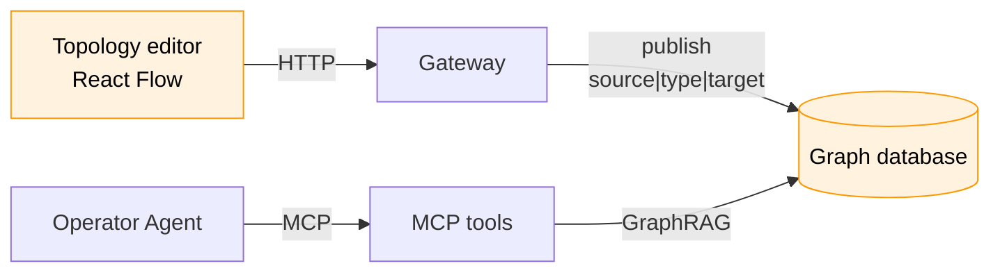

# Site Topology Graph — React Flow Editor and GraphRAG Context (HLD)

> **Version:** 0.4.0  |  **Date:** 2026-11-05  |  **Status:** Draft

---

## 1. Why

The Operator Agent knows each device *type* from its `mdk-contract.json` and can read live telemetry. It does not know how devices relate: which power meter measures which devices, which cooling unit serves which container, what loses power when a breaker opens. So it can't answer correlation questions.

This HLD adds a site topology graph. Operators connect real devices in a React Flow editor, the result is written to a graph database, and agents query that graph as GraphRAG context. It is the "Site State Model" vision from Gio.

The topology service is a closed-source sub-app of Sentinel. It owns topology construction, so
Sentinel and the Operator Agent read the same graph instead of each building their own.

**Ground rules**

1. **One store.** The graph database holds everything: devices, groups and relationships. No other
   store keeps topology data.
2. **Nodes are registered devices only.** Every device node is picked from the Kernel's device list;
   the editor never creates devices.
3. **Edges are granular.** A group (§5) is stored with its rule, and every edge drawn to it is also
   stored as one `source|type|target` edge per matching device, kept current automatically.
4. **Connectivity, not diagnosis.** Edge types describe how devices relate. Deciding why a device
   misbehaves stays with Sentinel's Detectors and Fault Catalogue.
5. **Agents read the published graph only**, through fixed tools, and never edit.

---

## 2. Architecture

Operators write the graph from the React Flow editor through the Gateway; the Operator Agent reads
it over MCP as GraphRAG context.



---

## 3. Nodes — the real device list

The editor gets its nodes from a real-time `GET /devices` call through the Gateway when it loads.
The Kernel owns which devices exist; the editor only places them.

| Field | Content | Example |
| --- | --- | --- |
| `id` | Kernel device name, `family/brand/worker/device` | `miner/whatsminer/whatsminer-a/wm041` |
| `metadata` | Descriptive data about the device: family, device type, brand, container, etc. | `{ "family": "miner", "deviceType": "whatsminer-m56s", "brand": "whatsminer", "container": "c2" }` |

- The node ID is the name RBAC already uses for devices, so `resourceNames` scope the graph with no
  new vocabulary.
- Group rules (§5) match on `id` and `metadata`.

---

## 4. Edge types — site config

A Kernel points to one physical site, so edge types are declared once per site, in the topology
app's `config` in `mdk.yaml`. The app ships no defaults in `mdk-app.yaml`. Each type has only a
`description`, which the LLM gets as context during GraphRAG retrieval (§7).

```yaml
# mdk.yaml
spec:
  apps:
    - name: topology
      config:
        edgeTypes:
          CONTAINS:
            description: B is physically inside A, e.g. a miner in a container.
          FEEDS_POWER:
            description: Power flows from A to B.
          MEASURES:
            description: A's readings describe B.
          CONTROLS:
            description: A's commands change B's state, e.g. a breaker.
          COOLS:
            description: A removes heat from B.
```

- **One set per site.** It is the only set the editor offers (`GET /edge-types`) and publish accepts.
  Removing a type that published edges still use makes the next publish fail until those edges are
  retyped or removed.
- **No structural constraints.** Any device can connect to any device with any type. The editor
  doesn't restrict family pairs, direction or cycles; the site decides.
- **No diagnostic rules.** A description says what the connection means, nothing more. Fault
  reasoning lives in Sentinel's Detectors, the single place for rules.

---

## 5. Editor — React Flow

Built with React Flow 12 (`@xyflow/react`, MIT) and MDK React Components, in the app's `ui/`. A
site with thousands of miners is wired at container and plant level, not miner by miner.

1. **Start from a site diagram (optional).** The app ships a prompt (skill) for vision models. The
   operator runs it with their site plan in a VLM of their choice, and gets a draft in the editor's
   output format (§6.1). Importing it fills the canvas as an unpublished draft; because extraction
   isn't deterministic, the operator fixes misassigned edges before publishing. Without a model,
   the operator maps the site by hand. The prompt is built from real site diagrams.
2. **Add device nodes.** The user adds a node and picks its ID from a dropdown of the devices from
   the Kernel (`GET /devices`, §3).
3. **Add group nodes.** A group node stands for every device matching a rule over `id` and
   `metadata`, such as `metadata.container == "c2"` or
   `metadata.container == "c2" AND metadata.brand == "antminer"`. It shows as one node with its
   match count.
4. **Connect.** The user drags an edge between device or group nodes and assigns it a type from
   `GET /edge-types` (§4). An edge touching a group stands for one edge per matching device: a
   `CONTAINS` edge from container `c2` to the group `metadata.container == "c2"` derives every
   miner's `CONTAINS` edge from its metadata.
5. **Publish.** The editor sends the groups and edges (§6.1). Work in progress autosaves in the
   browser until then.

**Group membership updates automatically.** The app watches the Kernel's device list, on every
worker registration and every few minutes. When a device appears, disappears or changes metadata,
the app re-evaluates the group rules and adds or removes that device's edges in the graph. No
publish is needed.

---

## 6. Output and storage

### 6.1 Editor output

The editor publishes its groups and the complete edge set as `source|type|target` strings, plus the
revision it was based on. An endpoint is a device ID or `group:<name>`. Node positions, viewport
and styling are not part of the output. A VLM draft (§5) uses the same format.

```json
{
  "baseRevision": "9f2c1e",
  "groups": {
    "c2-miners": "metadata.container == \"c2\""
  },
  "edges": [
    "container/acme/container-a/c2|CONTAINS|group:c2-miners",
    "powermeter/schneider/schneider-a/pm009|MEASURES|group:c2-miners",
    "cooling/acme/cdu-a/cdu-c2a|COOLS|container/acme/container-a/c2"
  ]
}
```

- Each string splits on `|` into exactly three parts. Device IDs never contain `|`; validation
  rejects anything that doesn't split cleanly.
- `revision` is a hash of the sorted group rules and drawn edges, computed by the app. It isn't
  stored. Automatic membership changes (§5) don't change it, so they never cause a `409`.

### 6.2 Graph model

Two node kinds and their relationships, all in the graph database:

| Element                       | Fields                                       | Rules                                                                 |
| ----------------------------- | -------------------------------------------- | --------------------------------------------------------------------- |
| **Node** `Device`             | `id`, `metadata` (§3)                        | `id` unique; text-searchable on `id` and `metadata`                   |
| **Node** `Group`              | `name`, `rule`                               | `name` unique                                                         |
| **Relationship** device–group | `type` (one of §4), `updatedBy`, `updatedAt` | The edge as drawn; read by the editor                                 |
| **Relationship** device–device | `type` (one of §4), `sources`, `updatedBy`, `updatedAt` | Unique per `source\|type\|target`; read by agents       |

- **Group edges are stored as drawn and expanded.** `container/acme/container-a/c2|CONTAINS|group:c2-miners`
  is kept as one device–group relationship, plus one device–device relationship per miner in `c2`,
  such as `container/acme/container-a/c2|CONTAINS|miner/whatsminer/whatsminer-a/wm041`.
- **`sources` records why a device–device edge exists:** `direct`, one or more group names, or
  both. Membership changes add or remove a group name; the edge is deleted when `sources` is empty.
  Overlapping groups never create duplicates.
- **Agents see only devices.** Traversals follow device–device relationships and skip `Group` nodes.
- **A device node exists only once it has a relationship.** Placed but unconnected devices aren't
  stored. The app keeps `metadata` current from the same device watch that drives membership.

### 6.3 Publish

One transaction:

1. **Check the revision.** Hash the stored group rules and drawn edges; if it doesn't match
   `baseRevision`, someone published first and the editor gets `409`.
2. **Validate.** Every group rule parses; every device endpoint is a device returned by
   `GET /devices`; every group endpoint is a group in the payload; the type is in the site's edge
   types (§4); no self-loops.
3. **Apply the diff.** Upsert `Group` nodes and endpoint `Device` nodes. Delete drawn relationships
   that are gone and create new ones with `updatedBy` and `updatedAt`. Re-expand every group whose
   rule or edges changed, updating `sources` on device–device relationships. Unchanged relationships
   aren't touched.
4. **Respond** with the new revision and the diff. The app rebuilds the agent outline (§7) in memory.

**Editor routes** (under `/apps/topology/`): `GET /edge-types`, `GET /graph` (groups, drawn edges and
revision), `POST /validate`, `POST /publish`, `GET /export`.

---

## 7. GraphRAG — the graph as agent context

The graph is authored, not extracted by an LLM, so traversals over it give exact, complete answers.
The context gives the agent connectivity and live state; finding the cause of a fault stays with
Sentinel's Detectors. The agent gets the graph in two layers:

- **Outline**, always in the prompt as a cached prefix: edge types with their descriptions, device
  counts by family, top-level structure and the revision, in ≤ 2k tokens. The app rebuilds it on start, after
  each publish and after each membership change, and holds it in memory.
- **Subgraph context**, per question through `topology_context`, built in four steps:

1. **Link** names, handles and fuzzy matches ("container two") to device IDs with text search on
   device nodes. The LLM never guesses an ID.
2. **Expand** along the edge types the agent picks from the outline, with hop and node caps. A heat
   question about one device follows `COOLS` and `CONTAINS`:
   - walk up `CONTAINS` (0–3 hops), then back along `COOLS` to find the device's coolers;
   - from each cooler, walk forward along `COOLS` and down `CONTAINS` (0–3 hops) to find up to 200
     peers of the same family.
3. **Enrich** the returned devices with their relevant metrics from the Kernel, fetched at call
   time and never stored in the graph, plus contract hints and the description of every type crossed.
4. **Pack**: rank by distance and anomaly, collapse peers into statistics, stop at the token budget,
   stamp the revision, and use short handles with a name map at the end.

Example, *"Why is wm041 running hot?"* (~150 tokens):

```text
topology rev 9f2c1e · types COOLS, CONTAINS · linked: wm041
wm041 (miner) in c2 · cooled by cdu-c2a (via c2) · measured and controlled by pm009
  temperature_out 91 °C (limit 85) HIGH · temperature_in 44 °C
cdu-c2a (cooling) supply_temp 31 °C (normal ≤ 27) HIGH · cools c2 (104 devices)
peers under cdu-c2a (103): temperature_in median 43 °C, 97 above 40 °C
types: COOLS = A removes heat from B · CONTAINS = B is physically inside A
names: wm041=miner/whatsminer/whatsminer-a/wm041 · cdu-c2a=cooling/acme/cdu-a/cdu-c2a · ...
```

---

## 8. MCP tools

The MCP server generates one tool per context route in `mdk-plugin.json`, namespaced by app ID
([hld-app-node-plugins.md](./hld-app-node-plugins.md) §8). Each tool runs a fixed, parameterised
traversal; there is no raw-query tool, so agents, including small local models, never write queries.

| Tool                | Input                                                | Returns                                                |
| ------------------- | ---------------------------------------------------- | ------------------------------------------------------ |
| `topology_outline`  | —                                                    | The outline for the current revision (§7)              |
| `topology_find`     | `query`, `family?`                                   | Matching devices with IDs and metadata                 |
| `topology_context`  | `deviceIds?` or `query?`, `types[]`, `budgetTokens?` | Packed subgraph context (§7)                           |
| `topology_traverse` | `deviceId`, `types[]`, `direction`, `depth?`         | Exact device set by hop, with counts beyond the cap    |
| `topology_impact`   | `deviceId`, `command`                                | Devices affected downstream, checked before any action |

- **Limits:** lists cap at 50 with totals; `budgetTokens` defaults to 1,500, max 4,000.
- **Freshness:** every result carries `topologyRevision`; the agent re-reads the outline when it changes.
- **Access:** agent roles get read access to these routes only. Results are filtered by the
  caller's `devices` `resourceNames`; labels are escaped as data, and edge-type descriptions come
  only from `mdk.yaml` (§4).
