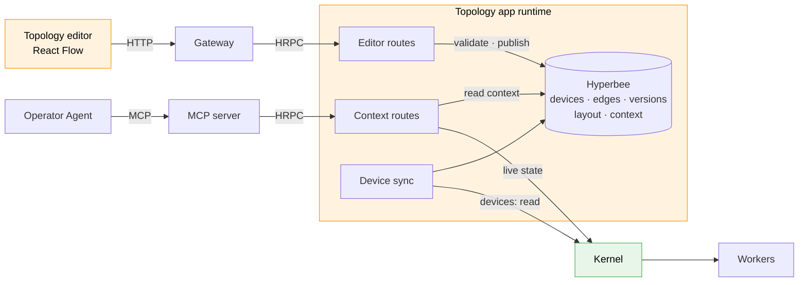
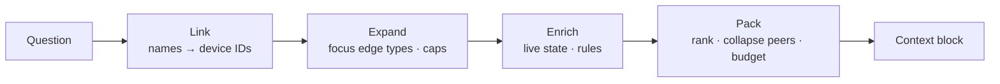

# Site Topology Graph — React Flow Editor and GraphRAG Context (HLD)

> **Version:** 0.1.0  |  **Date:** 2026-11-05  |  **Status:** Draft

---

## 1. Why

The Operator Agent knows each device *type* from its `mdk-contract.json` and can read live
telemetry. It does not know how devices relate: which power meter measures which devices, which
cooling unit serves which container, what loses power when a breaker opens. So it can't answer
correlation questions, and the POC compensates by sending the full contract and every device's
telemetry with every prompt.

This HLD adds a site topology graph. Operators connect real devices in a React Flow editor, the
graph is stored with history, and agents retrieve only the part a question needs (GraphRAG). It is
the "Site State Model" left open in [hld-intelligent-mos-on-mdk-v0_5.md](./hld-intelligent-mos-on-mdk-v0_5.md) §11.

**Ground rules**

1. **Nodes are registered devices only.** The editor places and connects devices; it never creates them.
2. **Edge types are a fixed set**, shipped with the app (§4).
3. **Topology and layout are stored separately.** Edges are data; positions are presentation.
4. **Agents read published versions only**, and never edit.

---

## 2. Architecture

The topology service is an MDK app ([hld-app-packaging.md](./hld-app-packaging.md)): its own
runtime, service account, Hyperbee store and UI module. No Kernel or Gateway change.



| Component | Change | Role |
| --- | --- | --- |
| **Topology app** (`io.tether.topology`) | New | Device sync, validation, storage, context builder |
| **Topology editor** (app `ui/`) | New | React Flow canvas for placing and connecting devices |
| **Editor routes** | New, `mcpOptOut: true` | Draft, publish, history, export |
| **Context routes** | New, MCP tools | GraphRAG retrieval for agents (§7, §8) |
| **Operator Agent** | Changed | Topology outline as prompt prefix; topology tools instead of dumping the contract and all telemetry |

```yaml
# mdk-app.yaml
id: io.tether.topology
version: 0.1.0
displayName: Site Topology
permissions:
  - resources: [devices]
    verbs: [read]                      # registry and live state; never sends commands
    resourceNames: ["*"]
```

---

## 3. Nodes — the real device list

Device sync reads the Kernel registry with the app's service account: on start, on every worker
registration, and every few minutes as a safety net.

| Field | Source | Example |
| --- | --- | --- |
| `id` | Kernel device name, `family/brand/worker/device` | `miner/whatsminer/whatsminer-a/wm041` |
| `handle` | Last segment; qualified with the worker if not unique | `wm041` |
| `family` | Contract `metadata.deviceFamily` | `miner` |
| `labels` | Device `info` from the worker, when reported | `{ container: "c2" }` |
| `status` | Device sync | `active` · `missing` · `retired` |

- The node ID is the name RBAC already uses for devices, so `resourceNames` scope the graph with no
  new vocabulary.
- New devices appear as **unplaced** in the editor's palette.
- A device that stops reporting is flagged **missing**; its edges are kept. Only an explicit
  **retire** removes it, closing its edges in the next published version.

---

## 4. Edge types — fixed registry

`edge-types.json` ships in the app package. Changing it is a new app version.

| Type | Meaning | From | To | Rules |
| --- | --- | --- | --- | --- |
| `contains` | B is physically inside A | `container` | any | One parent per device; acyclic |
| `feeds_power` | Power flows from A to B | `switchgear`, `pdu`, `container` | any | Acyclic; propagates through `contains` |
| `measures` | A's readings describe B | `powermeter`, `sensor` | any | — |
| `controls` | A's commands change B's state (e.g. a breaker) | `powermeter`, `switchgear`, `controller` | any | — |
| `cools` | A removes heat from B | `cooling`, `container` | any | Propagates through `contains` |

- **Families come from contracts.** A new worker joins the matrix by declaring its `deviceFamily`.
  A pair that isn't allowed can't be drawn or saved.
- **Propagation** means a cooling unit that `cools` a container cools everything inside it: one edge
  instead of one per device. It is applied on read, not stored as extra edges.
- **Each type carries its meaning for agents:**

```json
{
  "name": "cools",
  "inverse": "cooled_by",
  "description": "A removes heat from B. Applies to everything B contains.",
  "from": ["cooling", "container"],
  "to": ["*"],
  "propagatesVia": ["contains"],
  "agentRules": [
    "If most devices cooled by one unit run hot, the cooling unit is the likely cause.",
    "If one device is hot while its peers are normal, check that device's fans."
  ]
}
```

---

## 5. Editor — React Flow

Built with React Flow 12 (`@xyflow/react`, MIT) and MDK React Components, in the app's `ui/`.

| Action | Behaviour |
| --- | --- |
| **Place** | Drag from a palette of unplaced devices, grouped by family and `labels.container`. Node `id` = device name. Once per canvas. |
| **Create a node** | Not possible: no add-node control, no create-on-drop. |
| **Connect** | Offers only the types allowed for the family pair (`isValidConnection`). Bulk connect links one source to a whole selection. |
| **Remove a node** | Returns it to the palette (`onBeforeDelete`); the device is untouched. Its edges are removed after a confirm. |
| **Views** | All · Power (`feeds_power`, `measures`, `controls`) · Thermal (`cools`, `contains`). Each keeps its own layout. |
| **Publish** | The draft autosaves. Publish validates, shows a diff ("+14 relations, −2"), and writes version N+1. Returns `409` if the base version is stale. |

Edge IDs are `source|type|target`, so duplicate edges can't exist.

---

## 6. Output and storage

### 6.1 Editor output

`toObject()` returns nodes, edges and the viewport. The editor strips presentation and sends:

```json
{
  "baseVersion": 41,
  "canvas": "power",
  "nodes": [{ "id": "powermeter/schneider/schneider-a/pm009", "x": 420, "y": 80 }],
  "edges": [{
    "source": "powermeter/schneider/schneider-a/pm009",
    "type": "measures",
    "target": "miner/whatsminer/whatsminer-a/wm041"
  }],
  "viewport": { "x": 0, "y": 0, "zoom": 1 }
}
```

`nodes` and `viewport` become **layout**. `edges` become **topology**.

### 6.2 Validation

On publish: every endpoint is a known, non-retired device; the type exists; the family pair is
allowed; no self-loops or duplicates; one `contains` parent per device; no cycles in `contains` or
`feeds_power`; the base version is current. Missing endpoints are warnings, not errors.

### 6.3 Storage

The app's own Hyperbee ([hld.md](./hld.md) §2.2). Keys use tuple encoding, since device names contain `/`.

| Sub-db | Key | Value |
| --- | --- | --- |
| `dev` | `deviceId` | Device record (§3) |
| `out` / `in` | `(source, type, target)` / `(target, type, source)` | `{ sinceVersion, attrs }` — current published edges |
| `ver` | `n` | `{ publishedBy, added[], removed[], coreLength }` |
| `layout` | `(canvas, deviceId)` | `{ x, y }`, plus one viewport per canvas |
| `draft` | `user` | The editor output from §6.1 |
| `ctx` | `outline` · `group/<id>` · `card/<deviceId>` | Agent context for the latest version (§7) |

- **History:** Hypercore is append-only; `ver/n` records the core length, so `checkout` reads the
  graph as it was at version n.
- **Traversal:** the runtime keeps the published graph in memory as adjacency maps. No graph
  database is needed at site scale.

**Editor routes** (`mcpOptOut: true`, under `/apps/topology/`): `GET /devices`, `GET /edge-types`,
`GET|PUT /draft`, `POST /publish`, `GET /versions/{n}`, `GET /export`, `POST /devices/{id}/retire`.

---

## 7. GraphRAG — context for agents

Retrieval runs over the graph instead of over text chunks. The graph is authored, not extracted by
an LLM, so traversals give exact, complete answers.

**Precomputed on publish, cached by version.** Telemetry is attached at call time and never cached.

| Layer | Content | Reaches the agent |
| --- | --- | --- |
| **L0 Outline** | Edge types with rules, device counts by family, top-level structure, version. Target ≤ 2k tokens. | Always, as a cached prompt prefix |
| **L1 Group summary** | One per container, cooling unit and power meter | When a question targets a group |
| **L2 Device card** | Neighbours by edge type, peers, allowed commands | When a question targets a device |
| **Live state** | Focus metrics of the retrieved devices | At call time |



1. **Link** names, handles and fuzzy matches ("container two") to device IDs; the LLM never guesses an ID.
2. **Expand** breadth-first along the edge types for the focus — `thermal`: `cools`, `contains` ·
   `power`: `feeds_power`, `measures`, `controls` · `impact`: `controls`, `feeds_power` downstream —
   with hop and node caps.
3. **Enrich** with live state for the subgraph only, contract hints, and the `agentRules` of every
   edge type crossed.
4. **Pack**: rank by distance and anomaly, collapse peers into statistics, stop at the token budget,
   stamp the version, and use short handles with a name map at the end.

Example, *"Why is wm041 running hot?"* (~150 tokens):

```text
topology v42 · focus thermal · linked: wm041
wm041 (miner) in c2 · cooled by cdu-c2a (via c2) · measured and controlled by pm009
  temperature_out 91 °C (limit 85) HIGH · temperature_in 44 °C · fans normal
cdu-c2a (cooling) supply_temp 31 °C (normal ≤ 27) HIGH · cools c2 (104 devices)
peers under cdu-c2a (103): temperature_in median 43 °C, 97 above 40 °C
rule [cools]: most devices cooled by one unit run hot → the cooling unit is the likely cause
names: wm041=miner/whatsminer/whatsminer-a/wm041 · cdu-c2a=cooling/acme/cdu-a/cdu-c2a · ...
```

---

## 8. MCP tools

Context routes are declared in `mdk-plugin.json`; the MCP server generates one tool per route,
namespaced by app ID ([hld-app-node-plugins.md](./hld-app-node-plugins.md) §8). All are read-only.

| Tool | Input | Returns |
| --- | --- | --- |
| `topology_outline` | — | L0 outline |
| `topology_find` | `query`, `family?` | Matching devices with IDs, handles and status |
| `topology_context` | `deviceIds?` or `query?`, `focus`, `budgetTokens?` | Packed context (§7) |
| `topology_traverse` | `deviceId`, `edgeTypes[]`, `direction`, `depth?` | Exact device set by hop, with counts beyond the cap |
| `topology_impact` | `deviceId`, `command` | Devices affected downstream, checked before any action |

- Every result carries `topologyVersion`; the agent re-reads the outline when it changes.
- Lists are capped at 50 with totals. `budgetTokens` defaults to 1,500, max 4,000.
- **Access:** agent roles get `get`/`list` on the topology routes only, never draft or publish.
  Results are filtered by the caller's `devices` `resourceNames`. Labels are escaped as data; agent
  rules come only from the packaged registry.

---

## 9. Open questions

| # | Question |
| --- | --- |
| 1 | Do racks, rows or rooms need to be nodes, or are worker `labels` enough for grouping? |
| 2 | Can operators extend the edge-type registry in `mdk.yaml`, or only the package? |
| 3 | How do other apps (e.g. Sentinel) read the topology, given apps call the Kernel, not each other? |
| 4 | Which workers report `labels` (container, position) today, and should the contract declare them? |
| 5 | Is fuzzy name matching enough for linking, or is an embedding index needed? |
| 6 | Should correlations found in telemetry be offered in the editor as suggested edges? |
