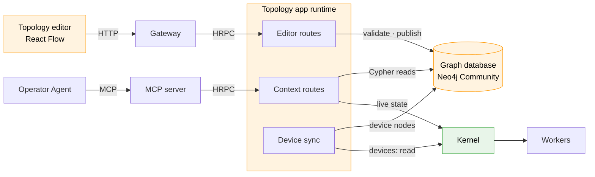
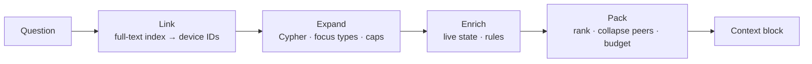

# Site Topology Graph — React Flow Editor and GraphRAG Context (HLD)

> **Version:** 0.2.0  |  **Date:** 2026-11-05  |  **Status:** Draft

---

## 1. Why

The Operator Agent knows each device *type* from its `mdk-contract.json` and can read live
telemetry. It does not know how devices relate: which power meter measures which devices, which
cooling unit serves which container, what loses power when a breaker opens. So it can't answer
correlation questions, and the POC compensates by sending the full contract and every device's
telemetry with every prompt.

This HLD adds a site topology graph. Operators connect real devices in a React Flow editor, the
result is written to a graph database, and agents query that graph as GraphRAG context. It is the
"Site State Model" left open in [hld-intelligent-mos-on-mdk-v0_5.md](./hld-intelligent-mos-on-mdk-v0_5.md) §11.

**Ground rules**

1. **One source of truth.** The graph database holds every relationship, its history and the canvas
   layout. No other store keeps relationship data.
2. **Nodes are registered devices only.** The editor places and connects devices; it never creates them.
3. **Edge types are a fixed set**, shipped with the app (§4).
4. **Agents read published versions only**, through fixed tools, and never edit.

---

## 2. Architecture

The topology service is an MDK app ([hld-app-packaging.md](./hld-app-packaging.md)) with its own
runtime, service account and UI module. Its runtime is the only client of the graph database. No
Kernel or Gateway change.



| Component | Change | Role |
| --- | --- | --- |
| **Topology app** (`io.tether.topology`) | New | Device sync, validation, publish, GraphRAG retrieval |
| **Topology editor** (app `ui/`) | New | React Flow canvas for placing and connecting devices |
| **Graph database** | New | Single store for devices, relationships, versions and layout |
| **Editor routes** | New, `mcpOptOut: true` | Validate, publish, history, export |
| **Context routes** | New, MCP tools | GraphRAG retrieval for agents (§7, §8) |
| **Operator Agent** | Changed | Topology outline as prompt prefix; topology tools instead of dumping the contract and all telemetry |

```yaml
# mdk-app.yaml
id: io.tether.topology
version: 0.1.0
displayName: Site Topology
permissions:
  - resources: [devices]
    verbs: [read]                      # registry and live state; never sends commands
    resourceNames: ["*"]
```

### 2.1 Choice of graph database

| Option | Fit | Gap |
| --- | --- | --- |
| **Neo4j Community** | Full Cypher, including multi-type variable-length paths (`[:COOLS\|CONTAINS*1..3]`); full-text and vector indexes; mature JS driver | GPLv3, single instance, offline backups only, no in-database RBAC |
| Apache AGE (PostgreSQL) | Apache 2.0, standard Postgres operations | Rejects relationship-type alternation in variable-length paths, which every GraphRAG expansion here needs |
| LadybugDB (embedded) | MIT, in-process, no server to run | Young fork of the archived Kùzu project |

**Decision: Neo4j Community Edition.** Its gaps don't bite here:

- **GPLv3** — Neo4j runs as its own service and is not bundled into MDK packages. MDK talks to it
  over Bolt with the Apache-2.0 JavaScript driver.
- **No in-database RBAC** — only the topology runtime holds database credentials, and the database
  listens on the private network only. RBAC is enforced by the Gateway and MCP server (§8).
- **Offline backups** — the app's `/export` route gives an online JSON snapshot of any version.

This departs from the Hyperbee default in [hld.md](./hld.md) §2.2 on purpose: traversal and name
search are the whole workload, and a graph database does both natively.

---

## 3. Nodes — the real device list

The Kernel owns which devices exist; the graph mirrors them as `:Device` nodes. Device sync reads
the Kernel registry with the app's service account on start, on every worker registration, and
every few minutes, and `MERGE`s each device by `id`.

| Property | Source | Example |
| --- | --- | --- |
| `id` | Kernel device name, `family/brand/worker/device` | `miner/whatsminer/whatsminer-a/wm041` |
| `handle` | Last segment; qualified with the worker if not unique | `wm041` |
| `family` | Contract `metadata.deviceFamily` | `miner` |
| `container`, `position` | Device `info` from the worker, when reported | `c2` |
| `status` | Device sync | `active` · `missing` · `retired` |

- The node ID is the name RBAC already uses for devices, so `resourceNames` scope the graph with no
  new vocabulary.
- New devices appear as **unplaced** in the editor's palette.
- A device that stops reporting is marked **missing**; its relationships stay. Only an explicit
  **retire** removes them, in the next published version.

---

## 4. Edge types — fixed registry

`edge-types.json` ships in the app package and defines the only relationship types the graph may
hold. Changing it is a new app version.

| Type | Meaning | From | To | Rules |
| --- | --- | --- | --- | --- |
| `CONTAINS` | B is physically inside A | `container` | any | One parent per device; acyclic |
| `FEEDS_POWER` | Power flows from A to B | `switchgear`, `pdu`, `container` | any | Acyclic; propagates through `CONTAINS` |
| `MEASURES` | A's readings describe B | `powermeter`, `sensor` | any | — |
| `CONTROLS` | A's commands change B's state (e.g. a breaker) | `powermeter`, `switchgear`, `controller` | any | — |
| `COOLS` | A removes heat from B | `cooling`, `container` | any | Propagates through `CONTAINS` |

- **Families come from contracts.** A new worker joins the matrix by declaring its `deviceFamily`.
  A pair that isn't allowed can't be drawn or saved.
- **Propagation** means a cooling unit that `COOLS` a container cools everything inside it: one
  relationship instead of one per device. Queries follow `CONTAINS`; nothing extra is stored.
- **Each type carries its meaning for agents:**

```json
{
  "name": "COOLS",
  "description": "A removes heat from B. Applies to everything B contains.",
  "from": ["cooling", "container"],
  "to": ["*"],
  "propagatesVia": ["CONTAINS"],
  "agentRules": [
    "If most devices cooled by one unit run hot, the cooling unit is the likely cause.",
    "If one device is hot while its peers are normal, check that device's fans."
  ]
}
```

---

## 5. Editor — React Flow

Built with React Flow 12 (`@xyflow/react`, MIT) and MDK React Components, in the app's `ui/`.

| Action | Behaviour |
| --- | --- |
| **Place** | Drag from a palette of unplaced devices, grouped by family and container. Node `id` = device name. Once per canvas. |
| **Create a node** | Not possible: no add-node control, no create-on-drop. |
| **Connect** | Offers only the types allowed for the family pair (`isValidConnection`). Bulk connect links one source to a whole selection. |
| **Remove a node** | Returns it to the palette (`onBeforeDelete`); the device is untouched. Its edges are removed after a confirm. |
| **Views** | All · Power (`FEEDS_POWER`, `MEASURES`, `CONTROLS`) · Thermal (`COOLS`, `CONTAINS`). Each keeps its own layout. |
| **Publish** | Work in progress autosaves in the browser. Publish validates, shows a diff ("+14 relations, −2") and writes version N+1. Returns `409` if the base version is stale. |

Edge IDs are `source|type|target`, so duplicate edges can't exist.

---

## 6. Output and storage

### 6.1 Editor output

`toObject()` returns nodes, edges and the viewport. The editor strips presentation and publishes:

```json
{
  "baseVersion": 41,
  "canvas": "power",
  "nodes": [{ "id": "powermeter/schneider/schneider-a/pm009", "x": 420, "y": 80 }],
  "edges": [{
    "source": "powermeter/schneider/schneider-a/pm009",
    "type": "MEASURES",
    "target": "miner/whatsminer/whatsminer-a/wm041"
  }],
  "viewport": { "x": 0, "y": 0, "zoom": 1 }
}
```

`edges` become typed relationships between `:Device` nodes. `nodes` become `PLACES` relationships
from a `:Canvas` node, carrying `x` and `y`.

### 6.2 Graph model

```text
(:Device {id, handle, family, container, status})
(:Device)-[:CONTAINS | FEEDS_POWER | MEASURES | CONTROLS | COOLS {sinceVersion}]->(:Device)
(:Canvas {name, viewport})-[:PLACES {x, y}]->(:Device)
(:TopologyVersion {n, publishedBy, publishedAt, added[], removed[], outline})
(:TopologyHead {version})
```

```cypher
CREATE CONSTRAINT device_id FOR (d:Device) REQUIRE d.id IS UNIQUE;
CREATE CONSTRAINT version_n FOR (v:TopologyVersion) REQUIRE v.n IS UNIQUE;
CREATE FULLTEXT INDEX device_names FOR (d:Device) ON EACH [d.handle, d.id, d.container];
```

- **Topology and layout stay apart inside one store.** Agents only traverse the five topology
  types; `PLACES` is read by the editor alone.
- **History.** The live graph holds the current version. Each `:TopologyVersion` records the edges
  added and removed (as `source|type|target` keys), so any earlier version can be rebuilt and every
  change is attributed.

### 6.3 Publish

One Neo4j transaction:

1. **Claim the version.** `MATCH (h:TopologyHead) WHERE h.version = $base SET h.version = $base + 1`.
   No row means someone published first, and the editor gets `409`. The write lock on the head node
   serialises concurrent publishes.
2. **Validate.** Every endpoint is a known, non-retired device; the type is in the registry; the
   family pair is allowed; no self-loops or duplicates; one `CONTAINS` parent per device; no cycles
   in `CONTAINS` or `FEEDS_POWER`. Missing endpoints are warnings.
3. **Apply the diff.** Delete removed relationships, create added ones with `sinceVersion`, update
   `PLACES` for the canvas.
4. **Record.** Create the `:TopologyVersion` with the diff and the agent outline (§7).

**Editor routes** (`mcpOptOut: true`, under `/apps/topology/`): `GET /devices`, `GET /edge-types`,
`GET /graph?canvas=`, `POST /validate`, `POST /publish`, `GET /versions/{n}`, `GET /export`,
`POST /devices/{id}/retire`.

---

## 7. GraphRAG — the graph as agent context

Retrieval runs as Cypher over the graph instead of over text chunks. The graph is authored, not
extracted by an LLM, so traversals give exact, complete answers. Telemetry is attached at call
time and never stored in the graph.

| Layer | Content | How it's produced | Reaches the agent |
| --- | --- | --- | --- |
| **Outline** | Edge types with rules, device counts by family, top-level structure, version. Target ≤ 2k tokens. | Built at publish, stored on `:TopologyVersion` | Always, as a cached prompt prefix |
| **Subgraph context** | The devices a question is about, their neighbours along the relevant types, peers, rules | Cypher at query time | Per question, via `topology_context` |
| **Live state** | Focus metrics of the retrieved devices | Kernel, at call time | Inside the subgraph context |



1. **Link** names, handles and fuzzy matches ("container two") to device IDs with the `device_names`
   full-text index. The LLM never guesses an ID.
2. **Expand** along the types for the focus — `thermal`: `COOLS`, `CONTAINS` · `power`:
   `FEEDS_POWER`, `MEASURES`, `CONTROLS` · `impact`: `CONTROLS`, `FEEDS_POWER`, `CONTAINS`
   downstream — with hop and node caps. For example, thermal context for one device:

   ```cypher
   MATCH (d:Device {id: $id})
   OPTIONAL MATCH (d)<-[:CONTAINS*0..3]-(:Device)<-[:COOLS]-(cooler:Device)
   OPTIONAL MATCH (cooler)-[:COOLS]->(:Device)-[:CONTAINS*0..3]->(peer:Device {family: d.family})
   WHERE peer <> d
   RETURN d, collect(DISTINCT cooler) AS coolers, collect(DISTINCT peer.id)[..200] AS peers
   ```

3. **Enrich** with live state from the Kernel for the returned devices only, contract hints, and
   the `agentRules` of every type crossed.
4. **Pack**: rank by distance and anomaly, collapse peers into statistics, stop at the token budget,
   stamp the version, and use short handles with a name map at the end.

Example, *"Why is wm041 running hot?"* (~150 tokens):

```text
topology v42 · focus thermal · linked: wm041
wm041 (miner) in c2 · cooled by cdu-c2a (via c2) · measured and controlled by pm009
  temperature_out 91 °C (limit 85) HIGH · temperature_in 44 °C · fans normal
cdu-c2a (cooling) supply_temp 31 °C (normal ≤ 27) HIGH · cools c2 (104 devices)
peers under cdu-c2a (103): temperature_in median 43 °C, 97 above 40 °C
rule [COOLS]: most devices cooled by one unit run hot → the cooling unit is the likely cause
names: wm041=miner/whatsminer/whatsminer-a/wm041 · cdu-c2a=cooling/acme/cdu-a/cdu-c2a · ...
```

---

## 8. MCP tools

Context routes are declared in `mdk-plugin.json`; the MCP server generates one tool per route,
namespaced by app ID ([hld-app-node-plugins.md](./hld-app-node-plugins.md) §8). Each runs a fixed,
parameterised Cypher query. **There is no raw-Cypher tool**: agents can't write queries, and small
local models don't have to.

| Tool | Input | Returns |
| --- | --- | --- |
| `topology_outline` | — | The outline for the current version |
| `topology_find` | `query`, `family?` | Matching devices with IDs, handles and status |
| `topology_context` | `deviceIds?` or `query?`, `focus`, `budgetTokens?` | Packed subgraph context (§7) |
| `topology_traverse` | `deviceId`, `types[]`, `direction`, `depth?` | Exact device set by hop, with counts beyond the cap |
| `topology_impact` | `deviceId`, `command` | Devices affected downstream, checked before any action |

- Every result carries `topologyVersion`; the agent re-reads the outline when it changes.
- Lists are capped at 50 with totals. `budgetTokens` defaults to 1,500, max 4,000.
- **Access:** agent roles get `get`/`list` on the topology routes only, never validate or publish.
  Results are filtered by the caller's `devices` `resourceNames`. Labels are escaped as data; agent
  rules come only from the packaged registry.

---

## 9. Open questions

| # | Question |
| --- | --- |
| 1 | Do racks, rows or rooms need to be nodes, or is the worker-reported `container` enough for grouping? |
| 2 | Can operators extend the edge-type registry in `mdk.yaml`, or only the package? |
| 3 | How do other apps (e.g. Sentinel) read the topology, given apps call the Kernel, not each other? |
| 4 | Which workers report `container` and `position` today, and should the contract declare them? |
| 5 | Is the full-text index enough for linking, or is a vector index on device descriptions needed? |
| 6 | Is Neo4j acceptable on small site boxes, or should the embedded option (§2.1) be revisited? |
