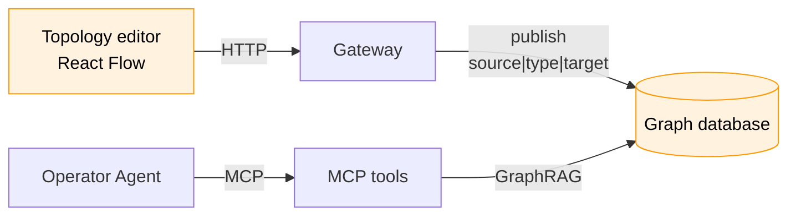

# Site Topology Graph — React Flow Editor and GraphRAG Context (HLD)

> **Version:** 0.3.0  |  **Date:** 2026-11-05  |  **Status:** Draft

---

## 1. Why

The Operator Agent knows each device *type* from its `mdk-contract.json` and can read live telemetry. It does not know how devices relate: which power meter measures which devices, which cooling unit serves which container, what loses power when a breaker opens. So it can't answer correlation questions.

This HLD adds a site topology graph. Operators connect real devices in a React Flow editor, the result is written to a graph database, and agents query that graph as GraphRAG context. It is the "Site State Model" vision from Gio. 

**Ground rules**

1. **One source of truth.** The graph database holds every relationship. No other store keeps
  relationship data.
2. **Nodes are registered devices only.** Every canvas node is picked from the Kernel's device list; the editor never creates devices.
3. **The editor's output is a list of** `source|type|target` **edges**. Nothing else is persisted
  from the canvas.
4. **Agents read the published graph only**, through fixed tools, and never edit.

---


## 2. Architecture

Operators write the graph from the React Flow editor through the Gateway; the Operator Agent reads
it over MCP as GraphRAG context.



---

## 3. Nodes — the real device list

The editor gets its nodes from a real-time `GET /devices` call through the Gateway when it loads.
The Kernel owns which devices exist; the editor only places them.

| Field | Content | Example |
| --- | --- | --- |
| `id` | Kernel device name, `family/brand/worker/device` | `miner/whatsminer/whatsminer-a/wm041` |
| `metadata` | Descriptive data about the device: family, device type, brand, container, etc. | `{ "family": "miner", "deviceType": "whatsminer-m56s", "brand": "whatsminer", "container": "c2" }` |

- The node ID is the name RBAC already uses for devices, so `resourceNames` scope the graph with no
  new vocabulary.

---

## 4. Edge types — configurable

Edge types are app config. The app ships a default set in `mdk-app.yaml`; the operator adds new
types or replaces defaults in `mdk.yaml`, so each site can model itself the way it works. Each type
has only a `description` and `rules`, both written for the agent.

```yaml
# mdk-app.yaml — defaults shipped with the app
config:
  edgeTypes:
    CONTAINS:
      description: B is physically inside A.
      rules:
        - Anything that applies to A applies to everything it contains.
    FEEDS_POWER:
      description: Power flows from A to B.
      rules:
        - If A loses power, B and everything B contains lose power.
    MEASURES:
      description: A's readings describe B.
      rules:
        - Use A's readings to confirm or rule out a problem on B.
    CONTROLS:
      description: A's commands change B's state, e.g. a breaker.
      rules:
        - Check the impact on B before sending any command to A.
    COOLS:
      description: A removes heat from B.
      rules:
        - If most devices cooled by one unit run hot, the cooling unit is the likely cause.
        - If one device is hot while its peers are normal, check that device's fans.
```

- **Overridable in `mdk.yaml`.** The operator can override `edgeTypes` under the app's `config` in
  `mdk.yaml`: the same name replaces a default, a new name adds a type. The merged set is the only set the editor offers and publish accepts.
- **No structural constraints.** Any device can connect to any device with any type. The editor
  doesn't restrict family pairs, direction or cycles; the site decides.
- **Rules reach the agent as-is.** The rules of every type crossed during retrieval go into the
  agent's context (§7).

---

## 5. Editor — React Flow

Built with React Flow 12 (`@xyflow/react`, MIT) and MDK React Components, in the app's `ui/`.

1. **Add a node.** The user adds a node to the canvas and picks its ID from a dropdown. The dropdown
   lists the devices from the Kernel (`GET /devices`, §3), so every node is a real device.
2. **Connect.** The user drags an edge from one device to another and assigns it a type. The type
   dropdown comes from `GET /edge-types`, which returns the merged edge types from §4.
3. **Publish.** The editor sends the edges as `source|type|target` strings (§6.1). Work in progress
   autosaves in the browser until then.

The React Flow edge `id` is the `source|type|target` string itself, so duplicate edges can't exist
on the canvas.

---

## 6. Output and storage


### 6.1 Editor output

The editor publishes the complete edge set as `source|type|target` strings, plus the revision it
was based on. Node positions, viewport and styling are not part of the output.

```json
{
  "baseRevision": "9f2c1e",
  "edges": [
    "powermeter/schneider/schneider-a/pm009|MEASURES|miner/whatsminer/whatsminer-a/wm041",
    "powermeter/schneider/schneider-a/pm009|CONTROLS|miner/whatsminer/whatsminer-a/wm041",
    "cooling/acme/cdu-a/cdu-c2a|COOLS|container/acme/container-a/c2",
    "container/acme/container-a/c2|CONTAINS|miner/whatsminer/whatsminer-a/wm041"
  ]
}
```

- Each string splits on `|` into exactly three parts. Device IDs never contain `|`; validation
rejects anything that doesn't split cleanly.
- The string is also the edge's identity everywhere: in the diff, in the database's uniqueness rule
and in exports.
- Placed but unconnected devices aren't sent; a `Device` node exists in the graph only once it has
  a relationship.
- `revision` is a hash of the sorted edge set, computed by the app. It isn't stored.


### 6.2 Graph model

Two things only: device nodes and typed relationships between them.


| Element           | Fields                                               | Rules                                                               |
| ----------------- | ---------------------------------------------------- | ------------------------------------------------------------------- |
| **Node** `Device` | `id`, `metadata` (§3)                                | `id` unique; text-searchable on `id` and `metadata`                 |
| **Relationship**  | `type` (one of §4), `updatedBy`, `updatedAt`         | Directed from `source` to `target`; unique per `source\|type\|target` |


Mapping from editor output to storage:


| Editor string part       | Stored as                                                         |
| ------------------------ | ----------------------------------------------------------------- |
| `source`                 | Start node, matched by `Device.id`                                |
| `type`                   | Relationship type                                                 |
| `target`                 | End node, matched by `Device.id`                                  |
| Publishing user and time | `updatedBy`, `updatedAt` on relationships created in that publish |


### 6.3 Publish

One transaction:

1. **Check the revision.** Hash the current edge set; if it doesn't match `baseRevision`, someone
  published first and the editor gets `409`.
2. **Validate.** Every endpoint is a device returned by `GET /devices`; the type is in the merged
   edge-type config (§4); no self-loops.
3. **Apply the diff.** Upsert endpoint `Device` nodes with their `id` and `metadata`. Compare the submitted strings with the stored ones; delete relationships that
  are gone and create new ones with `updatedBy` and `updatedAt`. Unchanged relationships aren't touched.
4. **Respond** with the new revision and the diff. The app rebuilds the agent outline (§7) in memory.

**Editor routes** (under `/apps/topology/`): `GET /edge-types`,
`GET /graph` (edge strings and revision), `POST /validate`, `POST /publish`, `GET /export`.

---


## 7. GraphRAG — the graph as agent context

The graph is authored, not extracted by an LLM, so traversals over it give exact, complete answers.
The agent gets it in two layers:

- **Outline**, always in the prompt as a cached prefix: edge types with their rules, device counts
  by family, top-level structure and the revision, in ≤ 2k tokens. The app rebuilds it after each
  publish and on start, and holds it in memory.
- **Subgraph context**, per question through `topology_context`, built in four steps:

1. **Link** names, handles and fuzzy matches ("container two") to device IDs with text search on
   device nodes. The LLM never guesses an ID.
2. **Expand** along the edge types the agent picks from the outline, with hop and node caps. A heat
   question about one device follows `COOLS` and `CONTAINS`:
   - walk up `CONTAINS` (0–3 hops), then back along `COOLS` to find the device's coolers;
   - from each cooler, walk forward along `COOLS` and down `CONTAINS` (0–3 hops) to find up to 200
     peers of the same family.
3. **Enrich** the returned devices with their relevant metrics from the Kernel, fetched at call
   time and never stored in the graph, plus contract hints and the `rules` of every type crossed.
4. **Pack**: rank by distance and anomaly, collapse peers into statistics, stop at the token budget,
   stamp the revision, and use short handles with a name map at the end.

Example, *"Why is wm041 running hot?"* (~150 tokens):

```text
topology rev 9f2c1e · types COOLS, CONTAINS · linked: wm041
wm041 (miner) in c2 · cooled by cdu-c2a (via c2) · measured and controlled by pm009
  temperature_out 91 °C (limit 85) HIGH · temperature_in 44 °C · fans normal
cdu-c2a (cooling) supply_temp 31 °C (normal ≤ 27) HIGH · cools c2 (104 devices)
peers under cdu-c2a (103): temperature_in median 43 °C, 97 above 40 °C
rule [COOLS]: most devices cooled by one unit run hot → the cooling unit is the likely cause
names: wm041=miner/whatsminer/whatsminer-a/wm041 · cdu-c2a=cooling/acme/cdu-a/cdu-c2a · ...
```

---


## 8. MCP tools

The MCP server generates one tool per context route in `mdk-plugin.json`, namespaced by app ID
([hld-app-node-plugins.md](./hld-app-node-plugins.md) §8). Each tool runs a fixed, parameterised
traversal; there is no raw-query tool, so agents, including small local models, never write queries.

| Tool                | Input                                                | Returns                                                |
| ------------------- | ---------------------------------------------------- | ------------------------------------------------------ |
| `topology_outline`  | —                                                    | The outline for the current revision (§7)              |
| `topology_find`     | `query`, `family?`                                   | Matching devices with IDs and metadata                 |
| `topology_context`  | `deviceIds?` or `query?`, `types[]`, `budgetTokens?` | Packed subgraph context (§7)                           |
| `topology_traverse` | `deviceId`, `types[]`, `direction`, `depth?`         | Exact device set by hop, with counts beyond the cap    |
| `topology_impact`   | `deviceId`, `command`                                | Devices affected downstream, checked before any action |

- **Limits:** lists cap at 50 with totals; `budgetTokens` defaults to 1,500, max 4,000.
- **Freshness:** every result carries `topologyRevision`; the agent re-reads the outline when it changes.
- **Access:** agent roles get read access to these routes only. Results are filtered by the
  caller's `devices` `resourceNames`; labels are escaped as data, and rules come only from the
  edge-type config (§4).
