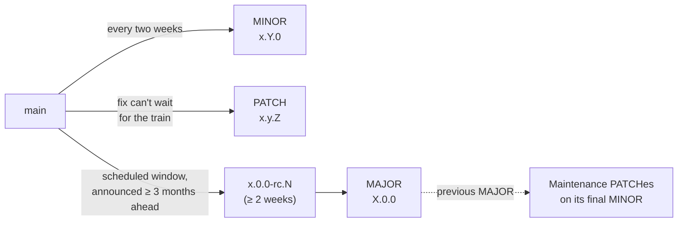
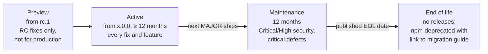
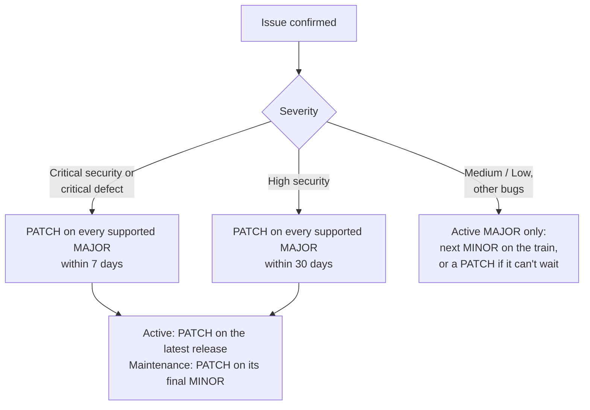
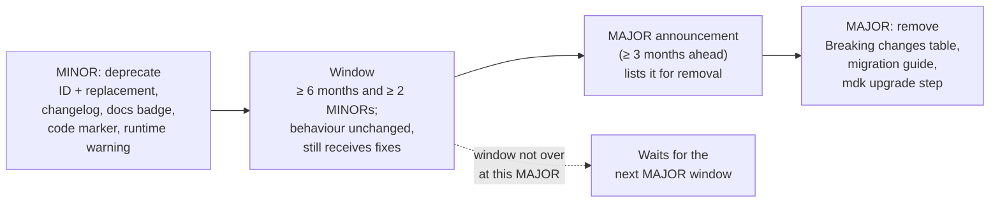
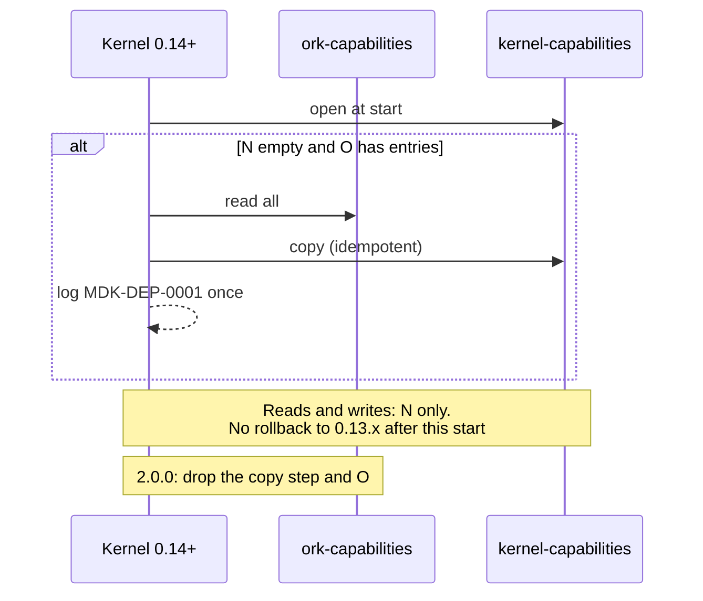
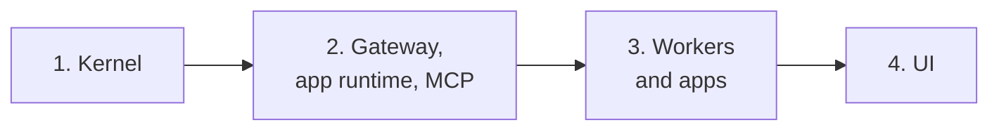

# MDK Release and Deprecation Policy (HLD)

> **Version:** 0.2.0  |  **Date:** 2026-11-19  |  **Status:** Draft
>
> How MDK versions and schedules releases, which versions receive fixes and for how long, and how an interface is deprecated and removed. Intended home: `docs/reference/releases.md` in the MDK repo, replacing `docs/reference/versioning.md`. Where another HLD differs on versioning, compatibility or deprecation, this document supersedes it. Branching and the step-by-step release procedure are in the release process documentation, not here.

---

## 1. Problem

MDK ships every two weeks, but nothing tells an integrator or an operator what a version number promises, which versions get fixes, or how long a deprecated interface keeps working.

- **Breaking changes ship in PATCH releases.** v0.12.1 removed `@tetherto/mdk-fonts` and moved the devkit's `zod` peer from 3 to 4. v0.13.1 removed `createWorkerClient` and renamed two skills without aliases. Every project created by `mdk create` uses a `^0.y.z` range, so it picked these up on its next install. A dashboard created before v0.12.1 stops building: npm leaves a dangling link to the removed package without an error, Vite can't resolve the import, and the only fix today is to recreate the dashboard.
- **Security fixes come bundled with breaking changes.** v0.10.0 shipped two Gateway security fixes together with four breaking changes.
- **No version is supported.** `SECURITY.md` promises best-effort fixes on `main` only.
- **Deprecation has no process.** There is no `Deprecated` changelog section, no notice period and no removal rule.

### 1.1 Scope

**In scope:** every publishable `@tetherto/mdk-*` package in the MDK repository: Kernel, Gateway, Worker runtime and contract, client, app runtime, MCP server, agent, the `mdk` CLI and its templates, and the UI toolkit. They ship at one version number, so they follow one policy.

**Out of scope**, except for how they [declare compatibility](#71-declaring-mdk-compatibility): apps and Workers in their own repositories (catalog apps, partner Workers in `external-workers.json`), which version independently; everything under `examples/`; mock servers and test utilities.

---

## 2. Ground rules

1. **One version, one release line.** Every package ships at the same version from `main`. A release ships **every two weeks** as a MINOR. An urgent fix ships as a PATCH in between.
2. **Breaking changes only in a MAJOR.** From `1.0.0`, MDK follows [SemVer 2.0.0](https://semver.org/). A MAJOR ships **at most once every 12 months**, announced **at least three months** ahead, with a migration guide. Before `1.0.0`, breaking changes ship only in a `0.y.0`, never in a PATCH.
3. **Every MAJOR is supported for at least 24 months**: active until the next MAJOR (at least 12 months), then 12 months of security and critical fixes.
4. **Fixes roll forward.** A fix ships in the newest release of each supported MAJOR. Any release upgrades directly to any later release of the same MAJOR, and code built on Stable interfaces needs no changes.
5. **Deprecate before removing.** A deprecated interface keeps working for **at least six months and two MINORs**, whichever is longer, and carries an ID (`MDK-DEP-0001`) and a warning wherever it runs.
6. **Nothing is lost on upgrade.** Stored data is always migrated forward, and a project created by `mdk create` never has to be regenerated. Migrations don't run backward: a release that migrates data can't be rolled back.

---

## 3. Versioning

### 3.1 Version numbers

The internal `@tetherto/mdk-*` dependencies are pinned to `^<version>` of the same release. Mixing packages from different releases in one stack is not supported; [§7.2](#72-version-skew) covers components on different hosts.

| Part | Increments when a release | What you do |
| --- | --- | --- |
| `MAJOR` | Changes a public interface incompatibly, including removing a deprecated interface | Read the migration guide, run `mdk upgrade`, test |
| `MINOR` | Adds an interface or capability, or deprecates one, without breaking existing use | Upgrade freely; plan off anything deprecated |
| `PATCH` | Fixes a bug or a security issue without changing a public interface; safe to roll back | Upgrade freely |

**A big feature does not make a MAJOR.** The MAJOR tracks compatibility, not the size of what is new. A new Worker family, app runtime or Kernel capability ships in a MINOR as long as existing code keeps working, at the [stability level](#35-stability-levels) it has earned. When a feature can't be added without a break, it ships in a MINOR alongside the old interface, the old interface is deprecated, and the removal waits for the next MAJOR window.

| Change | Release |
| --- | --- |
| New capability, package, route, CLI command or optional field | MINOR |
| New feature that replaces an existing interface | MINOR, with the old one deprecated |
| Removing the replaced interface | Next MAJOR window |
| A new `apiVersion` or envelope `version` | MAJOR window; the old one stays accepted |
| A feature that needs a break and can't wait for the window | Experimental in a MINOR, or wait: a feature never forces an early MAJOR |

### 3.2 Public interfaces

The compatibility promise covers exactly these:

| Interface | What's covered |
| --- | --- |
| Package entry points | Every export reachable from a package's `exports` map, with its documented arguments, return shape and types |
| Gateway HTTP API | Documented routes, methods, request and response fields, status codes |
| MDK Protocol | The message envelope, the action catalogue and each action's payload |
| Worker contract | `mdk-contract.schema.json` for a given `apiVersion` |
| Stack manifest (`mdk.yaml`) | Fields under a given `apiVersion` |
| App manifest (`mdk-app.yaml`) | The manifest fields and the route table (`mdk-plugin.json`) |
| `mdk` CLI | Command names, flags, exit codes, documented `--json` output |
| MCP server | Tool names, input schemas, safety annotations |
| UI toolkit | Exported components, hooks and stores, with the props and types in `dist/registry.json` |
| Error codes | Documented codes; not the message text |
| Environment variables and config | Documented names, keys and defaults |
| Runtime baseline | The supported Node.js and npm range |
| Peer dependencies | The MAJOR of every `peerDependencies` entry (for example React, zod) |
| Generated projects | A project created by `mdk create` keeps building after an upgrade ([§7.3](#73-migrations-and-generated-projects)) |

**Not covered, in any release:** deep imports that a package's `exports` map doesn't expose; log lines, error message text and undocumented metric names; anything [Experimental](#35-stability-levels) or [out of scope](#11-scope); the on-disk layout of stores. A store layout can change in any release except a PATCH, but **stored data is never lost**: the release that changes it ships an automatic migration, which runs forward only ([§7.3](#73-migrations-and-generated-projects)).

### 3.3 What counts as a breaking change

A change is breaking if code, configuration or data that worked against the previous release stops working, or silently behaves differently, without the user changing anything:

- Removing or renaming an export, route, CLI command or flag, manifest field, environment variable or package
- Adding a required argument, field or config key
- Changing a documented default, return shape, status code, exit code or `--json` field
- Raising the minimum Node.js or npm version (except under [§7.4](#74-runtime-baseline))
- Moving a peer dependency to a new MAJOR (for example `zod` 3 to 4)
- Removing a package from npm or from a template, or renaming a shipped skill without an alias
- Changing stored data without an automatic migration

**Not breaking:** adding an optional field or export, fixing behaviour to match the documentation, changing log or error text, performance changes that keep behaviour. A fix that changes behaviour people demonstrably rely on is treated as breaking even if the old behaviour was a bug; the tech lead decides.

### 3.4 Schema versions (`apiVersion`)

**Every YAML or JSON configuration file that MDK reads carries an `apiVersion` field.** It names the schema generation the file was written against, in the form `mdk/v<N>`, and is the first key of the file:

```yaml
apiVersion: mdk/v1
id: my-app
```

```json
{
  "apiVersion": "mdk/v1",
  "name": "my-app.plugin"
}
```

| Rule | Commitment |
| --- | --- |
| Which files | Every file MDK parses and a user or generator writes: `mdk.yaml`, `mdk-app.yaml`, `mdk-plugin.json`, `mdk-contract.json`, the catalogue and Worker manifests (`external-workers.json`), and any new one |
| Which files are not | `package.json`, `tsconfig.json` and other files owned by another tool. Compatibility there is declared through `engines.mdk` ([§7.1](#71-declaring-mdk-compatibility)) |
| When the number changes | Only when the file's schema changes incompatibly. Adding an optional field never changes it |
| New generation | Ships only in a MAJOR. The previous generation stays accepted alongside it for the full [deprecation window](#63-deprecation-window), so a Worker built against `mdk/v1` keeps loading on the MAJOR that introduces `mdk/v2` |
| Missing field | Before `1.0.0`: treated as `mdk/v1`, with a `mdk validate` warning. From `1.0.0`: an error naming the file, with `mdk upgrade` adding it |
| Unknown generation | Rejected with an error that names the version and the MDK release that supports it, never silently misread |
| Generators | `mdk create`, `mdk add` and every template write `apiVersion`. A new config file type can't ship without one |
| Each file has its own number | `mdk.yaml` can move to `mdk/v2` while `mdk-contract.json` stays `mdk/v1`. The [support table](#55-support-table) lists the current generation of each |

The MDK Protocol envelope carries `version` in every message instead, because messages aren't files. It follows the same rules: a new envelope `version` ships only in a MAJOR, when the envelope or an action payload changes incompatibly.

**`contractVersion` is renamed.** `mdk-contract.json` carries `contractVersion` today. The Worker contract adopts `apiVersion` in a MINOR, and `contractVersion: "1"` stays accepted as an alias for `apiVersion: "mdk/v1"` until a MAJOR removes it (`MDK-DEP-0004`). A file with both must agree.

### 3.5 Stability levels

MAJOR, MINOR and PATCH say *when* an interface may break. A stability level says *which* interfaces the promise covers. Without one, a new feature is locked to its first shape the day it ships in a MINOR, for up to a year. So there is one opt-out level, Experimental; everything else public is **Stable**.

| Level | Guarantee | Can break in | Marked by |
| --- | --- | --- | --- |
| Stable | Full policy: SemVer, deprecation window, migration guide | MAJOR only | Default |
| Experimental | Opt-in preview. Can change or be removed in any MINOR, without a deprecation window, listed under `Breaking changes (experimental)` | Any MINOR | `@experimental` TSDoc tag, "Experimental" docs badge, an `/experimental` subpath export, or a `--experimental` CLI flag |
| Deprecated | Works as documented and receives fixes until removed | MAJOR, after the window | [§6.2](#62-how-a-deprecation-is-announced) |
| Internal | No promise | Any release | Not in an `exports` map, or `@internal` TSDoc tag |

- No PATCH changes an Experimental interface incompatibly
- **Experimental → Stable:** documented, tested, used by at least one first-party app or Worker, unchanged for two MINORs, and the tech lead signs off. An Experimental interface that isn't Stable within **six months** is reviewed for removal
- Security fixes apply at every level. Nothing Experimental is on by default in a production stack

---

## 4. Release cadence

### 4.1 One release line

MDK is released from `main` as a single line. Each release publishes **every** publishable package at the new version, even one that didn't change, so one version number always identifies a set built and tested together. Each release gets one `v<version>` tag and one GitHub Release. Older MINORs of the Active MAJOR get no further releases.



| Release type | Cadence | Contents | Breaking changes |
| --- | --- | --- | --- |
| MINOR | Every two weeks, on a fixed train | Features, additions, deprecations, fixes | No (Experimental excepted) |
| PATCH | Between trains, when a fix can't wait | Bug and security fixes only | No |
| MAJOR | At most once every 12 months, in a scheduled window | Removals of deprecated interfaces, new schema generations | Yes, with migration guide and `mdk upgrade` |

**The MINOR train is date-driven.** A feature that misses a train waits for the next one. A train with nothing to ship is skipped, and the skip is noted on the support table.

### 4.2 MAJOR releases

**A MAJOR is scheduled, not triggered.** It isn't cut because one breaking change is ready; breaking changes are batched into the next window. A window with nothing to remove is skipped. The first MAJOR after `1.0.0` ships no earlier than 12 months after it.

At least **three months** before a MAJOR ships, MDK publishes one announcement stating:

- the target month of `x.0.0`
- the deprecations it will remove (each deprecated at least six months earlier, so nothing in it is a surprise)
- the date the current MAJOR enters maintenance (the day `x.0.0` ships), and its end-of-life date 12 months after that

It goes on the support table, in the release notes of every release from then on, and in a GitHub Discussion, approved by the tech lead and the product owner. If the date moves, it moves later, never earlier, and is announced the same way.

### 4.3 Release candidates

The release candidate (`-rc.N`) is the only pre-release form. There is no alpha or beta channel; an unready feature ships as Experimental inside a normal release.

| Rule | Commitment |
| --- | --- |
| MAJOR | Always has RCs. `x.0.0-rc.1` is published at least **two weeks** before `x.0.0`, with the migration guide and `mdk upgrade` in draft |
| MINOR | RCs optional, at the tech lead's discretion for a risky change |
| PATCH | Never has RCs |
| Between RCs | Fixes and documentation only. No new feature, no new breaking change after `rc.1` |
| `x.0.0` | The last RC republished without code changes. A fix after the final RC means another RC |
| Promise | None for RCs, between one another or with the final release. RCs receive no fixes outside the next RC; don't run one in production |

| npm dist-tag | Example | Points at |
| --- | --- | --- |
| `latest` | `1.4.0` | The current release |
| `next` | `2.0.0-rc.1` | The newest release candidate; never installed by default |
| `v<major>-maintenance` | `1.26.3` | The newest PATCH of a MAJOR in [maintenance](#51-major-lifecycle) |

### 4.4 Patch releases

A PATCH is cut from the latest release of a supported MAJOR. It:

- Contains only bug and security fixes that already landed on `main` ("main first"). A fix that can't land on `main` first, because `main` moved on, is written against the release being patched and reviewed as new code
- Adds no feature, export, config key or deprecation
- Changes a dependency only to fix a bug or a vulnerability, and only within the dependency's current MAJOR (else see [§8](#8-exceptions))
- Changes no on-disk layout, needs no config change, and is **safe to roll back** to the release it patches

---

## 5. Support

### 5.1 MAJOR lifecycle

Support is tied to the MAJOR. There are no separately designated LTS lines: the maintenance phase **is** the long-term support, and every MAJOR gets it automatically.



| Commitment | Number |
| --- | --- |
| Active phase | Until the next MAJOR ships, and **at least 12 months**. Every fix and feature, security of any severity |
| Maintenance phase | **12 months** from the day the next MAJOR ships. Critical and High security fixes, [critical defects](#54-critical-defects), and regressions caused by a third-party change such as a Node.js security release |
| Total support per MAJOR | **At least 24 months** from its `x.0.0` |
| Maintenance notice | **At least three months**, by the [MAJOR announcement](#42-major-releases) |
| End-of-life date | Published when the MAJOR enters maintenance. Can be extended, never brought forward |
| Extension | If a production deployment needs longer, MDK can extend a MAJOR's maintenance phase, announced with its scope and new EOL date |
| Supported at once | At most two MAJORs: one Active, one in Maintenance. A MAJOR under an extension is a third |

### 5.2 Where fixes ship



Fixes are **not** backported to older MINORs of the Active MAJOR. To pick up a fix, move to the newest release of your MAJOR. That is safe for an operator who doesn't take every release because:

- No release inside a MAJOR breaks a Stable interface (the [§8](#8-exceptions) exceptions aside), so the newest release is a drop-in replacement
- Any release upgrades directly to any later release of the same MAJOR; CI [tests this](#73-migrations-and-generated-projects) before every release
- Nothing forces an upgrade: pin exact versions and commit the lockfile, and a stack changes only when its operator changes it

### 5.3 Security fixes

Severity is the CVSS v4 base score on the GitHub Security Advisory. Reports are acknowledged within **three business days** (as `SECURITY.md` states) and given a severity within **five business days** of acknowledgment. Targets run from confirmation:

| Severity | Fixed on | Target |
| --- | --- | --- |
| Critical | Every supported MAJOR | PATCH within **7 days** |
| High | Every supported MAJOR | PATCH within **30 days** |
| Critical defect | Every supported MAJOR | PATCH within **7 days** |
| Medium | Active MAJOR | Next MINOR |
| Low | Active MAJOR | Next MINOR or later |

A Critical or High fix isn't held for the train and never ships only inside a release that also carries breaking changes. Every security entry in a changelog or release note states the severity and the advisory ID.

### 5.4 Critical defects

A non-security bug that, in a supported configuration, can cause damage to hardware; loss of fleet control, including curtailment; misdirected hashrate or payouts; or loss or corruption of stored data. The tech lead decides.

### 5.5 Support table

The docs keep a support table, updated every release. Today:

| MAJOR | Phase | Latest release | Supported until |
| --- | --- | --- | --- |
| `0.x` | Initial development | `0.13.1` | `1.0.0` ships; latest release only |

After `2.0.0`, for example, with `T` as the `1.0.0` date:

| MAJOR | Phase | First release | Active until | Maintenance until |
| --- | --- | --- | --- | --- |
| `2.x` | Active | `T+12m` | `3.0.0` ships (`T+24m` or later) | 12 months after `3.0.0` |
| `1.x` | Maintenance | `T` | `T+12m` | `T+24m` (end of life) |
| `0.x` | End of life | — | `T` | — |

---

## 6. Deprecation

### 6.1 Lifecycle

A deprecation tells users an interface will be removed in a future MAJOR and what replaces it. It ships in a MINOR and never changes the interface's behaviour.



Every deprecation gets an ID, `MDK-DEP-NNNN`, assigned in order and never reused. It appears in the changelog, the docs, the code marker and every warning, so one search finds the reason, the replacement and the removal version. A deprecation always names a working replacement in the same release, unless a capability is retired outright, which the changelog then says.

### 6.2 How a deprecation is announced

| Where | Marker |
| --- | --- |
| Changelog and release notes | Entry under `Deprecated` with the ID, the replacement and the earliest version that may remove it |
| Docs | "Deprecated" badge with the ID on the interface's reference page, linking the replacement |
| Exports, UI props, types | `@deprecated MDK-DEP-NNNN: use <replacement>. Removal: <version>.` |
| Gateway route, MCP tool | `deprecated: true` in `mdk-plugin.json` and in the tool description |
| Whole package | `npm deprecate` on **every** published version, naming the replacement and linking the migration guide |
| Node.js packages (runtime) | One warning per process through the shared helper: `[mdk] MDK-DEP-0002: VITE_API_BASE_URL is deprecated. Use VITE_MDK_API_URL.` |
| `mdk` CLI | One `stderr` line per invocation, prefixed `warning: MDK-DEP-NNNN`. Never on `stdout`, so `--json` stays parseable; exit code unchanged |
| Gateway HTTP responses | `Deprecation` header (RFC 9745), `Sunset` header (RFC 8594) once a removal date is set, and `Link: <docs-url>; rel="deprecation"` |
| Worker contract | The Kernel logs one warning per Worker that registers with a deprecated `apiVersion` |
| Manifests | `mdk validate` reports deprecated fields as warnings |

`MDK_NO_DEPRECATION=1` silences runtime warnings; `MDK_THROW_DEPRECATION=1` turns them into errors, so CI catches a deprecated call before the removal does.

### 6.3 Deprecation window

| Rule | Commitment |
| --- | --- |
| Minimum window | **Six months and two MINORs** from the deprecating release, whichever is longer. MDK never shortens it to make a release |
| Removal | Only in a MAJOR, after the window |
| While deprecated | Documented behaviour unchanged; receives bug and security fixes |
| Schema generations | The previous `apiVersion` or envelope `version` stays accepted for the same window |
| Stored data | The migration that reads the old format stays for the **whole MAJOR after** the one that deprecates it, so any supported version upgrades directly |

### 6.4 Deprecations register

| ID | Interface | Replacement | Deprecated in | Earliest removal | Status |
| --- | --- | --- | --- | --- | --- |
| `MDK-DEP-0001` | Kernel store key `ork-capabilities` | `kernel-capabilities`, migrated automatically | `0.14.0` | `2.0.0` | Deprecated |
| `MDK-DEP-0002` | `VITE_API_BASE_URL` and `API_BASE_URL` env vars | `VITE_MDK_API_URL` and `MDK_API_URL` | `0.7.0` | `1.0.0` | Deprecated |
| `MDK-DEP-0003` | `@tetherto/mdk-fonts` package | `@fontsource-variable/jetbrains-mono` with a local `@font-face` | `0.12.1` | `0.12.1` | Removed (before this policy) |
| `MDK-DEP-0004` | `contractVersion` in `mdk-contract.json` | `apiVersion: mdk/v1` | Next `0.y.0` | `2.0.0` | Planned |

Renames completed before this policy, recorded for search: ORK packages became Kernel packages in `0.5.0`; "App Node" and `miningos-gateway` were renamed in docs and templates; the `mdk-worker-plugin` and `mdk-gateway-plugin` skills became `mdk-worker` and `mdk-app-routes` in `0.13.1`.

### 6.5 Reference example: retiring the ORK name (`MDK-DEP-0001`)

One ORK reference remains, and it is the instructive case: the Kernel's capability store is opened as `ork-capabilities` in `backend/core/kernel/lib/storage/stores.js`. It holds operators' saved data, so a plain rename would start an upgraded Kernel with an empty capability map and lose every device-to-contract mapping.



| Step | Release | What happens |
| --- | --- | --- |
| Deprecate, migrate, announce | `0.14.0` (MINOR) | Copy on start as above. `Deprecated` changelog entry with earliest removal `2.0.0`; the Kernel README store table and the storage-model concept page name the new key and note the old one |
| No rollback | From `0.14.0` | The Kernel reads and writes `kernel-capabilities` only, and `ork-capabilities` goes stale. Rolling back to `0.13.x` isn't supported; back up before upgrading |
| Keep the migration | All of `1.x` | Any `0.13`+ release upgrades straight to any `1.x` |
| Remove | `2.0.0` | Listed in the migration guide. `mdk doctor` on `1.x` warns if an install still has data only in the old store |

---

## 7. Compatibility and upgrades

### 7.1 Declaring MDK compatibility

Workers and apps declare the MDK versions they support in `package.json`, in the `engines` block that already holds the Node.js range:

```json
{
  "engines": { "node": ">=24", "mdk": "^1.2.0" },
  "dependencies": { "@tetherto/mdk-worker": "^1.2.0" }
}
```

| Artifact | Declares |
| --- | --- |
| Worker | `engines.mdk`, a `^` dependency on `@tetherto/mdk-worker`, and `apiVersion` in `mdk-contract.json` |
| App | `engines.mdk`, and a `^` dependency on `@tetherto/mdk-client` and any other MDK package it imports |
| UI / dashboard | A `^` dependency on each MDK UI package it imports |

`mdk create` writes `engines.mdk` as `^<current version>`. `mdk validate app|worker` warns when the running MDK is outside the range. `mdk add app` and the Worker runtime refuse an artifact whose range excludes the running MAJOR, and warn when only the MINOR is outside it. The catalog and the supported-Workers list show the range each entry was tested against. An artifact built against `1.y` works on every later `1.x`, not on an earlier `1.x` or on `2.0`.

### 7.2 Version skew

Components can run on different hosts and be upgraded at different times. Within a MAJOR:

| Component | Supported skew |
| --- | --- |
| Kernel | The newest component |
| Gateway, app runtime, MCP | Same MINOR as the Kernel, or up to **two** MINORs older |
| Workers | Any MINOR at or below the Kernel's, with an `apiVersion` the Kernel accepts |
| UI packages | Same MINOR as the Gateway, or older |



Across a MAJOR, upgrade the whole stack together after reading the migration guide.

### 7.3 Migrations and generated projects

Every MAJOR ships:

1. **A migration guide** at `docs/guides/upgrade/v<major>.md`: every breaking change, why, and what to do, in the changelog's `Removed → Replacement` format with deprecation IDs
2. **`mdk upgrade`**: automated migrations for every mechanical change (a rename, a moved import, a manifest field). It updates `package.json` ranges, manifests and imports, prints what it changed, and lists what's left to do by hand
3. **Data migrations** for every changed store, run automatically at first start and safe to re-run

**Data migrations are one-way.** A migration moves stored data forward to the new release; MDK ships no downgrade migration. Once a MINOR or MAJOR has migrated a store, rolling back to the earlier release is not supported, because the earlier release can't read the new layout. Back up the stores before upgrading; the release notes say when a release migrates data. A PATCH never migrates data, so a PATCH can always be rolled back.

A project created by `mdk create` belongs to its author, and MDK never requires regenerating it:

- Templates depend only on packages published to npm, at `^<version>` of the release; never on a `file:`, `link:` or workspace path, which leaves a dangling link when the target goes away
- A release that changes generator output in a way existing projects must follow lists the steps under `Upgrade steps for generated projects` in its changelog entry, and from `1.0.0` ships them in `mdk upgrade`
- `mdk doctor` checks that every `@tetherto/mdk-*` dependency resolves to a published package in the stack's MAJOR, and names any that don't

Before each release, CI runs an upgrade test:


### 7.4 Runtime baseline

Each MAJOR supports the Node.js lines in Active or Maintenance LTS upstream when it ships. Raising the minimum is breaking and ships in a MAJOR, with one exception: a Node.js line past its upstream end of life stays supported for at least **six months** after it, then a MINOR can drop it with six months' notice in the changelog and a startup warning on that version. Otherwise a long-lived MAJOR would be held on a runtime that no longer receives security fixes.

---

## 8. Exceptions

Four changes can break a Stable interface outside a MAJOR. Each is approved by the tech lead and named as an exception in the release notes.

1. **Security.** A security fix can change a public interface in a MINOR or PATCH when no compatible fix exists. Listed under both `Breaking changes` and `Security`, with advisory ID and severity; `SECURITY.md` covers disclosure
2. **Vulnerable dependency.** A dependency or peer dependency moves to a new MAJOR only to fix a vulnerability with no fix in its current MAJOR. Same changelog treatment
3. **End-of-life runtime.** Under [§7.4](#74-runtime-baseline)
4. **Broken release.** npm versions can't be replaced, so a broken version is `npm deprecate`d and replaced by a PATCH

---

## 9. Communication and sign-off

### 9.1 Channels

| Channel | Carries | Source of truth |
| --- | --- | --- |
| `CHANGELOG.md` | Every release, in the [Appendix A](#appendix-a-changelog-entry-template) template | Yes |
| GitHub Releases | One per tag: the changelog entry under the [Appendix B](#appendix-b-release-notes-template) header | No |
| Docs: support table and register | Phase and EOL date of each MAJOR, the next MAJOR window, every deprecation ID | Yes |
| npm | Versions, dist-tags, `npm deprecate` messages | No |
| GitHub Security Advisories | GHSA ID, CVE where assigned, severity, affected and fixed versions per MAJOR | Yes |
| GitHub Discussions | MAJOR announcements | No |
| README | Current version; links to this page and the support table | No |
| Runtime and CLI warnings | Deprecations. Maintenance PATCHes also warn at startup during the last three months before end of life; earlier releases can't, because the date is set after they shipped | No |

| Event | Notice |
| --- | --- |
| Next MAJOR, and the current MAJOR entering maintenance | At least three months ahead ([§4.2](#42-major-releases)) |
| First MAJOR release candidate | At least two weeks before the MAJOR |
| End of life of a MAJOR | When it enters maintenance (12 months ahead), and in every release's notes for the last three months |
| Removal of a deprecation | At deprecation (earliest removal version), and in the RC of the removing MAJOR |
| Dropping an end-of-life Node.js line | At least six months ahead, in the changelog |

### 9.2 Commits and pull requests

Commits use Conventional Commits with the package as scope (`fix(kernel):`, `feat(client):`), so every changelog entry names its package. A breaking commit adds `!` after the type (`feat(client)!:`) and a `BREAKING CHANGE:` footer; a deprecating commit adds `DEPRECATED: MDK-DEP-NNNN`. The PR template asks whether a change breaks or deprecates something; either answer requires a changelog entry in the matching section.

### 9.3 Roles

| Decision or action | Responsible | Approves |
| --- | --- | --- |
| Cutting a MINOR or PATCH | Release engineer | Tech lead |
| Publishing to npm | Release engineer | A second `mdk-publish` member |
| A breaking change, deprecation or exception | Change author | Tech lead |
| Severity of a security issue or critical defect | Tech lead | Tech lead |
| MAJOR schedule, EOL dates, maintenance extensions | Tech lead | Product owner signs off the announcement |
| MAJOR release, migration guide, announcements | Release engineer | Tech lead; product owner signs off |
| Docs-debt gate (none on an RC or MAJOR) | Docs maintainer | Tech lead |

---

## 10. FAQ

**Is there an LTS release?**
Every MAJOR is long-term supported: at least 24 months, including 12 months of security and critical fixes after the next MAJOR ships ([§5.1](#51-major-lifecycle)). There are no separately designated LTS lines.

**Do I have to upgrade every two weeks?**
No. Pin exact versions and commit the lockfile. When you do upgrade, any release moves directly to the newest release of the same MAJOR.

**Will a fix be backported to the MINOR I'm on?**
No. Move to the newest release of your MAJOR; it's a drop-in replacement for anything built on Stable interfaces. Critical and High security fixes also ship as a PATCH on the MAJOR in maintenance.

**Does a big new feature mean a new MAJOR?**
No. Features ship in MINORs. Only a breaking change, usually removing something deprecated, needs a MAJOR ([§3.1](#31-version-numbers)).

**How much notice do I get before something is removed?**
At least six months and two MINORs after it is deprecated, plus at least three months' notice of the MAJOR that removes it.

**What happens to `0.x` at `1.0`?**
Until `1.0.0`, breaking changes ship only in a `0.y.0`, never in a PATCH, and only the latest `0.y` gets fixes. Interfaces deprecated in `0.y` may be removed in `1.0.0`. At `1.0.0`, `0.x` reaches end of life, and the release ships a migration guide and `mdk upgrade` steps from the last `0.y`.

**Will upgrading MDK break my generated dashboard, app or Worker?**
It shouldn't. Templates use only published packages, CI upgrade-tests projects scaffolded on older releases, and `mdk doctor` finds dependencies that no longer resolve. Never recreate a project to upgrade it.

**How does my Worker or app say which MDK it supports?**
`engines.mdk` in `package.json`, and `apiVersion` in its config files ([§7.1](#71-declaring-mdk-compatibility)).

**Is the UI covered by this policy?**
Yes. UI packages ship under the same version number as the rest of MDK.

---

## Appendix A: changelog entry template

Sections appear in this order; an empty section is omitted.

```markdown
## v<version>

<!-- One line per highlight, the part a reader scans for in bold. -->
- <Highlight>

## Breaking changes

<!-- MAJOR, security exceptions and Experimental interfaces only. Pre-1.0: 0.y.0 only. -->

### <Interface> <what changed>

<Why, and who is affected.>

| Removed | Replacement | Deprecation ID |
| --- | --- | --- |
| `<old>` | `<new>` | `MDK-DEP-NNNN` |

<Migration steps. Say whether `mdk upgrade` handles it.>

## Deprecated

| ID | Interface | Replacement | Earliest removal |
| --- | --- | --- | --- |
| `MDK-DEP-NNNN` | `<interface>` | `<replacement>` | `<major>.0.0` |

## Security

| Advisory | Severity | Package | Affected | Fixed in | Resolution |
| --- | --- | --- | --- | --- | --- |
| `GHSA-xxxx-xxxx-xxxx` | High | `<package>` | `<range>` | `<versions>` | <one sentence> |

## Added

## Changed

## Fixed

## Removed

<!-- Removed deprecated interfaces, each with its ID. Anything else removed also goes under Breaking changes. -->

## Dependencies

| Change | Reason |
| --- | --- |

## Upgrade steps for generated projects

<!-- Only if projects created by `mdk create` must change. -->

## Documentation debt

<!-- Open `docs-required` items, as RELEASING.md requires. -->
```

## Appendix B: release notes template

The GitHub Release is the changelog entry, unchanged, under this header:

```markdown
**MDK v<version>** · <MAJOR | MINOR | PATCH> · <date>

| | |
| --- | --- |
| Safe to upgrade from | `<oldest version that upgrades without manual steps>` |
| Breaking changes | <None | Yes: docs/guides/upgrade/v<major>.md> |
| Security fixes | <None | count by severity, with GHSA IDs> |
| New deprecations | <None | MDK-DEP-NNNN, …> |
| Migrates stored data | <No | Yes: back up first; this release can't be rolled back> |
| This MAJOR is supported until | <EOL date, or "at least <date>" while Active> · [Support table](<docs-url>/reference/releases#support-table) |

<changelog entry>
```
