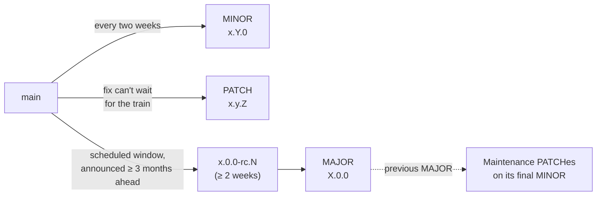
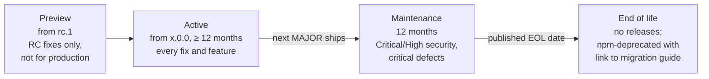
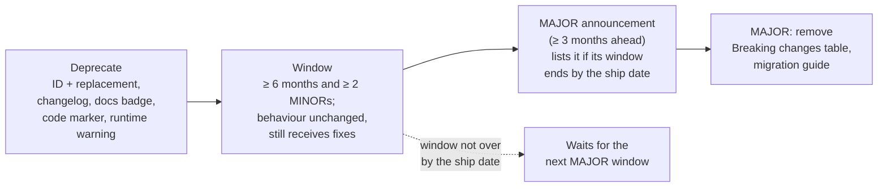
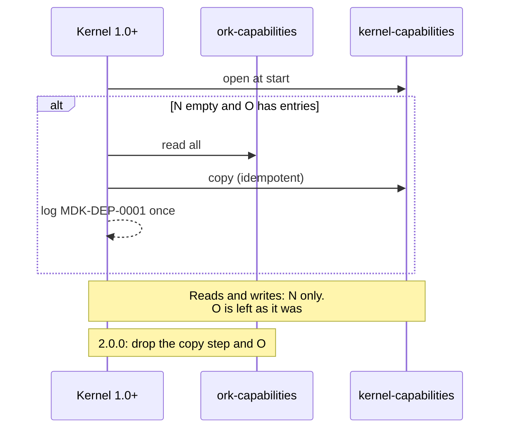
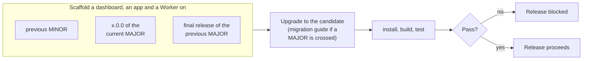

# MDK Release and Deprecation Policy (HLD)

> **Version:** 0.4.0  |  **Date:** 2026-11-24  |  **Status:** Draft
>
> How MDK versions and schedules releases, which versions receive fixes and for how long, and how an interface is deprecated and removed. Intended home: `docs/reference/releases.md` in the MDK repo, replacing `docs/reference/versioning.md`. Where another HLD differs on versioning, compatibility or deprecation, this document supersedes it. Branching and the step-by-step release procedure are in the release process documentation, not here; [Appendix A](#appendix-a-release-process-moves-to-releasingmd) holds the process parts of this policy until they move to `RELEASING.md`.

---

## 1. Problem

MDK ships every two weeks, but nothing tells an integrator or an operator what a version number promises, which versions get fixes, or how long a deprecated interface keeps working.

- **Breaking changes ship in PATCH releases.** v0.12.1 removed `@tetherto/mdk-fonts` and moved the devkit's `zod` peer from 3 to 4. v0.13.1 removed `createWorkerClient` and renamed two skills without aliases. Every project created by `mdk create` uses a `^0.y.z` range, so it picked these up on its next install. A dashboard created before v0.12.1 stops building: npm leaves a dangling link to the removed package without an error, Vite can't resolve the import, and the only fix today is to recreate the dashboard.
- **Security fixes come bundled with breaking changes.** v0.10.0 shipped two Gateway security fixes together with four breaking changes.
- **No version is supported.** `SECURITY.md` promises best-effort fixes on `main` only.
- **Deprecation has no process.** There is no `Deprecated` changelog section, no notice period and no removal rule.

### 1.1 Scope

**In scope:** every publishable `@tetherto/mdk-*` package in the MDK repository: Kernel, Gateway, Worker runtime and contract, client, app runtime, MCP server, agent, the `mdk` CLI and its templates, and the UI toolkit. They ship at one version number, so they follow one policy.

**Out of scope**, except for how they [declare compatibility](#71-declaring-mdk-compatibility): apps and Workers in their own repositories (catalog apps, partner Workers in `external-workers.json`), which version independently; everything under `examples/`; mock servers and test utilities.

---

## 2. Ground rules

1. **One version, one release line.** Every package ships at the same version from `main`. A release ships **every two weeks** as a MINOR. An urgent fix ships as a PATCH in between.
2. **Breaking changes only in a MAJOR.** From `1.0.0` ([§9](#9-the-100-release)), MDK follows [SemVer 2.0.0](https://semver.org/) for every [Stable](#35-stability-levels) interface. A MAJOR ships **at most once every 12 months**, announced **at least three months** ahead, with a migration guide. Before `1.0.0`, breaking changes ship only in a `0.y.0`, never in a PATCH.
3. **Every MAJOR is supported for at least 24 months**: active until the next MAJOR (at least 12 months), then 12 months of security and critical fixes.
4. **Fixes roll forward.** A fix ships in the newest release of each supported MAJOR. Any release upgrades directly to any later release of the same MAJOR, and code built on Stable interfaces needs no changes.
5. **Deprecate before removing.** A deprecated interface keeps working for **at least six months and two MINORs**, whichever is longer, and carries an ID (`MDK-DEP-0001`) and a warning wherever it runs. Six months is the earliest removal; no other notice is added on top of it.
6. **Nothing is lost on upgrade.** Stored data is always migrated forward, and a project created by `mdk create` never has to be regenerated. Migrations don't run backward: the way back from a release that migrates data is a backup taken before the upgrade ([§7.3](#73-migrations-and-generated-projects)).

---

## 3. Versioning

### 3.1 Version numbers

The internal `@tetherto/mdk-*` dependencies are pinned to `^<version>` of the same release. Mixing packages from different releases in one stack is not supported ([§7.2](#72-one-version-per-stack)).

| Part | Increments when a release | What you do |
| --- | --- | --- |
| `MAJOR` | Changes a Stable interface incompatibly, including removing a deprecated interface | Read the migration guide, apply it (with `mdk upgrade` once it [ships](#10-tooling-to-build)), test |
| `MINOR` | Adds an interface or capability, or deprecates one, without breaking existing use | Upgrade freely; check the release notes for a data migration; plan off anything deprecated |
| `PATCH` | Fixes a bug or a security issue without changing a public interface; safe to roll back | Upgrade freely |

**A big feature does not make a MAJOR.** The MAJOR tracks compatibility, not the size of what is new. A new Worker family, app runtime or Kernel capability ships in a MINOR as long as existing code keeps working, at the [stability level](#35-stability-levels) it has earned. When a feature can't be added without a break, it ships in a MINOR alongside the old interface, the old interface is deprecated, and the removal waits for the next MAJOR window.

| Change | Release |
| --- | --- |
| New capability, package, route, CLI command or optional field | MINOR |
| New feature that replaces an existing interface | MINOR, with the old one deprecated |
| Removing the replaced interface | Next MAJOR window |
| A new `apiVersion` or envelope `version` | MAJOR window; the old one stays accepted |
| A feature that needs a break and can't wait for the window | Experimental in a MINOR, or wait: a feature never forces an early MAJOR |

### 3.2 Public interfaces

The compatibility promise covers these interfaces, at the level shown. Experimental ones become Stable under [§3.5](#35-stability-levels) without waiting for a MAJOR.

| Interface | What's covered | Level at `1.0.0` |
| --- | --- | --- |
| Worker contract | `mdk-contract.schema.json` for a given `apiVersion`, and the exports of `@tetherto/mdk-worker` | Stable |
| Gateway HTTP API | Documented routes, methods, request and response fields, status codes | Stable |
| MDK Protocol | The message envelope, the action catalogue and each action's payload | Stable |
| App interfaces | The exports of `@tetherto/mdk-client` and `@tetherto/mdk-app-runtime`; the app manifest (`mdk-app.yaml`) and route table (`mdk-plugin.json`) | Stable |
| `mdk` CLI | Command names, flags, exit codes, documented `--json` output | Stable |
| Stack manifest (`mdk.yaml`) | Fields under a given `apiVersion` | Stable |
| Environment variables and config | Documented names, keys and defaults | Stable |
| Error codes | Documented codes; not the message text | Stable |
| Runtime baseline | The supported Node.js and npm range | Stable |
| Peer dependencies | The MAJOR of every `peerDependencies` entry (for example React, `zod`), in Experimental packages too | Stable |
| Generated projects | A project created by `mdk create` never has to be regenerated, and its `@tetherto/mdk-*` dependencies keep resolving ([§7.3](#73-migrations-and-generated-projects)). The app and Worker templates use Stable interfaces only and keep building unchanged; the dashboard template uses the Experimental UI toolkit and can need the listed upgrade steps | Stable |
| Other package entry points | Exports of the Kernel, Gateway, core, protocol, identity, RBAC and stats packages | Experimental |
| UI toolkit | Exported components, hooks and stores, with the props and types in `dist/registry.json` | Experimental |
| MCP server | Tool names, input schemas, safety annotations | Experimental |
| Agent | `@tetherto/mdk-agent` and `@tetherto/mdk-ui-agent` | Experimental |

**Not covered, in any release:** deep imports that a package's `exports` map doesn't expose; log lines, error message text and undocumented metric names; anything [out of scope](#11-scope); the on-disk layout of stores. A store layout can change in any release except a PATCH, but **stored data is never lost**: the release that changes it ships an automatic migration, which runs forward only ([§7.3](#73-migrations-and-generated-projects)).

### 3.3 What counts as a breaking change

A change is breaking if code, configuration or data that worked against the previous release stops working, or silently behaves differently, without the user changing anything:

- Removing or renaming an export, route, CLI command or flag, manifest field, environment variable or package
- Adding a required argument, field or config key
- Changing a documented default, return shape, status code, exit code or `--json` field
- Raising the minimum Node.js or npm version (except under [§7.4](#74-runtime-baseline))
- Moving a peer dependency to a new MAJOR (for example `zod` 3 to 4)
- Removing a package from npm or from a template, or renaming a shipped skill without an alias
- Changing stored data without an automatic migration

**Not breaking:** adding an optional field or export, fixing behaviour to match the documentation, changing log or error text, performance changes that keep behaviour. A fix that changes behaviour people demonstrably rely on is treated as breaking even if the old behaviour was a bug; the tech lead decides.

### 3.4 Schema versions (`apiVersion`)

**Every YAML or JSON configuration file that MDK reads carries an `apiVersion` field.** It names the schema generation the file was written against, in the form `mdk/v<N>`, and is the first key of the file:

```yaml
apiVersion: mdk/v1
id: my-app
```

```json
{
  "apiVersion": "mdk/v1",
  "name": "my-app.plugin"
}
```

| Rule | Commitment |
| --- | --- |
| Which files | Every file MDK parses and a user or generator writes: `mdk.yaml`, `mdk-app.yaml`, `mdk-plugin.json`, `mdk-contract.json`, the catalogue and Worker manifests (`external-workers.json`), and any new one |
| Which files are not | `package.json`, `tsconfig.json` and other files owned by another tool. Compatibility there is declared through `engines.mdk` ([§7.1](#71-declaring-mdk-compatibility)) |
| When the number changes | Only when the file's schema changes incompatibly. Adding an optional field never changes it |
| New generation | Ships only in a MAJOR. The previous generation stays accepted alongside it for the full [deprecation window](#63-deprecation-window), so a Worker built against `mdk/v1` keeps loading on the MAJOR that introduces `mdk/v2` |
| Missing field | `mdk.yaml`: an error, as today. Every other file: treated as `mdk/v1` with a `mdk validate` warning through all of `1.x`, and an error from `2.0.0`, covered by its migration guide |
| Unknown generation | Rejected with an error that names the version and the MDK release that supports it, never silently misread |
| Generators | `mdk create`, `mdk add` and every template write `apiVersion` ([§10](#10-tooling-to-build) says when). A new config file type can't ship without one |
| Each file has its own number | `mdk.yaml` can move to `mdk/v2` while `mdk-contract.json` stays `mdk/v1`. The [support table](#55-support-table) lists the current generation of each |

The MDK Protocol envelope carries `version` in every message instead, because messages aren't files. It follows the same rules: a new envelope `version` ships only in a MAJOR, when the envelope or an action payload changes incompatibly.

**`contractVersion` is renamed.** `mdk-contract.json` carries `contractVersion` today. The Worker contract adopts `apiVersion` in a `1.x` MINOR, and `contractVersion: "1"` stays accepted as an alias for `apiVersion: "mdk/v1"` until a MAJOR removes it (`MDK-DEP-0004`). A file with both must agree.

### 3.5 Stability levels

MAJOR, MINOR and PATCH say *when* an interface may break. A stability level says *which* interfaces the promise covers. Without one, a new feature is locked to its first shape the day it ships in a MINOR, for up to a year. So there is one opt-out level, Experimental; everything else public is **Stable**.

| Level | Guarantee | Can break in | Marked by |
| --- | --- | --- | --- |
| Stable | Full policy: SemVer, deprecation window, migration guide | MAJOR only | Default |
| Experimental | Opt-in preview. Can change or be removed in any MINOR, without a deprecation window, listed under `Breaking changes (experimental)` | Any MINOR | The [§3.2](#32-public-interfaces) table for a whole package; otherwise an `@experimental` TSDoc tag, "Experimental" docs badge, an `/experimental` subpath export, or a `--experimental` CLI flag |
| Deprecated | Works as documented and receives fixes until removed | MAJOR, after the window | [§6.2](#62-how-a-deprecation-is-announced) |
| Internal | No promise | Any release | Not in an `exports` map, or `@internal` TSDoc tag |

- No PATCH changes an Experimental interface incompatibly
- Three rules hold for an Experimental package too, because breaking them is what broke generated projects before: it is never unpublished or dropped from a template in a MINOR, its peer dependencies never move to a new MAJOR in a MINOR, and a change to an export that a template uses comes with `Upgrade steps for generated projects`
- **Experimental → Stable:** documented, tested, used by at least one first-party app or Worker, unchanged for two MINORs, and the tech lead signs off. An Experimental interface inside a Stable package that isn't Stable within **six months** is reviewed for removal; Experimental packages are reviewed at each MAJOR announcement
- Security fixes apply at every level. An Experimental feature inside a Stable package is off by default

---

## 4. Release cadence

### 4.1 One release line

MDK is released from `main` as a single line. Each release publishes **every** publishable package at the new version, even one that didn't change, so one version number always identifies a set built and tested together. Each release gets one `v<version>` tag and one GitHub Release. Older MINORs of the Active MAJOR get no further releases.



| Release type | Cadence | Contents | Breaking changes |
| --- | --- | --- | --- |
| MINOR | Every two weeks, on a fixed train | Features, additions, deprecations, fixes | No (Experimental excepted) |
| PATCH | Between trains, when a fix can't wait | Bug and security fixes only | No |
| MAJOR | At most once every 12 months, in a scheduled window | Removals of deprecated interfaces, new schema generations | Yes, with a migration guide |

**The MINOR train is date-driven.** A feature that misses a train waits for the next one. A train with nothing to ship is skipped, and the skip is noted on the support table.

### 4.2 MAJOR releases

**A MAJOR is scheduled, not triggered.** It isn't cut because one breaking change is ready; breaking changes are batched into the next window. A window with nothing to remove is skipped. The first MAJOR after `1.0.0` ships no earlier than 12 months after it.

At least **three months** before a MAJOR ships, MDK publishes one announcement stating:

- the target month of `x.0.0`
- the deprecations it will remove: only those whose [window](#63-deprecation-window) ends on or before the target date. Nothing joins the list after the announcement. The three-month notice overlaps the deprecation window instead of adding to it, so six months after deprecation stays the earliest removal
- the date the current MAJOR enters maintenance (the day `x.0.0` ships), and its end-of-life date 12 months after that

It goes on the support table, in the release notes of every release from then on, and in a GitHub Discussion, approved by the tech lead and the product owner. If the date moves, it moves later, never earlier, and is announced the same way.

### 4.3 Release candidates

The release candidate (`-rc.N`) is the only pre-release form. There is no alpha or beta channel; an unready feature ships as Experimental inside a normal release. RCs are published under the npm `next` dist-tag, so they are never installed by default.

| Rule | Commitment |
| --- | --- |
| MAJOR | Always has RCs. `x.0.0-rc.1` is published at least **two weeks** before `x.0.0`, with the migration guide in draft. `1.0.0` is the one exception ([§9](#9-the-100-release)) |
| MINOR | RCs optional, at the tech lead's discretion for a risky change |
| PATCH | Never has RCs |
| Between RCs | Fixes and documentation only. No new feature, no new breaking change after `rc.1` |
| `x.0.0` | The last RC republished without code changes. A fix after the final RC means another RC |
| Promise | None for RCs, between one another or with the final release. RCs receive no fixes outside the next RC; don't run one in production |

### 4.4 Patch releases

A PATCH is cut from the latest release of a supported MAJOR. It:

- Contains only bug and security fixes that already landed on `main` ("main first"). A fix that can't land on `main` first, because `main` moved on, is written against the release being patched and reviewed as new code
- Adds no feature, export, config key or deprecation
- Changes a dependency only to fix a bug or a vulnerability, and only within the dependency's current MAJOR (else see [§8](#8-exceptions))
- Changes no on-disk layout, needs no config change, and is **safe to roll back** to the release it patches

---

## 5. Support

### 5.1 MAJOR lifecycle

Support is tied to the MAJOR. There are no separately designated LTS lines: the maintenance phase **is** the long-term support, and every MAJOR gets it automatically.



| Commitment | Number |
| --- | --- |
| Active phase | Until the next MAJOR ships, and **at least 12 months**. Every fix and feature, security of any severity |
| Maintenance phase | **12 months** from the day the next MAJOR ships. Critical and High security fixes, [critical defects](#54-critical-defects), and regressions caused by a third-party change such as a Node.js security release |
| Total support per MAJOR | **At least 24 months** from its `x.0.0` |
| Maintenance notice | **At least three months**, by the [MAJOR announcement](#42-major-releases) |
| End-of-life date | Published when the MAJOR enters maintenance. Can be extended, never brought forward |
| Extension | If a production deployment needs longer, MDK can extend a MAJOR's maintenance phase, announced with its scope and new EOL date |
| Supported at once | At most two MAJORs: one Active, one in Maintenance. A MAJOR under an extension is a third. Two MAJORs are first supported at once when `2.0.0` ships |

### 5.2 Where fixes ship


Fixes are **not** backported to older MINORs of the Active MAJOR. To pick up a fix, move to the newest release of your MAJOR. That is safe for an operator who doesn't take every release because:

- No release inside a MAJOR breaks a Stable interface (the [§8](#8-exceptions) exceptions aside), so the newest release is a drop-in replacement for code
- Any release upgrades directly to any later release of the same MAJOR; CI [tests this](#73-migrations-and-generated-projects) before every release
- Data is the one thing that only moves forward. If a MINOR between your release and the newest one migrates a store, the upgrade takes that migration too. The way back is a backup taken before the upgrade ([§7.3](#73-migrations-and-generated-projects)), not a downgrade
- Nothing forces an upgrade: pin exact versions and commit the lockfile, and a stack changes only when its operator changes it

### 5.3 Security fixes

Severity is the CVSS v4 base score on the GitHub Security Advisory, in the standard bands: **Critical** 9.0–10.0, **High** 7.0–8.9, **Medium** 4.0–6.9, **Low** 0.1–3.9. A report is acknowledged within **three business days** (as `SECURITY.md` states), and its severity is decided within **five business days** of acknowledgment. Fix targets are **calendar days from the severity decision**:

| Severity | Fixed on | Target |
| --- | --- | --- |
| Critical | Every supported MAJOR | PATCH within **7 days** |
| High | Every supported MAJOR | PATCH within **30 days** |
| Medium | Active MAJOR | Next MINOR |
| Low | Active MAJOR | Next MINOR or later |

A [critical defect](#54-critical-defects) has no CVSS score. It is handled like a Critical issue: a PATCH on every supported MAJOR within **7 calendar days** of the tech lead classifying it.

A Critical or High fix isn't held for the train and never ships only inside a release that also carries breaking changes. Every security entry in a changelog or release note states the severity and the advisory ID.

### 5.4 Critical defects

A non-security bug that, in a supported configuration, can cause damage to hardware; loss of fleet control, including curtailment; misdirected hashrate or payouts; or loss or corruption of stored data. The tech lead decides.

### 5.5 Support table

The docs keep a support table, updated every release. Today:

| MAJOR | Phase | Latest release | Supported until |
| --- | --- | --- | --- |
| `0.x` | Initial development | `0.14.0` | `1.0.0` ships (16 Dec 2026); latest release only |

After `2.0.0`, for example, with `T` as the `1.0.0` date:

| MAJOR | Phase | First release | Active until | Maintenance until |
| --- | --- | --- | --- | --- |
| `2.x` | Active | `T+12m` or later | `3.0.0` ships (`T+24m` or later) | 12 months after `3.0.0` |
| `1.x` | Maintenance | `T` | `2.0.0` ships | 12 months after `2.0.0` (end of life) |
| `0.x` | End of life | — | `T` | — |

---

## 6. Deprecation

### 6.1 Lifecycle

A deprecation tells users an interface will be removed in a future MAJOR and what replaces it. It ships in a MINOR or a MAJOR and never changes the interface's behaviour.



Every deprecation gets an ID, `MDK-DEP-NNNN`, assigned in order and never reused. It appears in the changelog, the docs, the code marker and every warning, so one search finds the reason, the replacement and the removal version. A deprecation always names a working replacement in the same release, unless a capability is retired outright, which the changelog then says.

### 6.2 How a deprecation is announced

| Where | Marker |
| --- | --- |
| Changelog and release notes | Entry under `Deprecated` with the ID, the replacement and the earliest version that may remove it |
| Docs | "Deprecated" badge with the ID on the interface's reference page, linking the replacement |
| Exports, UI props, types | `@deprecated MDK-DEP-NNNN: use <replacement>. Removal: <version>.` |
| Gateway route, MCP tool | `deprecated: true` in `mdk-plugin.json` and in the tool description |
| Whole package | `npm deprecate` on **every** published version, naming the replacement and linking the migration guide |
| Node.js packages (runtime) | One warning per process, in this format: `[mdk] MDK-DEP-0002: VITE_API_BASE_URL is deprecated. Use VITE_MDK_API_URL.` |
| `mdk` CLI | One `stderr` line per invocation, prefixed `warning: MDK-DEP-NNNN`. Never on `stdout`, so `--json` stays parseable; exit code unchanged |
| Gateway HTTP responses | `Deprecation` header (RFC 9745), `Sunset` header (RFC 8594) once a removal date is set, and `Link: <docs-url>; rel="deprecation"` |
| Worker contract | The Kernel logs one warning per Worker that registers with a deprecated `apiVersion` |
| Manifests | `mdk validate` reports deprecated fields as warnings |

`MDK_NO_DEPRECATION=1` silences runtime warnings; `MDK_THROW_DEPRECATION=1` turns them into errors, so CI catches a deprecated call before the removal does. The shared helper behind these variables and the Gateway headers are still to be built ([§10](#10-tooling-to-build)).

**Deprecating an interface never deprecates a release.** 
- A deprecated interface is flagged where people meet it: the editor, the logs, the CLI, the docs and the changelog. npm is not one of those places. 
- `npm deprecate` on a version is kept for four cases: a broken release ([§8](#8-exceptions)), a MAJOR at end of life ([§5.1](#51-major-lifecycle)), a retired package, and every `0.x` version when `1.0.0` ships ([§9](#9-the-100-release)). 
- Older MINORs of a supported MAJOR aren't npm-deprecated. An npm deprecation tells everyone who installs a version not to use it, and it can't say which interface is the problem. An older MINOR still works and upgrades directly, so the warning would be wrong, and it would teach people to ignore the ones that matter.

### 6.3 Deprecation window

| Rule | Commitment |
| --- | --- |
| Minimum window | **Six months and two MINORs** from the deprecating release, whichever is longer. MDK never shortens it to make a release |
| Removal | Only in a MAJOR whose ship date is after the window ends. The MAJOR announcement doesn't extend the window |
| While deprecated | Documented behaviour unchanged; receives bug and security fixes |
| Schema generations | The previous `apiVersion` or envelope `version` stays accepted for the same window |
| Stored data | The migration that reads the old format is removed only in a MAJOR, like any deprecated interface, so every supported release upgrades directly |

### 6.4 Deprecations register

| ID | Interface | Replacement | Deprecated in | Earliest removal | Status |
| --- | --- | --- | --- | --- | --- |
| `MDK-DEP-0001` | Kernel store key `ork-capabilities` | `kernel-capabilities`, migrated automatically | `1.0.0` | `2.0.0` | Planned |
| `MDK-DEP-0002` | `VITE_API_BASE_URL` and `API_BASE_URL` env vars | `VITE_MDK_API_URL` and `MDK_API_URL` | `0.7.0` | `1.0.0` | Deprecated |
| `MDK-DEP-0003` | `@tetherto/mdk-fonts` package | `@fontsource-variable/jetbrains-mono` with a local `@font-face` | `0.12.1` | `0.12.1` | Removed (before this policy) |
| `MDK-DEP-0004` | `contractVersion` in `mdk-contract.json` | `apiVersion: mdk/v1` | The `1.x` MINOR that adds `apiVersion` to the contract | `2.0.0` | Planned |
| `MDK-DEP-0005` | `getMetricCardValueColor` in `@tetherto/mdk-react-devkit` | The `MetricCard` value modifiers | `0.14.0` | Any `1.x` MINOR (Experimental package) | Deprecated |

Earliest removal is the first MAJOR that ships after the six-month window ends. `MDK-DEP-0002` has been deprecated since `0.7.0`, so `1.0.0` is allowed to remove it. `MDK-DEP-0001` and `MDK-DEP-0004` are deprecated at or after `1.0.0`, so `2.0.0` is the first MAJOR they can reach; the `contractVersion` alias isn't held longer on purpose.

Renames completed before this policy, recorded for search: the ORK packages became Kernel packages in `0.5.0`; the `mdk-worker-plugin` and `mdk-gateway-plugin` skills became `mdk-worker` and `mdk-app-routes` in `0.13.1`.

### 6.5 Reference example: retiring the ORK name (`MDK-DEP-0001`)

One ORK reference remains, and it is the instructive case: the Kernel's capability store is opened as `ork-capabilities` in `backend/core/kernel/lib/storage/stores.js`. It holds operators' saved data, so a plain rename would start an upgraded Kernel with an empty capability map and lose every device-to-contract mapping.



| Step | Release | What happens |
| --- | --- | --- |
| Deprecate, migrate, announce | `1.0.0` | Copy on start as above. `Deprecated` changelog entry with earliest removal `2.0.0`; the Kernel README store table and the storage-model concept page name the new key and note the old one |
| Way back | From `1.0.0` | No migration runs backward. `ork-capabilities` is left untouched, so reinstalling `0.14.x` starts on the data as it was before the upgrade; changes made on `1.x` are lost |
| Keep the migration | All of `1.x` | Any `0.13`+ release upgrades straight to any `1.x` |
| Remove | `2.0.0` | Listed in the migration guide. An install still on `0.x` starts once on any `1.x` before moving to `2.x` |

---

## 7. Compatibility and upgrades

### 7.1 Declaring MDK compatibility

Workers and apps declare the MDK versions they support in `package.json`, in the `engines` block that already holds the Node.js range:

```json
{
  "engines": { "node": ">=24", "mdk": "^1.2.0" },
  "dependencies": { "@tetherto/mdk-worker": "^1.2.0" }
}
```

| Artifact | Declares |
| --- | --- |
| Worker | `engines.mdk`, a `^` dependency on `@tetherto/mdk-worker`, and `apiVersion` in `mdk-contract.json` |
| App | `engines.mdk`, and a `^` dependency on `@tetherto/mdk-client` and any other MDK package it imports |
| UI / dashboard | A `^` dependency on each MDK UI package it imports |

`mdk create` writes `engines.mdk` as `^<current version>`. `mdk validate app|worker` warns when the running MDK is outside the range. `mdk add app` and the Worker runtime refuse an artifact whose range excludes the running MAJOR, and warn when only the MINOR is outside it. Until those checks [ship](#10-tooling-to-build), the range is informational. An artifact built against `1.y` works on every later `1.x`, not on an earlier `1.x` or on `2.0`.

The catalog and the supported-Workers list show the range each entry was tested against. Partner Workers are checked with the existing contract conformance check against every supported MAJOR, and the list shows the result per MAJOR.

### 7.2 One version per stack

The supported configuration is every `@tetherto/mdk-*` package in a stack on the **same version**. That includes components on different hosts: Kernel, Gateway, app runtime, MCP, Workers runtime and UI. Each release is built and tested as one set, and compatibility between packages from different releases is not developed, tested or promised.

- Upgrade every MDK package in the stack to the same release, together. Prefer the latest release: it is the one that receives fixes ([§5.2](#52-where-fixes-ship))
- Where a release is known to work alongside another version, its release notes say so. That statement covers that release only and is not a standing guarantee
- The order, timing and staging of a rollout at a site belong to the site's own runbook, not to this policy

An external Worker or app follows the same rule for the MDK packages it depends on. Its `^` range lets a site install the stack's version without changing the Worker's or app's code ([§7.1](#71-declaring-mdk-compatibility)).

### 7.3 Migrations and generated projects

Every MAJOR ships:

1. **A migration guide** at `docs/guides/upgrade/v<major>.md`: every breaking change, why, and what to do, in the changelog's `Removed → Replacement` format with deprecation IDs
2. **`mdk upgrade`** steps for every mechanical change (a rename, a moved import, a manifest field), from the first MAJOR after it [ships](#10-tooling-to-build). It updates `package.json` ranges, manifests and imports, prints what it changed, and lists what's left to do by hand. `1.0.0` ships the guide only, applied by hand
3. **Data migrations** for every changed store, run automatically at first start and safe to re-run

**Data migrations are one-way.** A migration moves stored data forward to the new release; MDK ships no downgrade migration, and an earlier release can't read the migrated layout. A MINOR can migrate data as well as a MAJOR; the release notes say when.

**The way back is a backup.** The release notes of a migrating release name the stores it changes and give the backup steps. The earlier release can be reinstalled on that backup; anything written after the upgrade is lost. An automatic snapshot before each migration is [planned](#10-tooling-to-build) to replace the manual step. A PATCH never migrates data, so a PATCH can always be rolled back.

A project created by `mdk create` belongs to its author, and MDK never requires regenerating it:

- Templates depend only on packages published to npm, at `^<version>` of the release; never on a `file:`, `link:` or workspace path, which leaves a dangling link when the target goes away
- A release that changes generator output in a way existing projects must follow lists the steps under `Upgrade steps for generated projects` in its changelog entry, and ships them in `mdk upgrade` once it exists
- `mdk doctor` checks that every `@tetherto/mdk-*` dependency is on the stack's version and resolves to a published package, and names any that don't

Before each release, CI runs an upgrade test:



### 7.4 Runtime baseline

Each MAJOR supports the Node.js lines in Active or Maintenance LTS upstream when it ships. Raising the minimum is breaking and ships in a MAJOR, with one exception: a Node.js line past its upstream end of life stays supported for at least **six months** after that date. The changelog announces the drop when the line reaches end of life, and a MINOR may drop it from six months later, so the notice runs inside the six months, not after them. Meanwhile MDK prints a startup warning on that Node.js version. Otherwise a long-lived MAJOR would be held on a runtime that no longer receives security fixes.

---

## 8. Exceptions

Three changes can break a Stable interface outside a MAJOR. Each is approved by the tech lead and named as an exception in the release notes.

1. **Security.** A security fix can change a public interface in a MINOR or PATCH when no compatible fix exists. Listed under both `Breaking changes` and `Security`, with advisory ID and severity; `SECURITY.md` covers disclosure
2. **Vulnerable dependency.** A dependency or peer dependency moves to a new MAJOR only to fix a vulnerability with no fix in its current MAJOR. Same changelog treatment
3. **End-of-life runtime.** Under [§7.4](#74-runtime-baseline)

A broken release isn't an exception but the remedy for one: npm versions can't be replaced, so a broken version is `npm deprecate`d and a PATCH replaces it.

---

## 9. The 1.0.0 release

`1.0.0` starts the policy, so a few rules apply to it differently.

| Date | Event |
| --- | --- |
| Before the cut | `0.15.0`, the last `0.y`. If the [deprecation checklist](#a6-deprecating-an-interface) is agreed in time, it is tried here on the existing `MDK-DEP-0002` and `MDK-DEP-0005` |
| 4 Dec 2026 | Release cut; `1.0.0-rc.1` published under `next` |
| 16 Dec 2026 | `1.0.0`. The same day `0.x` reaches end of life, and every `0.x` version of every `@tetherto/mdk-*` package is `npm deprecate`d with a message that points to `1.0.0` and the migration guide. Until then, only a broken `0.x` version is npm-deprecated |

| | `1.0.0` |
| --- | --- |
| Breaks | Every breaking change since `0.14.0`, listed in the migration guide. `MDK-DEP-0002` is the only deprecation old enough to remove |
| Deprecates | `MDK-DEP-0001` (the ORK store key, [§6.5](#65-reference-example-retiring-the-ork-name-mdk-dep-0001)) |
| Stable | The interfaces marked Stable in [§3.2](#32-public-interfaces): the Worker contract, what the Gateway exposes to apps, the CLI and the config formats. The UI toolkit, MCP server, agent and other package entry points ship as Experimental |
| Ships | `docs/guides/upgrade/v1.md`, a manual migration guide from the last `0.y`; `engines.mdk` in the templates; the CI upgrade test. No `mdk upgrade` |
| `apiVersion` | Missing in `mdk.yaml` stays an error. Missing anywhere else is a warning through all of `1.x` |

**In force from `1.0.0`:** SemVer, the deprecation window, the MAJOR lifecycle and support phases, and the security targets.

**In force from `2.0.0`**, the first release where they can be met: the two-week RC minimum (`1.0.0` has 12 days) and the three-month MAJOR announcement. `2.0.0` ships no earlier than December 2027.

---

## 10. Tooling to build

Parts of this policy rely on tooling that doesn't exist yet. Until an item ships, the fallback applies. "Needed by" is the latest acceptable release; an item can land earlier. Anything that compares MAJOR versions stays in the backlog until `2.0.0` is planned.

| Item | Section | Needed by | Until then |
| --- | --- | --- | --- |
| `engines.mdk` in the `mdk create` templates | [§7.1](#71-declaring-mdk-compatibility) | `1.0.0` | — |
| [Deprecation checklist](#a6-deprecating-an-interface) and the two PR template checkboxes ([A.1](#a1-commits-and-pull-requests)) | [§6](#6-deprecation) | `1.0.0`; tried in `0.15.0` if agreed in time | — |
| CI upgrade test | [§7.3](#73-migrations-and-generated-projects) | `1.0.0` | — |
| Kernel store migration for `MDK-DEP-0001` | [§6.5](#65-reference-example-retiring-the-ork-name-mdk-dep-0001) | `1.0.0` | If it misses the cut, it ships in a `1.x` MINOR and the register follows |
| `apiVersion` written by templates for `mdk-app.yaml`, `mdk-plugin.json` and `mdk-contract.json`, with the `contractVersion` alias | [§3.4](#34-schema-versions-apiversion) | A `1.x` MINOR | A missing field is a warning |
| `engines.mdk` warning in `mdk validate` when the running MDK is outside the range | [§7.1](#71-declaring-mdk-compatibility) | A `1.x` MINOR | The range is informational |
| `engines.mdk` refusal in `mdk add` and the Worker runtime when the range excludes the running MAJOR | [§7.1](#71-declaring-mdk-compatibility) | Backlog: `2.0.0-rc.1` | The range is informational |
| Shared runtime deprecation helper with `MDK_NO_DEPRECATION` and `MDK_THROW_DEPRECATION` | [§6.2](#62-how-a-deprecation-is-announced) | The first deprecation after `1.0.0` | Each warning is written by hand in the same format |
| Gateway `Deprecation`, `Sunset` and `Link` headers | [§6.2](#62-how-a-deprecation-is-announced) | Before the first Gateway route is deprecated | — |
| Automatic store snapshot before a migration | [§7.3](#73-migrations-and-generated-projects) | A `1.x` MINOR, once sized | Backup steps in the release notes |
| Conformance check of partner Workers against every supported MAJOR | [§7.1](#71-declaring-mdk-compatibility) | Backlog: `2.0.0` | The existing check, against the current release |
| `mdk doctor`, stack checks: every `@tetherto/mdk-*` package is on the same version ([§7.2](#72-one-version-per-stack)) and resolves to a published version that isn't npm-deprecated | [§7.3](#73-migrations-and-generated-projects) | A `1.x` MINOR | — |
| `mdk doctor`, MAJOR checks: an app's or Worker's range against the running MAJOR | [§7.1](#71-declaring-mdk-compatibility) | Backlog: `2.0.0-rc.1` | — |
| `mdk upgrade` | [§7.3](#73-migrations-and-generated-projects) | Backlog: `2.0.0-rc.1` | The migration guide, applied by hand |
| End-of-life startup warning in maintenance PATCHes | [§11](#11-communication) | When `1.x` enters maintenance | — |

---

## 11. Communication

| Channel | Carries | Source of truth |
| --- | --- | --- |
| `CHANGELOG.md` | Every release, in the [changelog template](#a4-changelog-entry-template) | Yes |
| GitHub Releases | One per tag: the changelog entry under the [release notes header](#a5-release-notes-header) | No |
| Docs: support table and register | Phase and EOL date of each MAJOR, the next MAJOR window, every deprecation ID | Yes |
| npm | Versions, dist-tags, `npm deprecate` messages | No |
| GitHub Security Advisories | GHSA ID, CVE where assigned, severity, affected and fixed versions per MAJOR | Yes |
| GitHub Discussions | MAJOR announcements | No |
| README | Current version; links to this page and the support table | No |
| Runtime and CLI warnings | Deprecations. Maintenance PATCHes also warn at startup during the last three months before end of life; earlier releases can't, because the date is set after they shipped | No |

| Event | Notice |
| --- | --- |
| Next MAJOR, and the current MAJOR entering maintenance | At least three months ahead ([§4.2](#42-major-releases)) |
| First MAJOR release candidate | At least two weeks before the MAJOR |
| End of life of a MAJOR | When it enters maintenance (12 months ahead), and in every release's notes for the last three months |
| Removal of a deprecation | At deprecation (earliest removal version), and in the RC of the removing MAJOR |
| Dropping an end-of-life Node.js line | When the line reaches upstream end of life, at least six months before the drop |

---

## 12. FAQ

**Is there an LTS release?**
Every MAJOR is long-term supported: at least 24 months, including 12 months of security and critical fixes after the next MAJOR ships ([§5.1](#51-major-lifecycle)). There are no separately designated LTS lines.

**Do I have to upgrade every two weeks?**
No. Pin exact versions and commit the lockfile. When you do upgrade, any release moves directly to the newest release of the same MAJOR.

**Will a fix be backported to the MINOR I'm on?**
No. Move to the newest release of your MAJOR; it's a drop-in replacement for anything built on Stable interfaces. Critical and High security fixes also ship as a PATCH on the MAJOR in maintenance.

**Can I go back after upgrading?**
From a PATCH, yes. From a release that migrated stored data, only by restoring a backup taken before the upgrade, which loses what was written since ([§7.3](#73-migrations-and-generated-projects)). The release notes say whether a release migrates data.

**Does a big new feature mean a new MAJOR?**
No. Features ship in MINORs. Only a breaking change, usually removing something deprecated, needs a MAJOR ([§3.1](#31-version-numbers)).

**How much notice do I get before something is removed?**
At least six months and two MINORs after it is deprecated. The three months' notice of the MAJOR that removes it overlaps that window; it isn't added on top.

**What happens to `0.x` at `1.0`?**
Until `1.0.0`, breaking changes ship only in a `0.y.0`, never in a PATCH, and only the latest `0.y` gets fixes. `1.0.0` removes what `0.y` deprecated, ships a manual migration guide, and ends `0.x` support. The same day, every `0.x` version is deprecated on npm ([§9](#9-the-100-release)).

**Will upgrading MDK break my generated dashboard, app or Worker?**
An app or a Worker: no, the templates use Stable interfaces only. A dashboard uses the UI toolkit, which is Experimental at `1.0.0`, so a MINOR can change a component it uses, and the changelog then lists the upgrade steps. You never recreate a project to upgrade it: packages aren't removed and peer dependency MAJORs don't move in a MINOR, and CI upgrade-tests projects scaffolded on older releases.

**Why doesn't npm warn me that I'm on an older MINOR?**
Because an older MINOR still works and upgrades directly to the newest release. npm warnings are kept for broken, end-of-life and `0.x` versions. Deprecated interfaces warn where you use them ([§6.2](#62-how-a-deprecation-is-announced)), and the release notes say what a newer release fixes.

**How does my Worker or app say which MDK it supports?**
`engines.mdk` in `package.json`, and `apiVersion` in its config files ([§7.1](#71-declaring-mdk-compatibility)).

**Is the UI covered by this policy?**
Yes. UI packages ship under the same version number as the rest of MDK. At `1.0.0` the UI toolkit is Experimental, so a component can change in a MINOR, listed under `Breaking changes (experimental)` with upgrade steps.

---

## Appendix A: release process (moves to `RELEASING.md`)

These parts are process, not promises to users. They move to `RELEASING.md` when this policy is published, so each lives in one place.

### A.1 Commits and pull requests

Commits use Conventional Commits with the package as scope (`fix(kernel):`, `feat(client):`), so every changelog entry names its package. A breaking commit adds `!` after the type (`feat(client)!:`) and a `BREAKING CHANGE:` footer; a deprecating commit adds `DEPRECATED: MDK-DEP-NNNN`. The PR template gains two checkboxes: "changes a public interface" and "deprecates a public interface". Ticking either one requires a changelog entry in the matching section and the tech lead's review.

### A.2 Roles

| Decision or action | Responsible | Approves |
| --- | --- | --- |
| Cutting a MINOR or PATCH | Release engineer | Tech lead |
| Publishing to npm | Release engineer | A second `mdk-publish` member |
| A breaking change, deprecation or exception | Change author | Tech lead |
| Severity of a security issue or critical defect | Tech lead | Tech lead |
| MAJOR schedule, EOL dates, maintenance extensions | Tech lead | Product owner signs off the announcement |
| MAJOR release, migration guide, announcements | Release engineer | Tech lead; product owner signs off |
| Docs-debt gate (none on an RC or MAJOR) | Docs maintainer | Tech lead |

### A.3 npm dist-tags

| Dist-tag | Example | Points at |
| --- | --- | --- |
| `latest` | `1.4.0` | The current release |
| `next` | `2.0.0-rc.1` | The newest release candidate; never installed by default |
| `v<major>-maintenance` | `1.26.3` | The newest PATCH of a MAJOR in [maintenance](#51-major-lifecycle) |

### A.4 Changelog entry template

`CHANGELOG.md` keeps its `# Changelog: mdk-<version>` heading and a `## Unreleased` section that collects entries until the release. Sections appear in the order `CHANGELOG.md` uses today; an empty section is omitted.

```markdown
## v<version>

<!-- One line per highlight, the part a reader scans for in bold. -->
- <Highlight>

## Breaking changes

<!-- MAJOR and security exceptions only. Pre-1.0: 0.y.0 only. -->

### <Interface> <what changed>

<Why, and who is affected.>

| Removed | Replacement | Deprecation ID |
| --- | --- | --- |
| `<old>` | `<new>` | `MDK-DEP-NNNN` |

<Migration steps. Say whether `mdk upgrade` handles it.>

## Breaking changes (experimental)

<!-- Changes to Experimental interfaces, any MINOR. -->

## Added

## Changed

## Deprecated

| ID | Interface | Replacement | Earliest removal |
| --- | --- | --- | --- |
| `MDK-DEP-NNNN` | `<interface>` | `<replacement>` | `<major>.0.0` |

## Removed

<!-- Removed deprecated interfaces, each with its ID. Anything else removed also goes under Breaking changes. -->

## Security

| Advisory | Severity | Package | Affected | Fixed in | Resolution |
| --- | --- | --- | --- | --- | --- |
| `GHSA-xxxx-xxxx-xxxx` | High | `<package>` | `<range>` | `<versions>` | <one sentence> |

## Dependencies

| Change | Reason |
| --- | --- |

## Fixed

## Upgrade steps for generated projects

<!-- Only if projects created by `mdk create` must change. -->

## Documentation debt

<!-- Open `docs-required` items, as RELEASING.md requires. -->
```

### A.5 Release notes header

The GitHub Release is the changelog entry, unchanged, under this header:

```markdown
**MDK v<version>** · <MAJOR | MINOR | PATCH> · <date>

| | |
| --- | --- |
| Safe to upgrade from | `<oldest version that upgrades without manual steps>` |
| Works alongside other versions | <No: run every MDK package on this version | the versions, and for which packages> |
| Breaking changes | <None | Yes: docs/guides/upgrade/v<major>.md> |
| Security fixes | <None | count by severity, with GHSA IDs> |
| New deprecations | <None | MDK-DEP-NNNN, …> |
| Migrates stored data | <No | Yes: back up first (steps below); no migration back> |
| This MAJOR is supported until | <EOL date, or "at least <date>" while Active> · [Support table](<docs-url>/reference/releases#support-table) |

<changelog entry>
```

### A.6 Deprecating an interface

One way to do it, whatever the interface. The change author does every step in the same PR; the tech lead approves.

1. **Take the next ID** in the [register](#64-deprecations-register) and add the row
2. **Keep the old interface working.** Where possible, implement it on top of the replacement, so both get the same fixes
3. **Mark it** where its users meet it ([§6.2](#62-how-a-deprecation-is-announced)): `@deprecated MDK-DEP-NNNN` in JSDoc for an export or prop; one runtime warning per process, or one CLI `stderr` line, in the `MDK-DEP-NNNN` format; `deprecated: true` for a Gateway route or MCP tool; a `mdk validate` warning for a manifest field
4. **Move first-party use off it.** Templates, examples, guides and skills use the replacement from this PR on, so no new project starts on the deprecated interface
5. **Document it.** A `Deprecated` changelog entry with the ID, the replacement and the earliest removal, and a "Deprecated" badge on the reference page
6. **Label it.** A `DEPRECATED: MDK-DEP-NNNN` commit footer and the PR checkbox ([A.1](#a1-commits-and-pull-requests))

Removal happens in a MAJOR, only if the [MAJOR announcement](#42-major-releases) lists the ID. That PR deletes the interface, its markers and its warning; adds `Removed` and `Breaking changes` entries and a migration guide section; and sets the register row to Removed.
