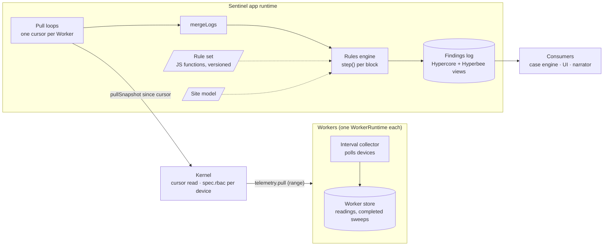
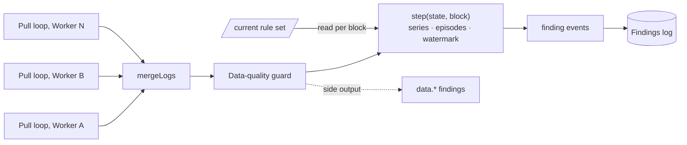
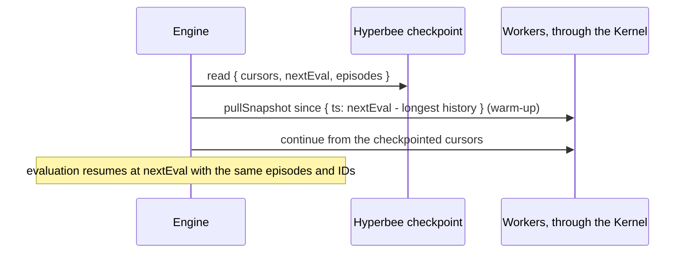
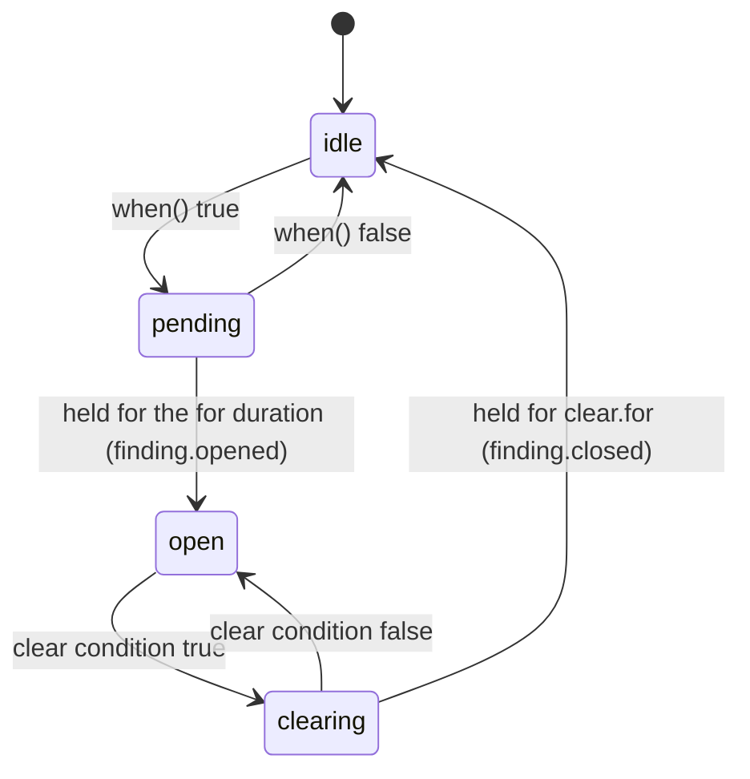

# Sentinel detector engine and findings (HLD)

> **Version:** 0.6.0  |  **Date:** 2026-11-10  |  **Status:** Draft

## 1. Why

Sentinel watches a mining site and finds faults early. This HLD covers the part that turns telemetry
into findings: how Sentinel reads readings from the Workers, how rules are written and evaluated, and
how findings are saved. Cases, narration and actions consume findings and are out of scope.

Three requirements drive this design:

- **Real time, low noise.** Every new reading is processed as it lands, across Workers and devices;
  one fault produces one finding, not a stream of alerts
- **Customizable rules.** Each site tunes limits and adds fault profiles without touching the engine
- **Provable.** Every finding can be replayed and every rule change measured before it goes live

The design takes its processing model from stream processors such as Apache Flink reading from Kafka:
ordered per-source streams, keyed state, event-time windows and rules delivered to a running job.

### 1.1 Principles

1. **Findings come only from deterministic code.** Consumers such as a case engine or a narrator
   read findings; they never create or change them.
2. **A rule is a pure function.** It declares its inputs and returns true or false from a frozen view
   of one key's data. The engine owns time, state and episodes.
3. **Detection is deterministic and replayable.** The same range of readings always yields the same
   findings, so a rule change can be backtested with an exact verdict.

## 2. Architecture

The engine runs inside the Sentinel app, `io.tether.sentinel`, a standard MDK app run by
`@tetherto/mdk-app-runtime` in its own process with its own service account.



## 3. Dataflow
<!-- 
### 3.1 Sources: pulling from the Workers

Each Worker's WorkerRuntime polls its devices and stores every reading, as in Approach B of the
[kernel telemetry snapshots HLD](../hld-kernel-telemetry-snapshots.md). Sentinel pulls: on a short
interval, it asks the Kernel for everything each Worker has stored since its last read. The Kernel
checks `spec.rbac` per device on every read and reaches the Workers on the connections it already
owns, so Workers still admit only the Kernel.

Each Worker's store needs two things for this:

- **Readings with a `seq`.** `deviceId`, `ts` (poll time), `seq`, `metrics`, `errors` and
  `reachable`; `seq` orders readings that share a `ts`, so a cursor is exact
- **Completed sweeps.** One record per sweep, stored even when no device answers. It tells a reader
  the Worker has stored everything up to `ts`, moves the watermark on, and lets absence rules fire
  on silence

The read extends `pullSnapshot` with a cursor and a completeness bound. A page never returns half a
sweep: readings stop at `upTo`, the last completed sweep.

```js
const res = await mdkClient.pullSnapshot({ workers: ['wm-1'], since: cursor, raw: true, limit: 5000 })
// res.workers['wm-1'] → { readings: [...], upTo: 1793923210000, cursor: { ts, seq }, more: false }
```

One pull loop per Worker turns each page into the blocks the engine consumes: a reading block per
reading, then a sweep marker at `upTo`.

```js
async function * pullWorker (mdkClient, workerId, { cursor, everyMs }) {
  for (;;) {
    const res = await mdkClient.pullSnapshot({ workers: [workerId], since: cursor, raw: true, limit: 5000 })
    const page = res.workers[workerId]
    for (const r of page.readings) yield { type: 'reading', worker: workerId, ...r }
    if (page.upTo !== null) yield { type: 'sweep', worker: workerId, ts: page.upTo }
    cursor = page.cursor
    if (!page.more) await sleep(everyMs)
  }
}
```

- **Interval.** `everyMs` defaults to the Worker's poll interval, so a pull usually returns one sweep
  and adds at most one pull interval of latency on top of the poll interval
- **Catch-up.** After an outage, pages with `more` are read back to back until the loop is current.
  `since: { ts }` starts a read at a time, for backtests and warm-up
- **Isolation.** A failed pull is retried with backoff from the same cursor, so it never skips
  readings; a slow or dead Worker only delays its own loop (§3.3)
- **Retention.** Each Worker must keep raw readings for at least the longest `history` any rule
  declares, plus the longest outage to recover from (§5.2) -->

### 3.2 Pipeline

One loop over the merged pull loops, and one pure reducer that holds every piece of event-time state.
It has no dependencies.


<!-- 
```js
const sources = site.workers.map((w) => pullWorker(mdkClient, w, { cursor: checkpoint.cursors[w], everyMs: pollMs[w] }))

for await (const event of runEngine(mergeLogs(sources), { rules: () => ruleSet.current, site, state })) {
  findingsLog.append(event)
  bus.emit('finding', event)
}
```

```js
async function * runEngine (blocks, { rules, site, state = initialState() }) {
  for await (const block of blocks) {
    yield * step(state, block, rules(), site)
  }
}
``` -->

1. **Sources.** One pull loop per Worker (§3.1), each an async iterable of readings and sweep markers.
2. **Merge.** `mergeLogs` yields blocks from every pull loop as they arrive, with at most one block
   read ahead per loop. It does not order them: `step` is correct for any interleaving (§3.3).
3. **Data-quality guard.** Stale, missing or physically impossible readings are tagged and sent to a
   side output as `data.*` findings. They never reach the rules.
4. **Reducer.** `step` records readings into per-minute buckets, advances the watermark on sweep
   markers, evaluates every rule for every key at each `evalEvery` boundary the watermark passes,
   and returns the finding events it produced.
5. **Rule set.** `rules` is a function read on every block, so a swapped set applies from the next
   block, with no restart.
6. **Sink.** Finding events are appended to the findings log (§8.3) and emitted to consumers.

**Backpressure comes from the loop.** `for await` asks a pull loop for its next block only after the
previous one has been processed, so a slow engine slows the pulls instead of filling memory.
Backtests use the same reducer without the loop: `replay(blocks, { rules, site })`.
<!-- 
### 3.3 Event time and watermarks

- **Per Worker.** A Worker's watermark is the `upTo` of its latest read: the last sweep it had fully
  stored
- **Global.** Minute M is evaluated once every Worker's watermark has passed M. Buckets that end
  after M are invisible to that evaluation, so a Worker ahead of the others cannot leak future
  readings into it. This is why the merge needs no ordering: only the order within each Worker
  matters
- **Scoped.** The target is a watermark per rule over only the Workers its inputs select, so a rule
  on 10 s miners does not wait for a 60 s Worker it never reads. The proof of concept uses one
  global watermark
- **Idleness.** A Worker whose `upTo` stops advancing, or whose pulls keep failing, for
  `idleTimeoutMs` of processing time drops out of the watermark, so one dead Worker does not stall
  every rule. Its devices then produce `comms.*` findings. Idleness is live-only; replays and
  backtests run with it off

Durations in rules are written in time (`for: '30s'`) rather than samples, because a sample means 10 s
on one Worker and 60 s on another.

### 3.4 State, checkpoints and idempotency

The reducer's state is one plain object: per-minute series buckets, finding episodes, per-Worker
watermarks and the next evaluation time. The pull loops add one cursor per Worker.

| Checkpoint style     | Holds                                             | Size in the proof of concept | Restart                                                              |
| -------------------- | ------------------------------------------------- | ---------------------------- | -------------------------------------------------------------------- |
| Full state           | Everything, plus the cursors                      | 114 KB (13 devices, 4 h)     | Resume from the cursors                                              |
| Episodes and cursors | Episodes, next evaluation time, cursor per Worker | 853 B                        | Re-read the longest declared `history` from each Worker, then resume |

Phase 1 uses **episodes and cursors**, written to Hyperbee every 30 s: it stays small as the fleet
grows, and window state is cheap to rebuild by re-reading (§5.2). Finding IDs are a hash of
`ruleId@version`, the key and the episode start, so a replay or restart cannot create duplicates.

### 3.5 Load

The [telemetry warehouse HLD](../hld-iot-telemetry-warehouse.md) sizes a site at about 500 devices
with 10 metrics every 5 s, about 100 readings per second. The proof of concept replays 14,412 blocks
(4 h of 13 devices) in about 60 ms on one core, so one Node process handles a site with room to
spare. On the Kernel, 10 Workers polling every 10 s is one read per second, each returning one sweep.
Real numbers go in the capacity template once IVHM runs. -->

## 4. Rule model

### 4.1 A rule

A rule is one JavaScript file in the app package. It declares what it reads and how its findings
behave; its logic is one pure function, `when`, that returns true or false.

```js
// rules/anomaly/container-power-and-heat.js
const { rule } = require('@tetherto/sentinel-rules')

module.exports = rule({
  id: 'anomaly.container.power_and_heat',
  version: 1,
  severity: 'P2',
  keyBy: 'container',
  inputs: {
    power: { family: 'miner', model: 'M56S', metric: 'power', history: '1h' },
    temp: { family: 'container', brand: 'antspace', metric: 'outlet_temp', history: '30m' }
  },
  params: { marginPct: 10, deltaC: 2 },
  tunable: { marginPct: [2, 50], deltaC: [1, 10] },
  for: '5m',
  clear: { for: '10m' },
  when: ({ power, temp, params }) =>
    power.some((m) => m.covered('1h') && m.now > m.mean('1h') * (1 + params.marginPct / 100)) &&
    temp.covered('30m') && temp.now > temp.mean('30m') + params.deltaC
})
```

| Field         | Meaning                                                                                 |
| ------------- | --------------------------------------------------------------------------------------- |
| `id`          | Stable code, `domain.signal.condition` for symptoms, `domain.fault` for faults          |
| `version`     | Integer, bumped on every change; findings record `id@version`                           |
| `role`        | `symptom` or `fault`; drives the unexplained view (§8.3). Default `symptom`             |
| `severity`    | `P1` to `P4`                                                                            |
| `keyBy`       | `device`, `container`, `upstream(<medium>)` or `site`; what one evaluation is about     |
| `inputs`      | Named series (`family`, `brand`, `model`, `metric`, `history`) or other rules' findings |
| `params`      | Named values `when` reads                                                               |
| `tunable`     | `[min, max]` per param operators may change                                             |
| `for`         | How long `when` must hold before a finding opens                                        |
| `clear`       | `{ for, when? }`: how long, and optionally what, closes it; default is `!when`          |
| `when`        | `(ctx) => boolean`, pure and synchronous                                                |
| `description` | Plain-language meaning, stored with each finding                                        |

### 4.2 What `when` receives

`ctx` is frozen. It holds one entry per input, plus `params`, `key`, `at` (event time) and, for
topology keys, `node` (`id`, `class`, `fed`, `redundancy`).

**How inputs are shaped.** With `keyBy: 'device'`, a series input is that device's series. With a
topology key, the node's own device (a container's controller, a loop's flow sensor) arrives as one
series, and the devices it contains or feeds arrive as an array, resolved through the site model.
A findings input (`{ findings: ['rule.id', ...] }`) arrives as the array of those rules' open findings
under the key.

**Series helpers.** Every series offers the same small API, computed from per-minute buckets:

| Helper             | Returns                                                                           |
| ------------------ | --------------------------------------------------------------------------------- |
| `now`              | Latest value in the last complete minute, or `undefined` if the device was silent |
| `mean(w)`          | Mean over the window, or `NaN` with no data                                       |
| `min(w)`, `max(w)` | Extremes over the window, or `NaN` with no data                                   |
| `count(w)`         | Readings in the window                                                            |
| `covered(w)`       | Whether the series has data reaching back the whole window                        |

Empty windows return `NaN` and silence returns `undefined`, so every comparison against them is
false: a rule cannot fire on missing data by accident. `covered(w)` keeps a rule quiet until it has
enough history. A window longer than the input's declared `history` is a rule error, not a silent
short window.

### 4.3 Examples

The proof of concept runs the first three against a simulated site with injected faults. The fourth
shows composition through findings and a topology key; it is designed, not yet in the proof of
concept.

```js
// rules/performance/hashrate-below-floor.js: below 5 TH/s for over an hour, per miner
module.exports = rule({
  id: 'performance.hashrate.below_floor',
  version: 1,
  severity: 'P2',
  keyBy: 'device',
  inputs: { hr: { family: 'miner', metric: 'hashrate_avg', history: '1h' } },
  params: { floor: 5 },
  tunable: { floor: [1, 50] },
  clear: { for: '5m' },
  when: ({ hr, params }) => hr.covered('1h') && hr.max('1h') < params.floor
})
```

```js
// rules/performance/container-hashrate-down.js: even the best miner in the container is below 5 TH/s
module.exports = rule({
  id: 'performance.container.hashrate_down',
  version: 1,
  severity: 'P1',
  keyBy: 'container',
  inputs: { hr: { family: 'miner', metric: 'hashrate_avg', history: '1h' } },
  params: { floor: 5 },
  clear: { for: '5m' },
  when: ({ hr, params }) => hr.length > 0 && hr.every((m) => m.covered('1h') && m.max('1h') < params.floor)
})
```

```js
// rules/faults/cooling-flow-restricted.js: hot miners on one loop, the rest of the site normal
module.exports = rule({
  id: 'cooling.flow_restricted',
  version: 3,
  role: 'fault',
  severity: 'P2',
  keyBy: 'upstream(feeds.coolant)',
  inputs: {
    hot: { findings: ['thermal.chip_temp.above_limit', 'thermal.chip_temp.above_peers'] },
    power: { findings: ['power.psu_input.undervoltage'] }
  },
  params: { minAffected: 3, maxShare: 0.8 },
  when: ({ hot, power, node, params }) => {
    const affected = new Set(hot.map((f) => f.deviceId)).size
    return power.length === 0 && affected >= params.minAffected && affected / node.fed < params.maxShare
  }
})
```

Rules that read findings are evaluated after the rules they read, in the same evaluation step, in
dependency order. A cycle is a load error.

### 4.4 Validation at load

A rule is admitted only when all of these hold:

1. Its definition passes `rule()`: required fields, a known `keyBy`, `params` within `tunable`.
2. Every series input's `metric` exists, with a numeric type, in the contract of at least one Worker
   its selector matches, read from the Kernel's published capabilities.
3. Every findings input names an admitted rule, and the dependency graph has no cycle.
4. A dry run against fixture series returns a boolean for every key without throwing.

A rule that fails stays out of the rule set; the engine keeps running the previous version and
reports the error.
                        |

## 5. Engine runtime

### 5.1 Pieces

| Piece                                       | Job                                                                                |
| ------------------------------------------- | ---------------------------------------------------------------------------------- |
| `step(state, block, rules, site)`           | Applies one block to the state and returns the finding events it produced          |
| `runEngine(blocks, { rules, site, state })` | Async generator: `for await` over blocks, `yield*` the events of each `step`       |
| `pullWorker(mdkClient, workerId, opts)`     | Async generator: pulls since the cursor, yields readings and a sweep marker (§3.1) |
| `mergeLogs(sources)`                        | Merges async iterables as blocks arrive, at most one block read ahead per source   |
| `replay(blocks, { rules, site, state })`    | Synchronous form over an array, for backtests and tests                            |
| Rule-set function                           | `() => ruleSet.current`, read on every block; a swap applies from the next block   |

**Errors.** A rule that throws, times out or reads past its declared history is caught per rule and
key inside `step` and reported as a `rule.error` event; the loop runs on. A failed pull is retried
inside its pull loop with backoff from the same cursor, so it never skips readings.

### 5.2 Restart



Warm-up readings only rebuild buckets; evaluations start at the checkpointed `nextEval`, so nothing
is evaluated twice and a finding open before the restart keeps its ID. Re-reading one hour at 100
readings per second is about 360,000 readings, a few seconds of engine time, plus the paged reads.

## 6. Rule lifecycle

### 6.2 Who changes what

| Change                            | Who      | How                                                                                         |
| --------------------------------- | -------- | ------------------------------------------------------------------------------------------- |
| New rule or logic change          | Engineer | Pull request on the app package, with unit tests and a backtest report                      |
| `tunable` parameter within bounds | Operator | UI or route, through `tune()`; written to the findings log and swapped into the current set |
| Disable a rule on one site        | Operator | Override in `mdk.yaml` under the app's `config`                                             |

### 6.3 Hot reload

A new rule set is validated in full, then swapped in as the current set; the next block uses it.
Episodes carry over for a rule whose `id` and `version` are unchanged, including when only `params`
change. A new `version` starts with fresh episodes; its inputs are already in the buckets if another
rule declared them, and otherwise fill in as data arrives, with `covered()` keeping the rule quiet.

## 8. Findings

### 8.1 The finding record

| Field         | Meaning                                                                  |
| ------------- | ------------------------------------------------------------------------ |
| `id`          | Hash of `rule@version`, `key` and `firstSeen`; the same on every replay  |
| `rule`        | `ruleId@version`                                                         |
| `params`      | The parameter values the rule ran with                                   |
| `key`         | What the finding is about: a device, a container or an upstream node     |
| `severity`, `role`, `status` | From the rule and its lifecycle status (§6.1)             |
| `firstSeen`   | When `when` first held                                                   |
| `openedAt`, `closedAt` | When the `for` and `clear.for` durations were met               |
| `readRef`     | The Worker cursor range the episode was read from                        |
| `description` | From the rule                                                            |

### 8.2 Episodes and events

A finding is one episode per rule and key:



| Event            | Written when                                   |
| ---------------- | ---------------------------------------------- |
| `finding.opened` | An episode has held for its `for` duration     |
| `finding.closed` | Its clear condition has held for `clear.for`   |
| `rule.error`     | A rule throws, times out or reads past its history |
| `data.*`         | The data-quality guard or reconciliation flags a problem |

### 8.3 How findings are saved

| Store         | Engine    | Holds                                                                    | Retention            |
| ------------- | --------- | ------------------------------------------------------------------------ | -------------------- |
| Findings log  | Hypercore | Every event of §8.2, evidence, parameter overrides and status changes, in order | Kept         |
| Views         | Hyperbee  | Open findings by key and by rule, per-rule counts, the unexplained view  | Rebuilt from the log |
| Checkpoint    | Hyperbee  | Cursor per Worker, next evaluation time, episodes                        | Latest only          |

All three live under the app's `config.dataDir`.

- **Append-only, idempotent.** Events are appended in the order the engine emits them. A replay or
  restart produces the same IDs, so an event already in the log is skipped
- **Evidence.** When a finding opens, and again when it closes, the readings behind it (from before
  `firstSeen` to the event) are read through the Kernel and copied into the log. A finding therefore
  stays replayable after the Workers' raw retention has cleared those readings
- **Unexplained view.** An open `symptom` finding that no open `fault` finding reads is listed in the
  unexplained view. Its size measures how much the fault rules cover
- **Consumers.** A case engine, the UI or a narrator subscribe to new events or read the views. They
  never write findings, only their own records, such as cases and labels

## 9. Evaluation

### 9.1 Tests and backtests

| Level    | What runs                                                     | Gate                                                                     |
| -------- | ------------------------------------------------------------- | ------------------------------------------------------------------------ |
| Unit     | Each rule's `when` against fixture series, without the engine | Ordinary assertions                                                      |
| Engine   | The pipeline over a recorded or simulated range of readings   | Same findings for any arrival order and after a checkpoint restart       |
| Backtest | A new rule version over a real time range or saved evidence   | Exact: the same range and rule set produce the same findings; every changed finding is named in the pull request |

A backtest reads its time range with the same cursor read, starting from `since: { ts }`, and runs
`replay` over it. Its report gives, per rule version, the findings opened, their agreement with
labels, and the difference from the previous version.


### 9.3 Proof of concept results

[`poc-vanilla/`](./poc-vanilla/) runs the engine over 4 h of a simulated two-container site, two
Workers (miners at 10 s, containers at 30 s), with three injected faults.

| Fault injected                                            | Finding                                         | Opened              |
| --------------------------------------------------------- | ----------------------------------------------- | ------------------- |
| One `c01` miner draws 15% more power and `c01` heats 4 °C | `anomaly.container.power_and_heat` on `c01`     | 02:12, closed 02:30 |
| `m-c02-3` hashes at about 2 TH/s from 01:00               | `performance.hashrate.below_floor` on `m-c02-3` | 02:00               |
| Every `c02` miner hashes at about 1 TH/s from 02:45       | `performance.container.hashrate_down` on `c02`  | 03:45               |

The power-and-heat finding closes at 02:30 while the fault lasts until 02:40: a rule that compares a
device with its own recent mean slowly accepts a sustained fault as the new normal. Rules of that
shape pair the mean with an absolute limit, or compare against a baseline frozen while their finding
is open.

All 12 tests pass in `poc-vanilla/`, including identical findings from merged live sources and an
in-order replay, for interleaved and Worker-by-Worker arrival, and after a resume from a full-state
and from an 853 B episodes checkpoint. They also cover a rule set swapped mid-stream and the one-block
read-ahead bound of `mergeLogs`.

## 10. Dependencies on MDK core

| Need                             | Status today                                                             | Ask                                                                                     |
| -------------------------------- | ------------------------------------------------------------------------ | --------------------------------------------------------------------------------------- |
| Runtime-side polling and store   | Designed as Approach B in the kernel telemetry snapshots HLD             | Ship the WorkerRuntime interval collector and its store                                 |
| Raw history on `WorkerRuntimeV2` | Not available                                                            | Store each reading with a `seq`, and each completed sweep, under raw retention (§3.1) |
| Cursor read                      | `pullSnapshot` designed with `from` and `granularity`; not in the Client | Add `since`, `raw`, `limit`, and `upTo`, `cursor` and `more` per Worker, checked by `spec.rbac` per device (§3.1) |

Until the cursor read ships, the engine runs against simulated sources, as in the proof of concept;
only the pull loops change when it does.
<!-- 
## 11. Open questions

- Scoped watermarks per rule: worth the extra state, or is one global watermark enough at IVHM's
  poll intervals
- `node:vm` with a per-call timeout, or the engine in a `worker_thread` with a watchdog, for
  isolating a slow rule
- Pull interval per Worker: its poll interval, or shorter for rules that need fresher readings
- Cursor format: how a Worker assigns `seq` so that it stays unique across Worker restarts
- Kernel load when several apps pull the same Workers, and whether the aggregate cache of the kernel
  telemetry snapshots HLD should also serve raw reads
- Promotion criteria per severity: minimum labeled findings and precision target
- Whether the shared infrastructure comes from the YAML overlay or from the
  [site topology graph](./hld-site-topology-graph.md); the engine only needs the lookups of §7
- Raw retention on Worker boxes, once disk growth is measured on IVHM -->


## 13. Alternatives considered
> Ignore this section, as it talks about discarded ideas which may be useful later. 

### 13.1 Push-based telemetry: a per-Worker log

v0.4.0 chose push: each Worker appended every sweep to its own Hypercore, and Sentinel replicated
those logs directly, read-only, with a separate key. The Kernel only brokered access: it checked
`spec.rbac`, told each Worker to admit Sentinel's key for a lease, and revoked it when needed.

It was dropped because cursor pull keeps nearly all of its benefits at a fraction of the cost:

- **More MDK core work.** A Hypercore log, its retention, Kernel `stream.open` and `stream.renew`,
  Worker `stream.grant` and `stream.revoke`, a replication firewall and replication keys
- **A second inbound path into Workers.** Today they admit only the Kernel's key
- **Coarser permissions.** One log holds all of a Worker's devices, so access is all or nothing
- **Load on Workers.** Every app replicates every log from the device-polling processes
- **Little gain.** It saves at most one pull interval, small next to the poll interval, and keeps
  detecting through a Kernel outage

It comes back only if rules need fresher readings than a pull interval allows, if enough apps make
pulling a load on the Kernel, or if detection must survive Kernel outages. Only the sources would
change.

### 13.2 RxJS as the engine's composition layer

The first proof of concept, [`poc/`](./poc/), built the engine on RxJS: `merge` for the sources,
`scan(step)` for state, `withLatestFrom(rules$)` for the rule set and `share` for fan-out. It produced
the same findings, and was dropped because RxJS did no work the engine needed:

- **The correctness is in `step`.** The watermark, the bucket views, the episodes and the IDs are
  plain code in the reducer
- **Its fixes solved problems it brought.** An `EventTimeScheduler` and an `orderByEventTime` merge
  were needed only so RxJS time operators would run on event time, and the engine uses none
- **Native backpressure.** `for await` pulls; RxJS pushes
- **No dependency.** `rxjs` and `tslib` add 11 MB for 238 lines of engine against 188 without

RxJS could still fit outside the engine, for wall-clock work such as retrying pulls or throttling UI
updates.

### 13.3 Other options

| Option                                           | Decision                | Reason                                                                               |
| ------------------------------------------------ | ----------------------- | ------------------------------------------------------------------------------------ |
| Snapshot pull                                    | Rejected                | Loses readings between pulls and leaves gaps on restart                              |
| Kernel relay                                     | Not needed              | Saves one pull interval, but puts the Kernel on the hot path with no replay          |
| Shared Hyperswarm topic                          | Rejected                | Bypasses the Kernel's allowlist and RBAC, is not pub/sub, cannot replay              |
| YAML rule kinds with CEL conditions              | Deferred                | Safe for operator-written rules, but needs extra kinds for grouping and multi-input logic; a possible front end that compiles to the same `when` |
| Streaming SQL (Flink SQL, ksqlDB, eKuiper)       | Rejected for live rules | Hysteresis, absence and topology grouping are awkward in SQL, and there is no embeddable streaming SQL engine for Node. SQL stays for offline analysis with DuckDB |
| Flink or Kinesis cluster on site                 | Rejected                | Offline site box, JVM cluster to operate, load far below what it is for              |
| IxJS, Most.js, Bacon.js                          | Not chosen              | The same reasons as RxJS                                                             |
| JSONLogic                                        | Rejected                | No type checking, hard to read past simple comparisons                               |
