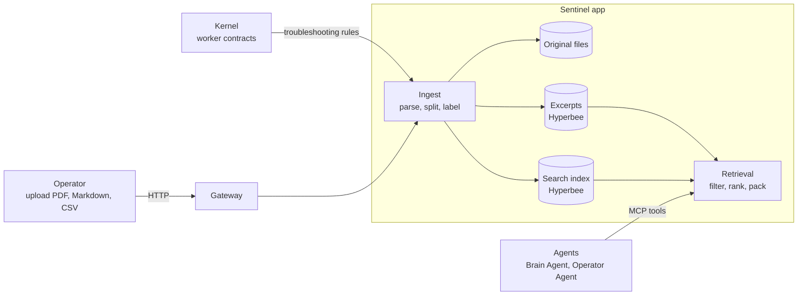
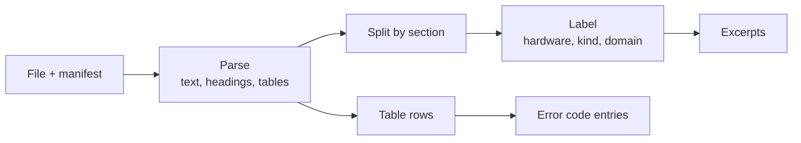

# Sentinel Hardware Docs Library (HLD)

> **Version:** 0.1.0  |  **Date:** 2026-11-24  |  **Status:** Draft
>
> Companion to the [Brain Agent Harness HLD](./hld-harness.md), which is its first consumer.
> Requirement IDs refer to [requirements.md](./requirements.md).

## 1. Why

A finding says that a miner runs hot. The vendor manual says what that model's temperature limit
is, what its error codes mean and how to check its coolant connection. Today that knowledge sits in
PDFs on someone's laptop, so an agent can't use it and a report can't cite it.

This HLD adds a hardware docs library to the site box. Operators upload manuals and runbooks; the
app splits them into small, labelled excerpts and indexes them; agents fetch the excerpts that fit
a device and a problem, through fixed tools.

**Ground rules**

1. **Everything stays on the site box.** Files, excerpts and the index live under the app's
   `config.dataDir`, with no external database or service (R-7, A-3).
2. **Every excerpt is tied to hardware.** An excerpt names the brand and models it applies to, so
   a search for one miner model never returns another model's procedure.
3. **Every excerpt can be cited.** It carries its document, version, section and page, so a report
   can show where an instruction came from.
4. **Agents read published docs only**, through fixed tools, and never edit them.
5. **Doc text is data.** It is never treated as instructions to the agent.

## 2. Architecture



| Part      | Job                                                                             |
| --------- | ------------------------------------------------------------------------------- |
| Ingest    | Turns an uploaded file or a contract into labelled excerpts (§4)                |
| Stores    | Keep the original files, the excerpts and the search index (§5)                 |
| Retrieval | Finds the excerpts for a device and a problem, within a token budget (§6)       |

## 3. Sources

| Source                    | Format                 | Comes from                                   | Examples                                             |
| ------------------------- | ---------------------- | -------------------------------------------- | ---------------------------------------------------- |
| Vendor manuals            | PDF with a text layer  | Operator upload                              | Miner service manual, cooling unit installation guide |
| Error code tables         | CSV, or tables in a PDF | Operator upload                             | Vendor error code list with meaning and action       |
| Site runbooks             | Markdown               | Operator upload                              | "Restarting a coolant pump", escalation contacts     |
| Contract troubleshooting  | JSON                   | Each Worker's `mdk-contract.json`, read from the Kernel | The `troubleshooting` rules of a device type |

Contract troubleshooting needs no upload. The app reads it from the Kernel's published capabilities
on start and whenever a Worker's contract changes, and stores each rule as an excerpt. The library
then has useful content on a site that has uploaded nothing.

## 4. Ingestion

### 4.1 Upload

An operator uploads a file with a small manifest. The manifest is what ties the document to
hardware.

```json
{
  "title": "M56S Service Manual",
  "docVersion": "2.3",
  "kind": "manual",
  "brand": "whatsminer",
  "models": ["whatsminer-m56s", "whatsminer-m56s-plus"],
  "family": "miner",
  "language": "en"
}
```

| Field        | Meaning                                                                               |
| ------------ | ------------------------------------------------------------------------------------- |
| `title`      | Shown in citations                                                                    |
| `docVersion` | The vendor's or the site's own version label                                          |
| `kind`       | `manual`, `error_codes` or `runbook`                                                  |
| `brand`, `models`, `family` | Must match values in the Kernel's device metadata; a runbook may use `models: ["*"]` for the whole family |
| `language`   | The document's language                                                               |

The upload follows the same two steps as the topology CSV import:

1. **Dry run.** `POST /docs?dryRun=true` parses the file and returns a preview: the sections
   found, the number of excerpts, the error codes detected and any problems, such as a page with no
   text. Nothing is written.
2. **Publish.** The operator reviews the preview and re-submits without `dryRun`. The document and
   its excerpts are written in one transaction and become searchable.

A file is rejected whole if its manifest names a brand or model the Kernel doesn't know, if its
type or size is outside the limits (§8), or if no text can be extracted.

### 4.2 Parse and split



1. **Parse.** PDF pages become text with their headings and tables; Markdown is read as is; CSV
   rows are read with their header.
2. **Split by section.** One excerpt per lowest-level section, so a procedure stays whole. A
   section longer than 400 tokens is split at paragraph or step boundaries, and each part repeats
   the heading path.
3. **Label.** Each excerpt gets the manifest's hardware fields, plus:
   - a `kind`: `procedure`, `spec`, `troubleshooting` or `reference`
   - a `domain`: `thermal`, `cooling`, `power`, `performance`, `network` or `firmware`. This is the
     first part of a detector rule ID, so a finding's rule maps straight to a domain

   Both are set by keyword rules on the heading path and text, with no model call. The dry run
   shows them, and the operator can correct them before publishing.
4. **Error codes.** A row of an error code table becomes one entry: the code, its meaning and the
   recommended action. These are stored separately, for exact lookup (§6.2).

Ingestion runs in code only. No language model is used, so the same file always gives the same
excerpts.

## 5. Storage

All stores live under the app's `config.dataDir`, next to the findings log.

| Store          | Engine              | Holds                                                           | Retention                 |
| -------------- | ------------------- | --------------------------------------------------------------- | ------------------------- |
| Original files | Files on disk       | Each uploaded file, named by its content hash                   | Kept, all versions        |
| Documents      | Hyperbee            | One record per document version: manifest, file hash, status    | Kept                      |
| Excerpts       | Hyperbee            | One record per excerpt                                          | Kept while the version is |
| Error codes    | Hyperbee            | One record per brand, model and code                            | Current version only      |
| Search index   | Hyperbee            | Word index over excerpts, and the by-model and by-domain lists  | Rebuilt from the excerpts |
| Change log     | Hypercore           | Every publish, replace and removal, with the user and time      | Kept                      |

**Document record**

| Field        | Meaning                                                            |
| ------------ | ------------------------------------------------------------------ |
| `docId`      | Stable ID, derived from `brand`, `kind` and `title`                |
| `revision`   | Hash of the file content and manifest; identifies this version     |
| `manifest`   | As uploaded (§4.1)                                                 |
| `status`     | `current`, `replaced` or `removed`                                 |
| `source`     | `upload` or `contract`                                             |
| `publishedBy`, `publishedAt` | Who published it and when                          |

**Excerpt record**

| Field         | Meaning                                                              |
| ------------- | -------------------------------------------------------------------- |
| `id`          | Hash of `docId`, `revision` and the excerpt's position               |
| `docId`, `revision` | The document version it belongs to                             |
| `brand`, `models`, `family` | From the manifest                                      |
| `kind`, `domain` | From labelling (§4.2)                                             |
| `headingPath` | For example `Troubleshooting > Overheating > Check coolant flow`     |
| `page`        | Page in the original file, where there is one                        |
| `text`        | The excerpt, up to 400 tokens                                        |
| `prev`, `next` | Neighbouring excerpt IDs, so a reader can fetch the rest of a long procedure |

**Error code record**, keyed by `brand|model|code`: `meaning`, `action`, `docId`, `revision`,
`page`.

**Size.** A service manual of 200 pages gives roughly 600 excerpts and under 2 MB of records and
index. A site with a few dozen documents stays well under 1 GB, originals included.

## 6. Retrieval

### 6.1 Search

A search goes through four steps:

1. **Resolve the hardware.** A `deviceId` is looked up in the Kernel's device list to get its
   brand, model and family. The caller never has to know model names.
2. **Filter.** Keep only excerpts of `current` documents that apply to that model, or to its whole
   family. Narrow by `domain` and `kind` when the caller gives them.
3. **Rank.** Score the remaining excerpts against the query text by keyword relevance (BM25) over
   the heading path and text. Headings weigh more than body text.
4. **Pack.** Return the top results, each cut to its token limit, with its citation. Stop at the
   token budget.

Filtering before ranking is what keeps results correct: the ranking only ever sees excerpts for
the right hardware. Keyword ranking fits this content, where queries carry exact terms such as
metric names, part names and codes. Search by meaning, with a local embedding model, is an open
question (§10).

A result looks like this:

```text
[1] M56S Service Manual v2.3 · Troubleshooting > Overheating > Check coolant flow · p. 84
    applies to: whatsminer-m56s · kind: procedure · domain: cooling
    1. Confirm the inlet valve is fully open. 2. Compare inlet and outlet water
    temperature; a difference above 12 °C at full load points to restricted flow. ...
```

### 6.2 Error code lookup

Readings carry the device's `errors`. A code is looked up by exact key, `brand|model|code`, with no
ranking. A code that isn't in the library returns "unknown code", never a near match.

### 6.3 MCP tools

Each tool is a context route of the app, exposed over MCP in the same way as the topology tools.

| Tool            | Input                                                               | Returns                                         |
| --------------- | ------------------------------------------------------------------- | ----------------------------------------------- |
| `docs_search`   | `query`, `deviceId` or `model`, `domain?`, `kind?`, `budgetTokens?` | Ranked excerpts with citations                  |
| `docs_code`     | `deviceId` or `model`, `code`                                       | Meaning and action of one error code            |
| `docs_excerpt`  | `id`, `neighbours?`                                                 | One excerpt, optionally with the ones around it |
| `docs_coverage` | `deviceId?` or `model?`                                             | Which documents exist for that hardware         |

- **Limits:** at most 5 excerpts per search; `budgetTokens` defaults to 1,500, max 3,000.
- **Freshness:** every result carries the document `revision`.
- **No match:** a search with no results says so, and says whether the model has any documents at
  all, so the agent can tell "nothing relevant" from "nothing uploaded".

## 7. Lifecycle

| Change                         | What happens                                                                                   |
| ------------------------------ | ---------------------------------------------------------------------------------------------- |
| New version of a document      | Published under the same `docId`. The new version becomes `current`, the old one `replaced`. Search returns only `current` |
| Removal                        | The document becomes `removed` and leaves the search. Its file and records are kept            |
| Worker contract changes        | The contract's troubleshooting excerpts are rebuilt as a new version of that contract's document |
| New device model on site       | `docs_coverage` shows it has no documents; the UI lists models without coverage                |

Old versions are kept because reports cite them: a report written last month still links to the
exact text it used.

**Authoring routes** (under `/apps/sentinel/docs/`):

| Route                  | Purpose                                              |
| ---------------------- | ---------------------------------------------------- |
| `POST /`               | Upload a file and manifest; `dryRun` as a query param |
| `GET /`                | List documents, with status and coverage             |
| `GET /:docId`          | One document, its versions and excerpt count         |
| `PATCH /:docId/excerpts/:id` | Correct an excerpt's `kind` or `domain`        |
| `DELETE /:docId`       | Remove a document                                    |
| `GET /coverage`        | Device models on site with no documents              |

## 8. Access and safety

- **Upload is a privileged action.** Only roles with write access to the docs routes can publish or
  remove; every change is logged with the user (O-4).
- **Agents are read-only.** Agent roles get the four tools of §6.3 and nothing else.
- **File limits.** PDF, Markdown and CSV only, up to 50 MB per file. Files are parsed as data;
  nothing in them is executed.
- **Doc text is data.** Excerpts reach the agent inside a marked block and are escaped. A sentence
  in a manual that reads like an instruction to the agent is not followed.
- **Not secret by device.** Documents describe models, not individual devices, so results are not
  filtered by the caller's device `resourceNames`.

## 9. Consumers

| Consumer            | Uses the library for                                                             |
| ------------------- | -------------------------------------------------------------------------------- |
| Brain Agent Harness | Limits, error code meanings and check procedures for the devices in a finding; see the [harness HLD](./hld-harness.md) §5.2 |
| Operator Agent      | Operator questions such as "what does error 0x21 mean on wm041?"                 |
| Console UI          | The citation link in a report opens the excerpt, and the original page           |

## 10. Open questions

- **Scanned PDFs.** A PDF without a text layer needs OCR. Is that in scope, or do we reject such
  files and ask for a text version?
- **Search by meaning.** Keyword ranking misses a query worded differently from the manual. A local
  embedding model would fix that, at the cost of a second model on the site box. Worth adding only
  if evaluation shows keyword search missing too often
- **Languages.** Manuals may be in Chinese or Portuguese while reports are in English. Do we need
  translation at ingest?
- **Table extraction.** How reliably error code tables can be read out of vendor PDFs, compared
  with asking for a CSV
- **Where it lives.** This HLD puts the library in the Sentinel app. If the Operator Agent needs it
  on sites without Sentinel, it should be its own app
- **Confirmed operator notes** (N-5) could become a fifth source; not designed here
