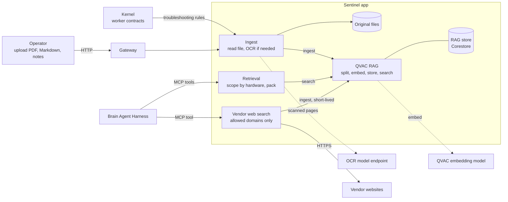
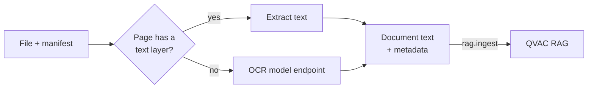

# Sentinel Hardware Docs Library (HLD)

> **Version:** 0.4.0  |  **Date:** 2026-11-25  |  **Status:** Draft
>
> Companion to the [Brain Agent Harness HLD](./hld-harness.md), which is its first consumer.
> Requirement IDs refer to [requirements.md](./requirements.md).

## 1. Why

A finding says that a miner runs hot. The vendor manual says what that model's temperature limit
is, what its error codes mean and how to check its coolant connection. Today that knowledge sits in
PDFs on someone's laptop, so an agent can't use it and a report can't cite it.

This HLD adds a hardware docs library to the Sentinel app. Operators upload manuals and playbooks;
the app turns them into text and hands them to QVAC RAG (`@qvac/rag`), which splits, embeds, stores
and searches them. The Brain Agent Harness fetches the excerpts that fit a device and a problem,
through fixed tools, to create its reports. When the library has no answer, it can search the
vendor's own website (§6.2).

**Ground rules**

1. **QVAC RAG does ingest and search.** The app does not keep its own excerpt store or search
  index. It owns only what QVAC RAG doesn't do: reading files, tying documents to hardware, and
   the tools agents call.
2. **Everything is stored on the site box**, under the app's `config.dataDir`, with no external
  database (R-7). The only outbound traffic is vendor web search, which is off by default (§6.2).
3. **Every document is tied to hardware.** A document names the brand and models it applies to, so
  a search for one miner model never returns another model's procedure.
4. **Every excerpt can be cited**, by document, version and page.
5. **Agents read published docs only**, through fixed tools, and never edit them.
6. **Doc text is data.** It is never treated as instructions to the agent.


## 2. Architecture




| Part              | Job                                                                                           |
| ----------------- | --------------------------------------------------------------------------------------------- |
| Ingest            | Turns an uploaded file, a note or a contract into text with a manifest (§4)                   |
| QVAC RAG          | Splits the text, embeds it, stores it and answers searches (§5)                               |
| Retrieval         | Limits a search to the documents of one device model and packs the results (§6.1)             |
| Vendor web search | Fetches troubleshooting pages from the vendor's website when the library has no answer (§6.2) |


## 3. Sources


| Source                       | Format                                   | Comes from                                                 | Examples                                                                                    |
| ---------------------------- | ---------------------------------------- | ---------------------------------------------------------- | ------------------------------------------------------------------------------------------- |
| Vendor manuals               | PDF                                      | Operator upload                                            | Miner service manual, cooling unit installation guide                                       |
| Playbooks and operator notes | Markdown, or a note typed in the console | Operator upload; notes an operator confirms                | "Restarting a coolant pump"; "on c2, a hot row usually means the inlet strainer is clogged" |
| Contract troubleshooting     | JSON                                     | Each Worker's `mdk-contract.json`, read from the Kernel    | The `troubleshooting` rules of a device type                                                |
| Vendor website               | Web pages                                | Fetched on demand from the vendor's allowed domains (§6.2) | A support article on an error code, a firmware known-issues page                            |


- **Contract troubleshooting needs no upload.** The app reads it from the Kernel's published
capabilities on start and whenever a Worker's contract changes. The library then has useful
content on a site that has uploaded nothing.
- **Operator notes are playbook entries.** A note an operator confirms, for example when closing a
report, is stored as a small playbook document for the device models involved (N-5). It is
searched like any other playbook.
- **No error code tables.** Error codes are found as text: in a manual, in contract troubleshooting
rules, or on the vendor's website.
- **English only for now.** Documents in other languages are not accepted. Support for other
languages comes later.


## 4. Ingestion


### 4.1 Upload

An operator uploads a file with a small manifest. The manifest is what ties the document to
hardware.

```json
{
  "title": "M56S Service Manual",
  "docVersion": "2.3",
  "kind": "manual",
  "brand": "whatsminer",
  "models": ["whatsminer-m56s", "whatsminer-m56s-plus"],
  "family": "miner",
  "language": "en"
}
```


| Field                       | Meaning                                                                                                    |
| --------------------------- | ---------------------------------------------------------------------------------------------------------- |
| `title`                     | Shown in citations                                                                                         |
| `docVersion`                | The vendor's or the site's own version label                                                               |
| `kind`                      | `manual` or `playbook`                                                                                     |
| `brand`, `models`, `family` | Must match values in the Kernel's device metadata; a playbook may use `models: ["*"]` for the whole family |
| `language`                  | Must be `en` for now                                                                                       |


The upload follows the same two steps as the topology CSV import:

1. **Dry run.** `POST /docs?dryRun=true` reads the file and returns a preview: the page count, the
  pages that needed OCR, a text sample per page and any problems. Nothing is written.
2. **Publish.** The operator reviews the preview and re-submits without `dryRun`. The text is
  handed to QVAC RAG and becomes searchable when the ingest completes.

A file is rejected whole if its manifest names a brand or model the Kernel doesn't know, if its
language, type or size is outside the limits (§8), or if no text can be read from it.

An operator note skips the dry run: it is short text typed in the console, with the brand and models
taken from the report it was written on.

### 4.2 From file to text

QVAC RAG takes text only, so the app reads the file first.




1. **Read.** Markdown is read as is. For a PDF, each page's text layer is extracted.
2. **OCR scanned pages.** A page with no text layer is rendered to an image and sent to the OCR
  model endpoint (§4.3). The dry run marks such pages, because OCR text can contain errors.
3. **Hand over.** The text and its metadata go to `rag.ingest`. QVAC RAG splits it into chunks of
  256 tokens with a 50-token overlap, embeds each chunk and stores it.


### 4.3 OCR endpoint

Scanned PDFs are in scope. The OCR model is reached through an endpoint set in the app's config.
`mdk-app.yaml` carries the default; a site overrides it in `mdk.yaml`.

```yaml
# mdk-app.yaml
config:
  docs:
    ocr:
      endpoint: http://127.0.0.1:11435/v1   # OpenAI-compatible endpoint of an OCR-capable model
      model: ocr-model
      apiKey: ""                            # only if the endpoint needs one
```

With no OCR endpoint configured, a PDF that has pages without a text layer is rejected, and the
dry run says which pages.

## 5. Storage and indexing


### 5.1 What QVAC RAG does

The app creates one RAG instance at start, on a Corestore it owns:

```js
const { createRag } = require('@qvac/rag')
const Corestore = require('corestore')

const rag = createRag({
  corestore: new Corestore(path.join(dataDir, 'docs/rag-storage')),
  embeddings,                                  // the embedding port, §5.3
  chunking: { chunkSize: 256, chunkOverlap: 50 },
  index: { dir: path.join(dataDir, 'docs/rag-index') }
})
await rag.ready()
```


| Step            | QVAC RAG call                                                     | Notes                                                                                   |
| --------------- | ----------------------------------------------------------------- | --------------------------------------------------------------------------------------- |
| Add or replace  | `rag.ingest({ namespace, documents })`                            | Re-ingesting the same document ID replaces its chunks; unchanged content writes nothing |
| Search          | `rag.search({ scope, query, k, minScore })`                       | Vector search; `scope` limits it to a namespace and a list of document IDs              |
| Read an excerpt | `rag.readDocument({ namespace, documentId, fromOrdinal, limit })` | Returns chunks in order, for reading around a hit                                       |
| List            | `rag.listDocuments({ namespace })`                                | Used for coverage and the document list                                                 |
| Remove          | `rag.deleteDocuments({ namespace, documentIds })`                 | Removes the document and its chunks                                                     |


### 5.2 Namespaces and documents


| Namespace | Holds                                                        | Lifetime                              |
| --------- | ------------------------------------------------------------ | ------------------------------------- |
| `library` | Manuals, playbooks, operator notes, contract troubleshooting | Until replaced or removed             |
| `web`     | Pages fetched by vendor web search (§6.2)                    | Short: deleted after the cache period |


A document in QVAC RAG is `{ id, text, metadata }`:


| Field      | Content                                                                                                                                                                                          |
| ---------- | ------------------------------------------------------------------------------------------------------------------------------------------------------------------------------------------------ |
| `id`       | `docId`, stable per document: derived from `brand`, `kind` and `title`; the URL for a web page                                                                                                   |
| `metadata` | The manifest (§4.1), plus `revision` (hash of file and manifest), `source` (`upload`, `note`, `contract` or `web`), `publishedBy`, `publishedAt`, and `sourceUrl` and `fetchedAt` for a web page |


QVAC RAG returns this metadata with every search hit, together with a citation (title, page, source
URL), so the app keeps no excerpt records of its own.

### 5.3 Embeddings

`@qvac/rag` does not load a model itself. The app gives it an embedding port: two functions,
`embedDocuments` and `embedQuery`, that call a QVAC embedding model. The model is app config, like
the chat model:

```yaml
config:
  docs:
    embeddings:
      model: EMBEDDINGGEMMA_300M_Q8_0   # QVAC model ID
      dimensions: 768
```

- A namespace is tied to one embedding model. Changing the model means creating a new namespace and
ingesting the original files again.
- The embedding model runs on the site box next to the chat model, so it adds to memory use (§10).


### 5.4 Stores

All under the app's `config.dataDir/docs/`.


| Store          | Engine                       | Holds                                                      | Retention                             |
| -------------- | ---------------------------- | ---------------------------------------------------------- | ------------------------------------- |
| Original files | Files on disk                | Each uploaded file, named by its content hash              | Kept, all versions                    |
| RAG store      | Corestore, owned by QVAC RAG | Documents, their metadata, chunks and vectors              | Current version of each document      |
| RAG index      | Files, owned by QVAC RAG     | Index snapshot for fast start                              | Rebuilt from the RAG store if missing |
| Change log     | Hypercore                    | Every publish, replace and removal, with the user and time | Kept                                  |


**Hardware lookup.** At start, and after every publish, the app lists the `library` documents and
builds an in-memory map from device model to document IDs. This map is what limits a search to the
right hardware (§6.1). It is derived data and is never stored.

**Size.** With 256-token chunks, a 200-page manual gives roughly 1,000 chunks. QVAC RAG's own
figures for 100,000 chunks at 768 dimensions are about 300 MiB of memory and a median search of
about 20 ms with its index, or over a second by full scan. A site with a few dozen documents is
well below that.

## 6. Retrieval


### 6.1 Search

A search goes through four steps:

1. **Resolve the hardware.** A `deviceId` is looked up in the Kernel's device list to get its
  brand, model and family. The caller never has to know model names.
2. **Scope.** From the hardware lookup (§5.4), take the IDs of the documents that apply to that
  model or to its whole family.
3. **Search.** Call `rag.search` with the query text and that scope. QVAC RAG embeds the query and
  returns the closest chunks, best first, above a minimum score.
4. **Pack.** Return the top results with their citations, stopping at the token budget.

Scoping before searching is what keeps results correct: QVAC RAG only ever compares the query with
chunks for the right hardware.

Search is by meaning, not by keyword. A query worded differently from the manual still finds the
passage, so the caller describes the problem in plain words: "miner overheating, coolant flow
check" rather than a list of tags.

A result looks like this:

```text
[1] M56S Service Manual v2.3 · p. 84 · score 0.81
    applies to: whatsminer-m56s · kind: manual
    1. Confirm the inlet valve is fully open. 2. Compare inlet and outlet water
    temperature; a difference above 12 °C at full load points to restricted flow. ...
```

**Error codes.** Search by meaning can return a passage about a similar code. When the query
contains an error code, the app keeps only the hits whose text contains that exact code. If none
does, the search returns no result, and the caller can try the vendor's website (§6.2).

### 6.2 Vendor web search

For when the library has no answer: a manual not uploaded yet, or an error code from a new
firmware that no manual lists. The agent calls `docs_web_search(deviceId, query)`.

```yaml
config:
  docs:
    webSearch:
      enabled: true                    # off by default; set per site in mdk.yaml
      cacheMinutes: 60
      vendors:
        whatsminer:
          domains: [support.vendor.example, www.vendor.example]
          searchUrl: "https://support.vendor.example/search?q={query}"
        acme:
          domains: [docs.acme.example]
          pages:                       # for a vendor whose site has no search
            - "https://docs.acme.example/troubleshooting"
```

- **Vendor domains only.** No general web search provider. A brand with neither a `searchUrl` nor
a `pages` list has no web search
- **Outbound query built in code.** It holds the model name and the caller's search terms, such as
an error code or a symptom. Device IDs, the site's name, readings and report text are never sent
- **Fetch.** Up to three result pages from the brand's `searchUrl`, or its `pages` list; at most
four requests per search, 10 s timeout each, and a daily cap per site. Links to other domains are
not followed
- **Ingest and search.** The main text of each page is ingested into the `web` namespace of QVAC
RAG, with its URL as ID and its fetch time as metadata. The caller's query is then searched over
those pages only
- **Result.** Excerpts marked `source: web`, cited by URL and fetch time. The consumer must show
the operator that they come from a website nobody on site has reviewed
- **Short cache.** Pages are deleted after `cacheMinutes` (default 60), since vendor pages change
often. The cache only avoids fetching a page twice in one investigation; a web page never becomes
a library document
- **Library first.** A separate tool, for when `docs_search` finds nothing useful. Web excerpts
are never mixed into `docs_search` results
- **Needs internet.** On a site without a connection, or with web search off or the brand not
configured, the tool returns "web search unavailable" and the caller carries on with what the
library gave. Offline sites may be supported later
- **What leaves the site.** The model name and the search terms go to the vendor's website. This
is the one exception to "nothing leaves the site" (A-3), hence opt-in per site and per brand


### 6.3 MCP tools

Each tool is a context route of the app, exposed over MCP in the same way as the topology tools.


| Tool              | Input                                           | Returns                                                         |
| ----------------- | ----------------------------------------------- | --------------------------------------------------------------- |
| `docs_search`     | `query`, `deviceId` or `model`, `budgetTokens?` | Ranked excerpts with citations                                  |
| `docs_web_search` | `query`, `deviceId` or `model`                  | Excerpts from the vendor's website, marked `source: web` (§6.2) |
| `docs_excerpt`    | `id`, `neighbours?`                             | One excerpt, optionally with the ones before and after it       |
| `docs_coverage`   | `deviceId?` or `model?`                         | Which documents exist for that hardware                         |


- **Limits:** at most 5 excerpts per search; `budgetTokens` defaults to 1,500, max 3,000.
- **Freshness:** every result carries the document `revision`.
- **No match:** a search with no results says so, and says whether the model has any documents at
all, so the agent can tell "nothing relevant" from "nothing uploaded".


## 7. Lifecycle


| Change                    | What happens                                                                                        |
| ------------------------- | --------------------------------------------------------------------------------------------------- |
| New version of a document | Published under the same `docId`. QVAC RAG replaces its chunks; search returns only the new version |
| Removal                   | The document is deleted from QVAC RAG and leaves the search. Its original file is kept              |
| Worker contract changes   | The contract's troubleshooting document is ingested again                                           |
| Operator note confirmed   | Ingested as a new playbook document for the models it concerns                                      |
| New device model on site  | `docs_coverage` shows it has no documents; the UI lists models without coverage                     |
| Embedding model changes   | A new namespace is created and every original file is ingested again                                |


Only the current version of a document is searchable. A consumer that cites an excerpt keeps its own
copy of the cited text, and the original file of every version stays on disk.

## 8. Access and safety

- **Upload is a privileged action.** Only roles with write access to the docs routes can publish or
remove; every change is logged with the user (O-4).
- **Agents are read-only.** Agent roles get the four tools of §6.3 and nothing else.
- **File limits.** PDF and Markdown only, in English, up to 50 MB per file. Files are read as data;
nothing in them is executed.
- **Doc text is data.** Excerpts reach the agent inside a marked block and are escaped. A sentence
in a manual that reads like an instruction to the agent is not followed.
- **Web pages are untrusted.** Fetched pages are read as text only: no scripts run, no redirects
to other domains are followed, and the text is handled as data like any other excerpt.
- **Not secret by device.** Documents describe models, not individual devices, so results are not
filtered by the caller's device `resourceNames`.


## 9. Consumer

The only consumer is the Brain Agent Harness. It uses the library to create reports: vendor limits,
error code explanations and check procedures for the devices in a finding become the cited steps of
a report. See the [harness HLD](./hld-harness.md) §5.2.

## 10. Open questions

- **Maturity of** `@qvac/rag`**.** It is a 0.x package that changes quickly. Needs to be confirmed
with the QVAC team that it is ready for production use
- **Search speed on Node.** QVAC RAG's fast index needs `@qvac/turbovec-ggml`, which its README
describes for the Bare runtime. On Node a search may be a full scan. That is fine at our size,
but should be measured
- **Embedding model.** Which QVAC embedding model to ship, its memory use next to the chat model,
and whether QVAC managed mode can serve both
- **Page numbers in citations.** Whether a chunk keeps the page it came from when the app ingests a
whole document, or whether the app must ingest page by page to keep it
- **Exact error code matches.** QVAC RAG has no keyword search. The exact-code check in §6.1 only
filters what vector search returned, so a code mentioned once in a long manual may be missed

