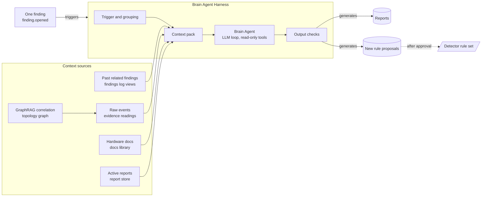
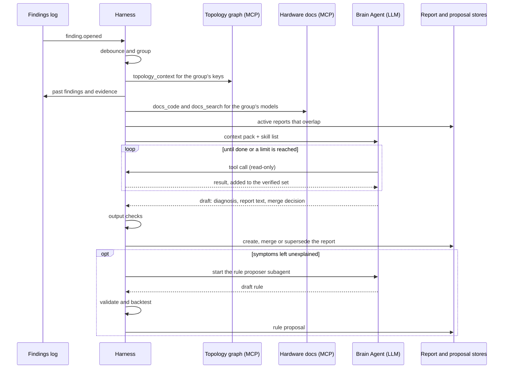

# Sentinel Brain Agent Harness (HLD)

> **Version:** 0.3.0  |  **Date:** 2026-11-24  |  **Status:** Draft
>
> Requirement IDs refer to [requirements.md](./requirements.md).

**Related HLDs.** This document covers only the harness. What it consumes is designed elsewhere and
is not repeated here:

| HLD                                                     | Owns                                                        | Referred to here as |
| ------------------------------------------------------- | ----------------------------------------------------------- | ------------------- |
| [Detector engine](./hld-detector-engine.md)             | Rules, findings, the findings log, evidence, `replay`       | Detector HLD        |
| [Site topology graph](./hld-site-topology-graph.md)     | Device relationships, edge types, the `topology_*` tools    | Topology HLD        |
| [Hardware docs library](./hld-hardware-docs.md)         | Manuals and runbooks as excerpts, the `docs_*` tools        | Docs HLD            |

## 1. Why

The detector engine turns telemetry into findings, and the topology graph says how devices relate.
Neither tells a technician what is wrong and what to check, and neither learns from what the rules
miss. The Brain Agent Harness does both. A finding triggers it; it gathers the context around that
finding, runs the Brain Agent on it, and produces two outputs:

- **Reports**: one per issue, saying what seems wrong, the likely cause and what to check first
- **New rules**: proposals for detectors and fault profiles that would catch the issue, or catch it
  earlier

### 1.1 Principles

1. **The harness reads findings and never writes them** (D-1). It writes its own records: runs,
   reports and proposals.
2. **Code gathers the facts; the model explains them.** The harness assembles the context in code.
   Every number and device ID in a report must come from that context (A-1).
3. **Outputs are proposals.** A report recommends actions and sends no command (S-1). A new rule
   changes nothing until a person approves it (A-2).
4. **Local and bounded.** A run fits a small local model and has fixed limits on steps, tokens and
   time (A-3, A-4).

## 2. Terms: harness, agent, subagent, skill

| Term         | What it is                                                                                      | Who controls the flow        | Use it when                                                                                   |
| ------------ | ----------------------------------------------------------------------------------------------- | ---------------------------- | --------------------------------------------------------------------------------------------- |
| **Harness**  | The code around the model: triggers, context assembly, tools, limits, output checks and storage | Code, written by us          | A step must happen every time, in the same way, and be testable without a model               |
| **Agent**    | A model in a loop: it reads context, calls tools, reads the results and decides the next step   | The model, inside the harness's limits | The steps can't be known in advance, such as which devices to look at next          |
| **Subagent** | A second agent started by the first for one task, with its own fresh context; it returns only its result | The parent agent decides when; the harness runs it | A side task would fill the parent's context, or needs different tools or instructions |
| **Skill**    | A packaged set of instructions, and optionally scripts, that an agent loads only when a task needs it | Nobody: it is knowledge, not a process | The same know-how is reused across runs, and is too long to keep in every prompt   |

The four fit together: the harness runs an agent, the agent may start subagents, and any of them may
load a skill.

**How to choose**

- If plain code can do the step, put it in the harness. It is cheaper, deterministic and replayable.
- Use an agent only where the next step depends on what the last one found.
- Start a subagent only when the task is separable and its working detail isn't needed afterwards.
  Each subagent costs a full model run and sees only what it is handed.
- Write a skill when the gap is knowledge, such as how to diagnose a coolant loop. A skill adds no
  new process and no new context window.

**In Sentinel**

| Term     | In this design                                                                                   |
| -------- | ------------------------------------------------------------------------------------------------ |
| Harness  | This HLD: trigger, grouping, context pack, tool set, budgets, output checks, stores              |
| Agent    | The Brain Agent: diagnoses one issue from the context pack and writes the report                 |
| Subagent | The rule proposer (§7.2): drafts and backtests a rule in its own context                         |
| Skill    | Diagnosis playbooks per fault domain (cooling, power, hashboard), the report format, how to write a `rule()` |

## 3. Architecture

The harness runs inside the Sentinel app, `io.tether.sentinel`, next to the detector engine, as a
consumer of the findings log.

| Part                 | Job                                                                                   |
| -------------------- | ------------------------------------------------------------------------------------- |
| Trigger and grouping | Subscribes to the findings log and decides which findings belong to one run (§4)      |
| Context pack         | Gathers the four context sources within a token budget (§5)                           |
| Brain Agent          | Diagnoses the issue and drafts the report, using read-only tools for more detail (§6) |
| Output checks        | Verifies the draft against the context, then writes the report or proposal (§7)       |

## 4. Trigger

The harness subscribes to the findings log (detector HLD §8.3) and reacts to two events:

| Event            | Reaction                                                                    |
| ---------------- | --------------------------------------------------------------------------- |
| `finding.opened` | Queue the finding for a run                                                 |
| `finding.closed` | Update the report that covers it; if all its findings are closed, mark the report as cleared |

`rule.error` and `data.*` events do not start a run.

**Grouping.** One fault often opens many findings, for example 100 hot miners on one coolant loop.
One run per finding would produce 100 reports to merge, so the harness groups first:

1. A queued finding waits for a short debounce window (default 60 s).
2. Findings in the window that share a topology ancestor (`topology_traverse` upstream along the
   site's edge types) or that already belong to one active report form one group.
3. Each group starts one run. A `fault` finding leads its group; the symptoms it reads as inputs
   join it.

**Order.** Groups run by severity, P1 first. On the local model, one run executes at a time; the
rest wait in the queue.

**Idempotency.** A run ID is a hash of the sorted finding IDs in the group. Finding IDs are stable
(detector HLD §3.4), so a restart cannot run the same group twice.

## 5. Context assembly

The harness builds one context pack per run, in code, before the model sees anything. The four
sources are those in the flow diagram.

| Source                | Read from                                                              | Selected by                                                                                  |
| --------------------- | ---------------------------------------------------------------------- | -------------------------------------------------------------------------------------------- |
| Past related findings | Findings log views (by key, by rule)                                   | Same key, same rule, or a topology neighbour, within a lookback window; with labels and repair outcomes where they exist (L-3, L-4) |
| Raw events            | Evidence copied into the findings log; live readings through the Kernel | The finding's own devices, plus the devices GraphRAG correlation selects (§5.1)             |
| Hardware docs         | The hardware docs library, through its tools (docs HLD §6.3)           | Device model, the rule's domain and the error codes in the readings (§5.2)                   |
| Active reports        | The harness's report store (§8)                                        | Open reports whose devices or topology ancestors overlap the group's                         |

### 5.1 GraphRAG correlation

Raw events are only useful for the right devices. The topology graph picks them:

1. **Ask the graph.** The harness calls `topology_context` (topology HLD §7) with the finding's
   `key` and the edge types that fit the rule's domain: cooling and containment edges for a thermal
   finding, power and measurement edges for a power finding. The mapping from rule domain to edge
   types is harness config, because edge types differ per site.
2. **Fetch.** For the devices returned, the harness reads the finding's evidence (detector HLD
   §8.3).
3. **Reduce.** Readings become statistics in code: the latest value, the window mean and extremes.
   The model receives no raw series.

The `topology_context` result goes into the pack unchanged, next to these statistics.

### 5.2 Hardware docs

The harness only reads the hardware docs library; what it holds and how search works are in the
docs HLD. The harness reads it at four points:

| When                                  | What the harness asks                                                                                  | Tool          |
| ------------------------------------- | ------------------------------------------------------------------------------------------------------ | ------------- |
| Context assembly, every run           | The meaning and action of each error code in the group's evidence readings                              | `docs_code`   |
| Context assembly, every run           | Troubleshooting and procedure excerpts for the device models in the group, and for the shared upstream device that GraphRAG correlation found | `docs_search` |
| Agent loop, when the agent chooses    | A procedure or a vendor limit for a cause it is considering and the pack doesn't cover                  | `docs_search`, `docs_excerpt` |
| Rule proposer (§7.2)                  | Vendor limits (`kind: spec`) for the metrics a draft rule reads                                         | `docs_search` |

**How the first search is built.** The harness builds it in code, with no model call:

- `deviceId`: one device per distinct model in the group, at most three models, the leading
  finding's first
- `domain`: the first part of the rule ID, such as `thermal` or `cooling`. If that part is not a
  docs domain, as with `anomaly`, the search runs without a domain filter
- `query`: the rule's description and the names of the metrics it reads

**The shared upstream device matters most.** When 100 miners on one loop run hot, the useful
procedure is the cooling unit's, not the miner's. The search for the upstream device's model is
made first and its excerpts are placed first in the pack.

**How the excerpts are used**

- Each step in a report's `checks` that comes from a document cites its excerpt: document, version,
  section and page. The citations are stored in the report's `sources`
- Numbers in an excerpt, such as a vendor limit, are part of the verified set, so the report may
  quote them (§7.1)

**When docs are not used**

- A `finding.closed` update and the report status changes that follow it
- A model with no documents: the pack says so, and the report is still written, from the readings
  and the topology rules. The report states that no vendor procedure was available

The template report of a failed run (§6.2) still includes the error code meanings and the excerpt
citations, because the pack is built before the model runs.

### 5.3 The pack

| Section               | Content                                                                   | Budget (tokens) |
| --------------------- | ------------------------------------------------------------------------- | --------------- |
| Findings in the group | Rule ID and description, key, severity, role, times, params               | 800             |
| Correlated readings   | The §5.1 output                                                           | 1,500           |
| Past related findings | Up to 10, most similar first, with outcomes                               | 1,000           |
| Hardware docs         | Error code meanings first, then up to 5 excerpts (§5.2)                   | 1,500           |
| Active reports        | Up to 3 candidates to merge into: title, devices, suspected cause         | 700             |

The total stays under 6k tokens, leaving room for skills, tool calls and the answer inside a 16k
context. The pack is stored with the run, so a run can be replayed against the same input.

## 6. Run

### 6.1 Tools

All tools are read-only. The agent gets two sets:

**Reused, defined in their own HLDs**

| Tools                                                    | Defined in       |
| -------------------------------------------------------- | ---------------- |
| `topology_context`, `topology_traverse`, `topology_find` | Topology HLD §8  |
| `docs_search`, `docs_code`, `docs_excerpt`               | Docs HLD §6.3    |

**New, owned by the harness**

| Tool             | Returns                                              |
| ---------------- | ---------------------------------------------------- |
| `findings_query` | Findings by key, rule or time range                  |
| `evidence_read`  | Reduced statistics for a device, metric and window   |
| `reports_read`   | An active or past report                             |

There is no command tool and no raw-query tool. `topology_impact` is left out, because the harness
sends no commands.

### 6.2 Limits

| Limit              | Default                 | On reaching it                                        |
| ------------------ | ----------------------- | ----------------------------------------------------- |
| Tool-call steps    | 8                       | The agent must answer with what it has                |
| Output tokens      | 1,500                   | The run fails                                         |
| Wall time          | 3 min                   | The run fails                                         |
| Concurrent runs    | 1 on the local model    | Groups wait in the queue                              |

**A failed run still produces a report.** The harness writes a template report from the rule
descriptions and the correlated readings, marked as not diagnosed. An operator never loses sight
of a finding because the model failed.

### 6.3 Model

The agent talks to an OpenAI-compatible endpoint, as the Operator Agent does. The default is the
local QVAC model (Qwen3-4B, 16k context); a larger local or hosted model is a configuration change.
The budgets in §5.3 and §6.2 are sized for the default.

## 7. Outputs

### 7.1 Reports

One report per issue (X-7). The agent's draft carries a decision the harness then applies:

| Decision    | When                                                                         | Effect                                                 |
| ----------- | ---------------------------------------------------------------------------- | ------------------------------------------------------ |
| `create`    | No active report in the pack covers this group                               | A new report                                           |
| `merge`     | An active report has the same suspected cause                                | The group's findings and devices are added to it       |
| `supersede` | The new findings change the cause of an active report                        | A new report replaces the old one and links to it      |

The agent can pick only from the active reports in its pack, so it can't merge into a report that
doesn't exist. A report is never duplicated (X-8).

| Field               | Meaning                                                                          |
| ------------------- | -------------------------------------------------------------------------------- |
| `id`                | Hash of the first run ID that created it                                         |
| `status`            | `open`, `acknowledged`, `cleared`, `closed`, `superseded`                        |
| `findings`          | IDs of the findings it covers                                                    |
| `devices`           | Devices affected, and the shared upstream device if there is one (X-3)           |
| `cause`             | The likely fault, using the technicians' closure labels (X-1)                    |
| `causeKind`         | `matched_fault` when a `fault` finding backs it, otherwise `unconfirmed_pattern` (X-5) |
| `unexplained`       | Symptoms in the group that no fault explains (X-4)                               |
| `summary`, `checks` | Plain-language text: what seems wrong and what to check first (O-3)              |
| `safety`            | Set when a finding points to a safety risk (S-3)                                 |
| `sources`           | The hardware doc excerpts cited in `checks`: document, version, section, page    |
| `runs`              | The run IDs that wrote or changed it, each with its context pack and model       |

**Output checks.** Before a report is written:

1. **Grounding.** Every number and device ID in the text must appear in the verified set: the
   context pack plus the tool results of the run. A draft that fails is sent back once, then
   replaced by the template report (A-1).
2. **Cause.** `causeKind` is set by the harness from the findings' `role`, not by the model.
3. **Names.** Device IDs are swapped for operator-facing names, and rule IDs are removed from the
   text.

### 7.2 New rules

A proposal is drafted in two cases:

- **A run ends with unexplained symptoms**, or with an `unconfirmed_pattern` cause (N-1)
- **A report is closed with a repair outcome**, and an earlier or more specific rule could have
  caught it (N-2)

The rule proposer is a subagent. It gets the report, the evidence statistics, the vendor limits
for the metrics involved (§5.2) and the rule-writing skill, and returns one draft. The harness
does the rest in code:

1. **Validate** the draft with the detector's load checks (detector HLD §4.4).
2. **Backtest** it with `replay` (detector HLD §9.1) over the saved evidence of this report and of
   past related ones, and over a recent range to count the new findings it would open.
3. **File** a proposal with the draft, the backtest report and the reports it came from.

A proposal is either a parameter change or a new rule. Who approves each kind, and how it goes
live, is the detector's rule lifecycle (detector HLD §6.2). The harness stops at the filed
proposal and never adds a rule to the running set.

## 8. Storage

All stores live under the app's `config.dataDir`, next to the findings log (R-7).

| Store          | Engine    | Holds                                                              | Retention            |
| -------------- | --------- | ------------------------------------------------------------------ | -------------------- |
| Run log        | Hypercore | Every run: group, context pack, tool calls, draft, checks, model   | Kept                 |
| Reports        | Hypercore | Every report event: created, merged, superseded, status changes    | Kept                 |
| Report views   | Hyperbee  | Active reports by device and by topology node                      | Rebuilt from the log |
| Rule proposals | Hypercore | Drafts, backtest reports, approval decisions                       | Kept                 |
| Queue          | Hyperbee  | Findings waiting for a run                                         | Latest only          |

## 9. Access and safety

- **Own grant.** The harness reads with the Sentinel app's service account; every read is checked
  by the site's RBAC (S-2).
- **Read-only.** No tool sends a command or writes to the findings log or the topology graph.
- **Retrieved text is data.** Anything a tool returns is escaped and never treated as
  instructions.
- **Auditable.** Every report and proposal links to the runs that produced it, and each run stores
  its input.

## 10. Dependencies

| Need                                   | Status                                                     |
| -------------------------------------- | ---------------------------------------------------------- |
| Findings log events and views          | Designed in the detector HLD §8.3                          |
| Evidence copied into the findings log  | Designed in the detector HLD §8.3                          |
| `replay` for backtests                 | In the detector proof of concept                           |
| Topology MCP tools                     | Designed in the topology HLD §8                            |
| Hardware docs library and its tools    | Designed in the docs HLD                                   |
| Repair outcomes and finding labels     | Required by L-1 to L-4; not designed yet                   |

## 11. Open questions

- **Trigger scope.** Every `finding.opened`, as assumed here, or only faults and unexplained
  symptoms?
- **Debounce window.** 60 s delays a P1 report by a minute. Should P1 findings skip the window?
- **Hardware docs coverage.** Which documents exist for the site's hardware, and who keeps them
  current? The harness works without them, but its `checks` are then generic
- **Rule proposals from a small model.** Whether a 4B local model can write a valid `rule()`, or
  whether the proposer needs a larger model or should fill in rule templates instead
- **Similar past findings.** Same key, rule and topology neighbours may be enough; otherwise this
  needs an embedding index
- **Report lifecycle owner.** This HLD keeps reports in the harness. A separate case engine, if one
  is built, would own them instead
