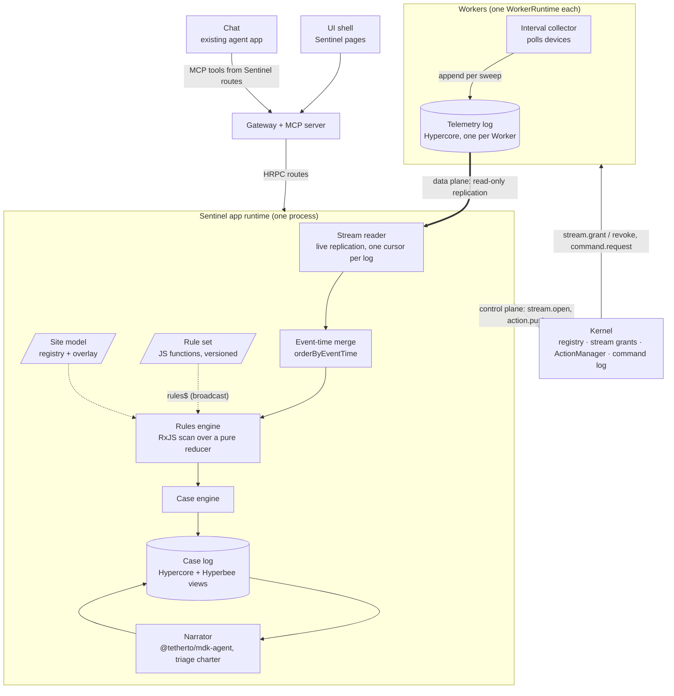
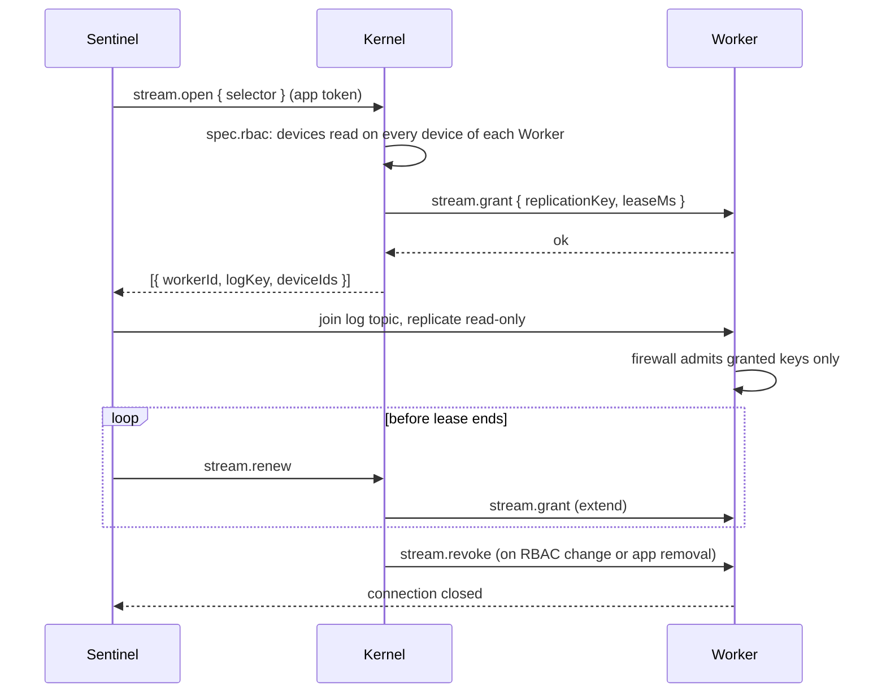
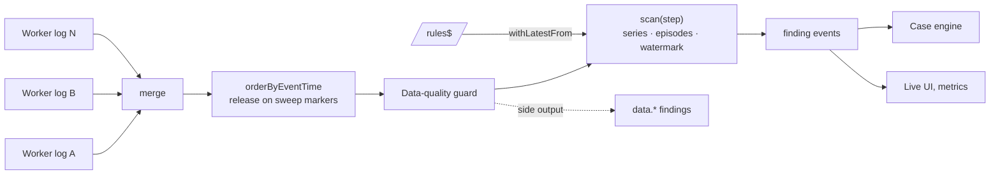
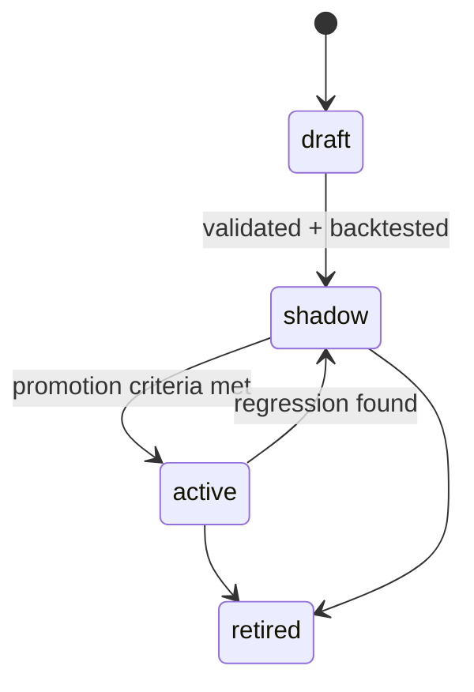
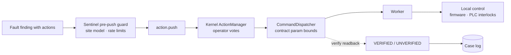

# Sentinel Phase 1: streaming rules engine on MDK (HLD)

> **Version:** 0.3.0  |  **Date:** 2026-11-06  |  **Status:** Draft
>
> Responds to the Sentinel Phase 1 HLD improvement proposal (Gio, 2026-10-29). Builds on
> [hld-app-gateway.md](../hld-app-gateway.md), [hld-app-packaging.md](../hld-app-packaging.md),
> [hld-kernel-telemetry-snapshots.md](../hld-kernel-telemetry-snapshots.md) and
> [hld-ivhm-shadow-site.md](../hld-ivhm-shadow-site.md). A runnable proof of concept of §5 to §7
> lives in [`poc/`](./poc/).

## 1. Why

Sentinel watches a mining site, finds faults early, explains them and proposes safe actions. It is
also the first agent on MDK, so its shape is the template for the ones after it.

Three requirements drive this design:

- **Real time, low noise.** Every new reading is processed as it lands, across Workers and devices;
  one fault should produce one case, not forty alerts
- **Customizable rules.** Each site tunes limits and adds fault profiles without touching the engine
- **Provable.** Every case can be replayed and every rule change measured before it goes live

The design takes its processing model from stream processors such as Apache Flink reading from
Kafka: partitioned append-only logs, keyed state, event-time windows, timers and rules delivered to
a running job. Each Worker publishes its readings as a live, replayable log (§4). Sentinel consumes
every log through an RxJS pipeline and evaluates rules written as small pure JavaScript functions
(§6), inside a standard MDK app.

### 1.1 Principles

1. **Code owns state; the LLM writes and proposes.** Only deterministic code opens, extends, merges
   or closes a case. The model adds narrative and proposals, never transitions.
2. **A rule is a pure function.** It declares its inputs and returns true or false from a frozen view
   of one key's data. The engine owns time, state and episodes.
3. **Detection is deterministic and replayable.** The same log range always yields the same cases,
   so a rule change can be backtested with an exact verdict.
4. **Control plane through the Kernel, data plane direct.** Access, commands and audit stay with the
   Kernel; readings stream from Worker to app without passing through it.
5. **Reuse MDK core.** Approval, command audit, parameter bounds, auth, model providers and agent
   evals already exist in MDK; Sentinel does not rebuild them.

## 2. Scope

| In Phase 1                                                   | Not in Phase 1                                      |
| ------------------------------------------------------------ | --------------------------------------------------- |
| Per-Worker telemetry log with Kernel-brokered live access    | Per-device log partitions                           |
| Rules engine on RxJS, with rules as pure JavaScript functions | Operator-authored rules at runtime (CEL, §15)      |
| Site model: Kernel registry plus a shared-infra overlay      | Inferred topology links                             |
| Case engine, case log, evidence bundles, closure labels      | Cross-site analytics and a central Flink cluster    |
| Narrator (Triage) and Chat on a local model through QVAC     | Research profile, learned model router              |
| Approval-gated proposals through the Kernel                  | Autonomous execution (autonomy level L4 and above)  |
| Backtest, shadow rules, rule unit tests and a scoreboard     | Fine-tuning the local model                         |

On IVHM, Sentinel runs on the [shadow site](../hld-ivhm-shadow-site.md), where only MOS talks to
devices. Phase 1 there is **recommend-only** (autonomy level L2 in the intelligent-MOS HLD):
proposals are recorded and shown, never executed.

## 3. Architecture

Sentinel is one MDK app, `io.tether.sentinel`, shipped as an npm package and run by
`@tetherto/mdk-app-runtime` in its own process with its own service account.



| Part              | Built or reused | What it is                                                                      |
| ----------------- | --------------- | ------------------------------------------------------------------------------- |
| Telemetry log     | New in MDK core | Per-Worker Hypercore written by the WorkerRuntime's interval collector (§4)     |
| Stream grants     | New in MDK core | Kernel action that checks `spec.rbac` and grants replication access (§4.4)      |
| App shell         | Reused          | `@tetherto/mdk-app-runtime`: process, service account, `main`, `config.dataDir` |
| Stream reader     | Built           | Replicates each granted log live and emits its blocks as an Observable          |
| Rules engine      | Built on RxJS   | Event-time merge, pure reducer, rules as functions (§5, §6, §7)                 |
| Site model        | Built           | Registry and device info from the Kernel, plus a YAML overlay (§9)              |
| Case engine       | Built           | Deterministic case state machine (§10)                                          |
| Case log          | Built on reuse  | Hypercore and Hyperbee in `config.dataDir` (§11)                                |
| Narrator and Chat | Reused          | `@tetherto/mdk-agent` with a Sentinel charter; the existing agent app (§12)     |
| Approval path     | Reused          | Kernel `ActionManager`, `CommandDispatcher`, `verify`, write-command log (§13)  |
| Auth              | Reused          | App service account, `spec.rbac`, the single MCP endpoint                       |
| Agent evals       | Reused          | The `mdk-agent` eval battery and its ledger (§14)                               |

## 4. Telemetry stream

Every reading a WorkerRuntime takes is pushed to Sentinel as it lands, and cross-Worker rules run on
that live stream. This section decides how the push works.

### 4.1 Options

| Option                       | How it works                                                            | Verdict  |
| ---------------------------- | ----------------------------------------------------------------------- | -------- |
| Shared Hyperswarm topic      | Every Worker emits each reading on one common topic; apps listen on it  | Rejected |
| Kernel relay                 | Kernel subscribes on its Worker connections and fans out to apps        | Fallback |
| Per-Worker telemetry log     | Each Worker appends to its own Hypercore; apps replicate it live        | Chosen   |

**Shared topic, rejected.** It breaks three properties MDK depends on:

- **Trust boundary.** Workers admit only the Kernel's key and never initiate traffic. A broadcast
  topic makes Workers talk to any peer that joins, outside the Kernel's allowlist and `spec.rbac`
- **Not pub/sub.** A Hyperswarm topic is for discovery: every listener opens a connection to every
  Worker, so fan-out, authorization and backpressure all become app code
- **No replay.** An event a listener misses during a restart is gone, so checkpoints and backtests
  cannot be exact

**Kernel relay, fallback.** Kernel already holds a connection to every Worker and an in-process
`_subscribers` map in `TelemetryCollector`. Workers would send a `telemetry.event` on that
connection after each sweep, and Kernel would fan out to subscribed apps with per-device RBAC. It
keeps one trust boundary and is the smallest change, but Kernel joins the hot path and a Kernel
restart leaves a gap that nothing can replay. It is the path if the telemetry log is not accepted.

**Per-Worker telemetry log, chosen.** It is the Kafka shape built from the Hyper stack MDK already
uses:

- **Ordered and durable.** Each Worker's log is one partition; a block's sequence number is its offset
- **Replayable.** A reader resumes from its checkpointed offset after a restart, with no gap
- **Signed.** Only the Worker can append, and every block is verifiable by the reader
- **Off the Kernel's data path.** Readings flow Worker to app; Kernel only grants access
- **One write, three uses.** The same log feeds the live stream, history reads and backtests, which
  also closes the `WorkerRuntimeV2` history gap

### 4.2 The log

The telemetry log builds on Approach B of the
[kernel telemetry snapshots HLD](../hld-kernel-telemetry-snapshots.md): the WorkerRuntime's interval
collector, which already polls devices on the Worker's `telemetryPollIntervalMs`, appends each sweep
to the log in one batch.

| Block        | Written                            | Fields                                                                 |
| ------------ | ---------------------------------- | ---------------------------------------------------------------------- |
| Reading      | Per device, per sweep              | `v`, `deviceId`, `ts` (poll time), `metrics`, `errors`, `reachable`    |
| Sweep marker | Once per sweep, after its readings | `v`, `ts`, `devices` (count polled), `answered` (count that answered)  |

The sweep marker is written even when no device answers. It advances the reader's watermark and
lets absence rules fire on silence rather than wait for data that never comes.

Blocks are encoded with Hyperschema, which already governs MDK Protocol messages. Metric names and
types are the ones the Worker's `mdk-contract.json` declares, so the reader validates blocks against
the contract the Kernel publishes.

### 4.3 Retention

| Store             | Holds                           | Bounded by                                                     |
| ----------------- | ------------------------------- | -------------------------------------------------------------- |
| Telemetry log     | Raw readings at poll resolution | `telemetryLogRetention` in the Worker config, default 7 days; older blocks are cleared, offsets stay stable |
| Worker rollups    | Coarser series for dashboards   | The rollup policy of the kernel telemetry snapshots HLD        |
| Sentinel case log | Evidence bundles for each case  | Kept (§11)                                                     |

Retention must cover the longest `history` any rule declares, because a restart rebuilds window
state by replaying that much of each log (§7.3). The telemetry warehouse HLD estimates about 65 GB a
month of raw JSON for a 500-device site, so 7 days is in the order of 15 GB across all Workers before
compact encoding. Measure on IVHM.

### 4.4 Access

Readings stream directly, but access is decided by the Kernel, on connections the Kernel initiates.



- **Separate key.** Sentinel replicates with its own replication key pair, distinct from its Kernel
  transport key
- **Read-only channel.** Replication connections carry no RPC. The Worker's RPC server still admits
  the Kernel's key only, so every command still goes through the Kernel's checks and command log
- **Worker granularity.** A log holds every device of its Worker, so a grant needs `devices: read`
  on all of them. An app whose rules cover only some is refused that Worker's log
- **Leases.** Grants expire unless renewed through the Kernel. A short Kernel outage does not stop
  the stream; a revocation ends it

### 4.5 Freshness

Push removes Sentinel's own polling hop. What remains, from a device reading to a finding:

| Delay                    | Set by                                                                      |
| ------------------------ | --------------------------------------------------------------------------- |
| Poll interval            | `telemetryPollIntervalMs` per vendor in the contract (for example 60 s for Antminer), overridable per instance in `mdk.yaml` |
| Append and replication   | Hypercore; milliseconds on a site network                                   |
| Event-time alignment     | The slowest Worker a rule reads from must sweep past the evaluation time (§5.2) |
| Evaluation step          | `evalEvery`, default 1 min; can drop to the fastest poll interval            |
| `for` duration           | The rule itself                                                             |

## 5. Dataflow

### 5.1 Pipeline

The pipeline is short on purpose. RxJS composes the sources, the rule set and the sinks; one pure
reducer holds every piece of event-time state.



```js
const blocks$ = merge(...logs.map((log) => from(log.createReadStream({ start: offsets[log.key], live: true }))))

const run$ = blocks$.pipe(
  orderByEventTime(site.workers),
  withLatestFrom(rules$),
  scan((acc, [block, rules]) => step(acc.state, block, rules, site), { state: initial, events: [] }),
  share()
)

const findings$ = run$.pipe(concatMap((acc) => acc.events))
```

1. **Sources.** One live Observable per granted Worker log. `from()` accepts the Hypercore read
   stream directly, because it is an async iterable.
2. **Event-time merge.** `orderByEventTime` releases blocks in timestamp order once every Worker has
   swept past them, so downstream sees one order whatever the arrival interleaving (§7.2).
3. **Data-quality guard.** Stale, missing or physically impossible readings are tagged and sent to a
   side output as `data.*` findings. They never reach the rules.
4. **Reducer.** `step` records readings into per-minute buckets, advances the watermark on sweep
   markers, evaluates every rule for every key at each `evalEvery` boundary the watermark passes,
   and turns results into finding episodes.
5. **Rule set.** `rules$` is broadcast state: pushing a new set takes effect on the next block, with
   no restart.
6. **Sinks.** Finding events go to the case engine (§10), the live UI and metrics.

### 5.2 Event time and watermarks

- **Per log.** A log's watermark is the `ts` of its latest sweep marker
- **Global.** Minute M is evaluated once every Worker's watermark has passed M. Buckets that end
  after M are invisible to that evaluation, so a Worker ahead of the others cannot leak future
  readings into it
- **Scoped.** The target is a watermark per rule over only the Workers its inputs select, so a rule
  on 10 s miners does not wait for a 60 s Worker it never reads. The proof of concept uses one
  global watermark
- **Idleness.** A log with no sweep marker for `idleTimeoutMs` of processing time drops out of the
  watermark, so one dead Worker does not stall every rule. Its devices then produce `comms.*`
  findings. Idleness is a live-only behavior; replays and backtests run with it off, because
  processing time does not exist in a replay

Durations in rules are written in time (`for: '30s'`) rather than samples, because a sample means 10 s
on one Worker and 60 s on another.

### 5.3 State, checkpoints and idempotency

The reducer's state is one plain object: per-minute series buckets, finding episodes, per-log
watermarks and the next evaluation time.

| Checkpoint style          | Holds                                  | Size in the proof of concept | Restart                                         |
| ------------------------- | -------------------------------------- | ---------------------------- | ----------------------------------------------- |
| Full state                | Everything                             | 114 KB (13 devices, 4 h)     | Resume at the next offset                       |
| Episodes and offsets      | Episodes, next evaluation time, offset per log | 853 B               | Replay the longest declared `history` from each log, then resume |

Phase 1 uses **episodes and offsets**: it stays small as the fleet grows, and it lets RxJS operators
that keep hidden state be rebuilt by replay instead of serialized (§7.3). The checkpoint is written
to Hyperbee every 30 s. Finding IDs are a hash of `ruleId@version`, the key and the episode start,
so a replay or restart cannot create duplicate cases.

### 5.4 Flink concepts and their Sentinel form

| Flink and Kafka concept | In Sentinel                                                                 |
| ----------------------- | --------------------------------------------------------------------------- |
| Topic partition         | One Worker's telemetry log                                                  |
| Offset                  | Block sequence number in the log                                            |
| Source                  | `from(log.createReadStream({ live: true }))`                                |
| Event time              | The Worker's poll timestamp on each reading                                 |
| Watermark               | Sweep markers, combined by `orderByEventTime`                               |
| Idle source             | A log with no sweep marker for `idleTimeoutMs`, live only                   |
| Keyed state             | Series buckets and episodes in the reducer, keyed by rule and key           |
| Event-time timers       | `EventTimeScheduler` for RxJS time operators (§7.2)                         |
| Broadcast state         | `rules$`, joined with `withLatestFrom`                                      |
| Dynamic keying          | `keyBy` on each rule, resolved through the site model                       |
| Side outputs            | `data.*` findings and the unexplained queue                                 |
| Checkpoint              | Episodes and offsets; windows rebuilt by replay                             |
| Replay                  | Backtest: the same pipeline over an offset or time range (§14.1)            |

### 5.5 Load

The [telemetry warehouse HLD](../hld-iot-telemetry-warehouse.md) sizes a site at about 500 devices
with 10 metrics every 5 s, about 100 readings per second. The proof of concept replays 14,412 blocks
(4 h of 13 devices) in under 0.1 s on one core, so one Node process handles a site with room to
spare and no cluster.
Real numbers go in the capacity template once IVHM runs.

## 6. Rule model

### 6.1 A rule

A rule is one JavaScript file in the app package. It declares what it reads and how its findings
behave; its logic is one pure function, `when`, that returns true or false.

```js
// rules/anomaly/container-power-and-heat.js
const { rule } = require('@tetherto/sentinel-rules')

module.exports = rule({
  id: 'anomaly.container.power_and_heat',
  version: 1,
  severity: 'P2',
  keyBy: 'container',
  inputs: {
    power: { family: 'miner', model: 'M56S', metric: 'power', history: '1h' },
    temp: { family: 'container', brand: 'antspace', metric: 'outlet_temp', history: '30m' }
  },
  params: { marginPct: 10, deltaC: 2 },
  tunable: { marginPct: [2, 50], deltaC: [1, 10] },
  for: '5m',
  clear: { for: '10m' },
  when: ({ power, temp, params }) =>
    power.some((m) => m.covered('1h') && m.now > m.mean('1h') * (1 + params.marginPct / 100)) &&
    temp.covered('30m') && temp.now > temp.mean('30m') + params.deltaC
})
```

| Field         | Meaning                                                                                 |
| ------------- | --------------------------------------------------------------------------------------- |
| `id`          | Stable code, `domain.signal.condition` for symptoms, `domain.fault` for faults          |
| `version`     | Integer, bumped on every change; findings record `id@version`                           |
| `role`        | `symptom` or `fault`; drives the unexplained queue (§10.3). Default `symptom`           |
| `severity`    | `P1` to `P4`                                                                            |
| `keyBy`       | `device`, `container`, `upstream(<medium>)` or `site`; what one evaluation is about     |
| `inputs`      | Named series (`family`, `brand`, `model`, `metric`, `history`) or other rules' findings |
| `params`      | Named values `when` reads                                                               |
| `tunable`     | `[min, max]` per param operators may change                                             |
| `for`         | How long `when` must hold before a finding opens                                        |
| `clear`       | `{ for, when? }`: how long, and optionally what, closes it; default is `!when`          |
| `when`        | `(ctx) => boolean`, pure and synchronous                                                |
| `actions`     | Proposal templates for §13                                                              |
| `description` | Plain-language meaning; also the fallback narrative                                     |

### 6.2 What `when` receives

`ctx` is frozen. It holds one entry per input, plus `params`, `key`, `at` (event time) and, for
topology keys, `node` (`id`, `class`, `fed`, `redundancy`).

**How inputs are shaped.** With `keyBy: 'device'`, a series input is that device's series. With a
topology key, the node's own device (a container's controller, a loop's flow sensor) arrives as one
series, and the devices it contains or feeds arrive as an array, resolved through the site model.
A findings input (`{ findings: ['rule.id', ...] }`) arrives as the array of those rules' open findings
under the key.

**Series helpers.** Every series offers the same small API, computed by the engine from per-minute
buckets:

| Helper        | Returns                                                                         |
| ------------- | ------------------------------------------------------------------------------- |
| `now`         | Latest value in the last complete minute, or `undefined` if the device was silent |
| `mean(w)`     | Mean over the window, or `NaN` with no data                                     |
| `min(w)`, `max(w)` | Extremes over the window, or `NaN` with no data                            |
| `count(w)`    | Readings in the window                                                          |
| `covered(w)`  | Whether the series has data reaching back the whole window                      |

Empty windows return `NaN` and silence returns `undefined`, so every comparison against them is
false: a rule cannot fire on missing data by accident. `covered(w)` keeps a rule quiet until it has
enough history, for example right after a restart or when a device first appears. A window longer
than the input's declared `history` is a rule error, not a silent short window.

### 6.3 Examples

The proof of concept runs the first three against a simulated site with injected faults. The fourth
shows composition through findings and the topology key; it is designed, not yet in the proof of
concept.

```js
// rules/performance/hashrate-below-floor.js: below 5 TH/s for over an hour, per miner
module.exports = rule({
  id: 'performance.hashrate.below_floor',
  version: 1,
  severity: 'P2',
  keyBy: 'device',
  inputs: { hr: { family: 'miner', metric: 'hashrate_avg', history: '1h' } },
  params: { floor: 5 },
  tunable: { floor: [1, 50] },
  clear: { for: '5m' },
  when: ({ hr, params }) => hr.covered('1h') && hr.max('1h') < params.floor
})
```

```js
// rules/performance/container-hashrate-down.js: even the best miner in the container is below 5 TH/s
module.exports = rule({
  id: 'performance.container.hashrate_down',
  version: 1,
  severity: 'P1',
  keyBy: 'container',
  inputs: { hr: { family: 'miner', metric: 'hashrate_avg', history: '1h' } },
  params: { floor: 5 },
  clear: { for: '5m' },
  when: ({ hr, params }) => hr.length > 0 && hr.every((m) => m.covered('1h') && m.max('1h') < params.floor)
})
```

```js
// rules/faults/cooling-flow-restricted.js: hot miners on one loop, the rest of the site normal
module.exports = rule({
  id: 'cooling.flow_restricted',
  version: 3,
  role: 'fault',
  severity: 'P2',
  keyBy: 'upstream(feeds.coolant)',
  inputs: {
    hot: { findings: ['thermal.chip_temp.above_limit', 'thermal.chip_temp.above_peers'] },
    power: { findings: ['power.psu_input.undervoltage'] }
  },
  params: { minAffected: 3, maxShare: 0.8 },
  actions: ['throttle_downstream'],
  when: ({ hot, power, node, params }) => {
    const affected = new Set(hot.map((f) => f.deviceId)).size
    return power.length === 0 && affected >= params.minAffected && affected / node.fed < params.maxShare
  }
})
```

Rules that read findings are evaluated after the rules they read, in the same evaluation step, in
dependency order. A cycle is a load error.

### 6.4 Validation at load

A rule is admitted only when all of these hold:

1. Its definition passes `rule()`: required fields, a known `keyBy`, `params` within `tunable`.
2. Every series input's `metric` exists, with a numeric type, in the contract of at least one Worker
   its selector matches, read from the Kernel's published capabilities.
3. Every findings input names an admitted rule, and the dependency graph has no cycle.
4. A dry run against fixture series returns a boolean for every key without throwing.

A rule that fails stays out of the rule set; the engine keeps running the previous version and
reports the error.

### 6.5 Keeping `when` pure

| Risk                                   | Guard                                                                           |
| -------------------------------------- | ------------------------------------------------------------------------------- |
| `Date.now()`, `Math.random()`, I/O     | Rule files are compiled inside a `node:vm` context with no `require`, no `process`, no `Math.random`, and `Date` pinned to event time |
| Infinite loop or slow rule             | Each evaluation runs through `script.runInContext(ctx, { timeout })`, since a `vm` timeout bounds only the call it wraps; a timeout is a rule error |
| Async work                             | `when` must return a boolean; a Promise is a rule error                          |
| Hidden state between calls             | `ctx` is frozen; a lint rule flags module-level mutable state in `rules/`        |
| A throw                                | Caught per rule and key, reported as a `rule.error` event; the stream continues  |
| Non-determinism that slips through     | CI replays a recorded log range twice and requires identical findings           |
| Untrusted code                         | Rules ship only in the app package, through review. `vm` is a safety net, not a security sandbox; Hardened JavaScript (SES) is the option if rules ever come from outside |

## 7. Building on RxJS

### 7.1 What RxJS does here

| RxJS piece             | Job                                                                       |
| ---------------------- | ------------------------------------------------------------------------- |
| `from(asyncIterable)`  | Turns each live Hypercore read stream into an Observable; live and replay are the same code |
| `merge`                | Combines every granted Worker log                                         |
| `withLatestFrom(rules$)` | Broadcasts the rule set; a pushed set applies from the next block        |
| `scan(step)`           | Carries the reducer's state from block to block                           |
| `share`, `concatMap`   | Fans finding events out to the case engine, the UI and metrics            |
| `TestScheduler`        | Marble tests for pipeline wiring                                          |

RxJS is the composition layer. Event-time logic lives in `step`, a plain reducer that can be tested,
replayed and checkpointed without RxJS.

### 7.2 Drawbacks and how they are solved

| Drawback                                   | Effect if ignored                                              | Solution                                                         | Status in the proof of concept |
| ------------------------------------------ | -------------------------------------------------------------- | ---------------------------------------------------------------- | ------------------------------ |
| Time operators run on the wall clock       | `bufferTime`, `windowTime`, `debounceTime` put a 4 h replay into one window, so backtests disagree with live | `EventTimeScheduler`, a `VirtualTimeScheduler` whose clock is advanced to each block's `ts`, passed to every time operator | Proven: one window per event-time minute, same for any arrival order |
| Blocks from different Workers interleave   | Event time goes backwards across Workers, so windows mix minutes | `orderByEventTime`: a k-way merge that releases blocks once every Worker has swept past them | Proven: identical order for interleaved and Worker-by-Worker arrival |
| Operator state is hidden in closures       | `scan` closures, `bufferTime` buffers and `groupBy` groups cannot be serialized | Keep long-lived state (episodes) in the reducer and checkpoint it; rebuild window state by replaying the longest declared `history` from the logs | Proven: an 853 B checkpoint resumes with identical findings |
| No backpressure                            | A fast source floods a slow consumer                           | Keep the hot path synchronous; `from()` then pulls the next block from the async iterator only after the previous one is processed. No `mergeMap` with async inner work on the hot path | By construction |
| One error ends the stream                  | A buggy rule stops all detection                               | Catch per rule and key inside `step`; emit `rule.error`; never let an error reach the Observable | Proven: a rule reading past its history reports errors, the stream runs on |
| `groupBy` grows with every key             | Memory grows with device churn                                 | Not used on the hot path; keys come from the bounded site model    | By construction |
| Long operator chains are hard to debug     | Behavior spread across operators                               | One short pipeline; rules are plain functions with unit tests      | By construction |

Two notes on these solutions:

- **The reorder buffer costs latency and memory.** A block waits until the slowest Worker sweeps
  past it, and blocks queue while it does. The scoped watermark (§5.2) and `idleTimeoutMs` bound
  both
- **Replay-based recovery needs retention.** The telemetry log must keep at least the longest
  `history` any rule declares (§4.3). Replaying one hour at 100 readings per second is about
  360,000 blocks, a few seconds at the proof of concept's speed

### 7.3 Restart

```mermaid
sequenceDiagram
  participant E as Engine
  participant H as Hyperbee checkpoint
  participant L as Worker logs

  E->>H: read { offsets, nextEval, episodes }
  E->>L: replay from nextEval - longest history (warm-up)
  Note over E: readings rebuild series buckets; no evaluation before nextEval
  E->>L: continue live from the checkpointed offsets
  Note over E: evaluation resumes at nextEval with the same episodes and IDs
```

Warm-up readings only rebuild buckets; evaluations start at the checkpointed `nextEval`, so nothing
is evaluated twice and an episode open before the restart keeps its ID.

### 7.4 Alternatives to RxJS

| Option                              | Decision  | Reason                                                                     |
| ----------------------------------- | --------- | -------------------------------------------------------------------------- |
| Plain async iterators and a loop    | Viable    | Same reducer, no dependency; loses `rules$`, `share` and marble tests      |
| IxJS (Interactive Extensions)       | Watch     | RxJS-style operators over async iterables, with pull-based backpressure; worth a spike if backpressure becomes a problem |
| Most.js (`@most/core`), Bacon.js    | Not chosen | No advantage at this load; RxJS has the larger community and `TestScheduler` |
| A JavaScript stream processor with event time and checkpoints | None known | Not surveyed in depth; the engine owns watermarks and keyed state so it does not depend on one |

## 8. Rule lifecycle

### 8.1 Status



| Status    | Runs live | Opens cases | Purpose                                                           |
| --------- | --------- | ----------- | ----------------------------------------------------------------- |
| `draft`   | No        | No          | Authoring, unit tests and backtest only                           |
| `shadow`  | Yes       | No          | Findings are logged and scored; two versions can run side by side |
| `active`  | Yes       | Yes         | Production                                                        |
| `retired` | No        | No          | Kept for replaying old cases                                      |

Status is set per rule in the Sentinel config, not in the rule file, so promoting a rule does not
change its code or version. Promotion from `shadow` to `active` needs a minimum number of labeled
cases and a precision target, both set per severity.

### 8.2 Who changes what

| Change                                   | Who       | How                                                          |
| ---------------------------------------- | --------- | ------------------------------------------------------------ |
| New rule or logic change                 | Engineer  | Pull request on the app package, with unit tests and a backtest report |
| Status change                            | Engineer  | Sentinel config, or an admin route that writes a log event   |
| `tunable` parameter within bounds        | Operator  | UI or route, through `tune()`; written to the case log as an event and pushed on `rules$` |
| Disable a rule on one site               | Operator  | Override in `mdk.yaml` under the app's `config`              |

Every finding records `ruleId@version` and the parameter values it ran with, so any case can be
explained and replayed exactly.

### 8.3 Hot reload

A new rule set is validated in full, then pushed on `rules$`. Episodes carry over for a rule whose
`id` and `version` are unchanged, including when only `params` change. A new `version` starts with
fresh episodes; its series inputs are already in the buckets if another rule declared them, and
otherwise fill in as data arrives, with `covered()` keeping the rule quiet until they do.

## 9. Site model

### 9.1 Sources

| Layer        | Source                                                   | Gives                                        |
| ------------ | -------------------------------------------------------- | -------------------------------------------- |
| Roster       | Kernel registry (`deviceId` to Worker)                   | Which devices exist and who owns them        |
| Containment  | Device info from Workers (`info.pos`, container tags)    | Where each device sits                       |
| Shared infra | YAML overlay in the app config, with container templates | PDUs, switches, loops, pumps and their feeds |

### 9.2 Overlay

The overlay declares only what MDK cannot discover. Templates model each container type once.

```yaml
# config/site-model/ivinhema.yaml
site: ivinhema
version: 14
templates:
  container-type-a:
    nodes:
      pump-a: { class: Pump, redundancy: pumps/N+1 }
      pump-b: { class: Pump, redundancy: pumps/N+1 }
      loop:   { class: CoolingLoop }
      pdu-1:  { class: PDU }
      sw-1:   { class: NetworkSwitch }
    links:
      - [pump-a, feeds.coolant, loop]
      - [pump-b, feeds.coolant, loop]
      - [loop,   feeds.coolant, "slot-*"]
      - [pdu-1,  feeds.power,   "slot-001..070"]
      - [sw-1,   feeds.network, "slot-*"]
nodes:
  c01: { class: Container, template: container-type-a, device: AS-C01 }
bindings:
  c01/slot-017: WM-M56S-0042
```

Link types are `contains`, `feeds.power`, `feeds.coolant`, `feeds.network` and `measures`. A node's
`device` binds it to the device that reports for it, such as a container controller. Phase 1 starts
with containment, power and network; coolant is added when a cooling fault rule needs it.

### 9.3 Use in the engine

- **Reconciliation.** The roster is compared with the bindings on every registry change. A bound
  device missing from the roster, or an unbound device in it, is a `data.topology.*` finding
- **Keys.** `keyBy: 'container'` and `keyBy: 'upstream(<medium>)'` enumerate their keys from the
  site model, which also bounds the number of keys the engine holds
- **Counter-evidence.** `node.fed` is the number of devices a node supplies on a medium; a pump
  feeding 40 miners with 8 hot is a weaker suspect than a loop feeding 10 with 8 hot
- **Anchor choice.** When several upstream keys diagnose the same fault, the lowest node in the
  tree wins, ties broken by the higher share of affected devices

## 10. Findings and cases

### 10.1 Records

| Record  | Key fields                                                                                    |
| ------- | --------------------------------------------------------------------------------------------- |
| Finding | `id`, `rule@version`, `params`, `key`, `severity`, `firstSeen`, `at`, `role`, `logRef`        |
| Case    | `id` (`case-NNNN`), `anchor`, `suspectedCause`, `severity`, `state`, `findingIds`, `narrative`, `proposals`, `label` |

A finding is one episode: it opens when `when` has held for `for` and closes when its clear condition
has held for `clear.for`. `logRef` is the Worker log key and offset range the episode was read from.

### 10.2 Case transitions

| Transition   | Owner                                                               | Narrator's role                      |
| ------------ | ------------------------------------------------------------------- | ------------------------------------ |
| Open         | Case engine, on a `fault` finding, or a `symptom` finding of P1     | Writes narrative and suspected cause |
| Extend       | Case engine, when the same fault spreads under the same anchor      | Updates the narrative                |
| Merge        | Case engine, when two anchors resolve to one upstream node          | Explains the merge                   |
| Acknowledged | Operator, from the UI or Chat                                       | None                                 |
| Fixed        | Case engine, when every finding of the case has closed              | Writes the closing summary           |
| Manual close | Operator, with a closure label                                      | Asks for the label in Chat           |
| Recurrence   | Case engine, same fault at the same anchor within the reopen window | Links the history                    |

The anchor is stable for the life of a case; `suspectedCause` sharpens as evidence arrives.

### 10.3 Closure labels and the unexplained queue

Closing a case asks for a label: `confirmed`, `other-fault` (with the rule ID), `no-fault-found` or
`unknown`, plus the repair done. Labels drive per-rule precision (§14.3) and promotion (§8.1).

An open `symptom` finding that no open `fault` finding reads enters the unexplained queue. Its size
measures catalogue coverage, and it is the backlog for new fault rules.

## 11. Storage

Sentinel's own stores live under the app's `config.dataDir`. Raw telemetry stays in the Worker logs.

| Store      | Engine    | Holds                                                                      | Retention            |
| ---------- | --------- | -------------------------------------------------------------------------- | -------------------- |
| Case log   | Hypercore | Every finding, transition, narrative, proposal, label, override, rule error | Kept                |
| Views      | Hyperbee  | Open cases, rule summaries, scoreboard, built from the log                 | Rebuilt from the log |
| Checkpoint | Hyperbee  | Offset per Worker log, next evaluation time, episodes                      | Latest only          |

**Evidence bundles.** When a case opens, and again when it closes, the blocks for its affected
devices (from before the first finding to the event) are copied from the Worker logs into the case
log. A case therefore stays replayable after the Worker's `telemetryLogRetention` has cleared them,
and bundles form the long-term backtest and eval sets. A Parquet export, as in the warehouse HLD,
can follow without changing either log.

## 12. Narrator and Chat

- **Narrator (Triage).** `@tetherto/mdk-agent` with a Sentinel triage charter, the `qvac` provider
  and `capability: small`. It runs after a case event, never on the detection path, with read-only
  tools: `get_case`, `get_window`, `get_site_node`, `get_rule`. `get_window` reads a time range
  from the Worker logs
- **Output contract.** `{ summary, suspectedCause?, evidenceRefs[], checks[] }`, schema-validated.
  Every device ID and value in it must appear in a tool result from the same run; otherwise the
  output is rejected
- **Fallback.** On a rejected or missing output, the case shows a template narrative built from the
  rules' `description` fields. The fallback is visible, never silent
- **Chat.** The existing agent app over the single MCP endpoint, with Sentinel's routes as tools.
  An operator note from Chat ("pump-b was serviced yesterday") is written to the case log on the
  site-model node, readable by the narrator

A hosted provider for harder cases is a provider setting per profile. It waits on a data-egress
policy that defines what may leave a site.

## 13. Actions



1. A finding whose rule lists `actions` produces a proposal on its case.
2. The pre-push guard checks it against the site model, for example never throttling the last
   running pump of a loop, and against per-anchor rate limits.
3. Sentinel stages it with `action.push`. It never sends `command.request` directly.
4. The Kernel's `ActionManager` collects operator votes; on approval, `CommandDispatcher` checks
   params against the contract's `min`, `max` and `enum`.
5. `verify` reads the device state back, and the write-command log records the attempt with Sentinel
   as `via`. Sentinel reads the outcome and writes it to the case log.

Three independent layers can refuse: Sentinel's guard, the Kernel's contract checks and local
control. The telemetry stream is read-only, so none of this changes with push. On IVHM, step 3 is
skipped and proposals stay recommendations.

## 14. Evaluation

### 14.1 Tests and backtests

| Level      | What runs                                                     | Gate                                    |
| ---------- | ------------------------------------------------------------- | --------------------------------------- |
| Unit       | Each rule's `when` against fixture series, without the engine | Ordinary assertions                     |
| Engine     | The pipeline over a recorded or simulated log range           | Same findings for any arrival order and after a checkpoint restart |
| Backtest   | A new rule version over a real log range or evidence bundles  | Exact: the same range and rule set produce the same findings; every changed finding is named in the pull request |

A time range maps to an offset range per log by binary search, since `ts` only grows within a log.
A backtest report gives, per rule version, the findings and cases opened, their agreement with
closure labels, and the difference from the previous version.

### 14.2 Narrator evals

The narrator is scored like the `mdk-agent` battery: a frozen set of past cases, each with its
evidence bundle and closure label, scored for schema, grounding (no invented IDs or values) and
whether `suspectedCause` matches the label. Runs go to the same hash-chained ledger and gate per case
with a tolerance, because the model is not deterministic. The smallest model that passes sets the
hardware (Mac mini class first).

### 14.3 Phase 1 scoreboard

| Metric              | Definition                                            | Source             |
| ------------------- | ----------------------------------------------------- | ------------------ |
| Precision per rule  | `confirmed` over labeled cases                        | Closure labels     |
| Recall              | Repairs with a matching case before the repair        | Repair tickets     |
| Anchor accuracy     | Cases whose anchor contains the repaired node         | Labels, site model |
| No-fault-found rate | `no-fault-found` over labeled cases                   | Closure labels     |
| Operator load       | Cases opened per day, per site                        | Case log           |
| Time to case        | Worker poll time of the first reading to case open    | Case log           |
| Stream lag          | Wall time at the engine minus `ts`, per log           | Stream reader      |
| Rule errors         | `rule.error` events per rule per day                  | Case log           |
| Unexplained share   | Symptom findings in the unexplained queue over all    | Case log           |
| Narrator pass rate  | Battery pass rate at the chosen model                 | Eval ledger        |

### 14.4 Proof of concept results

[`poc/`](./poc/) runs the engine over 4 h of a simulated two-container site, two Workers (miners at
10 s, containers at 30 s), with three injected faults.

| Fault injected                                            | Finding                                          | Opened |
| --------------------------------------------------------- | ------------------------------------------------ | ------ |
| One `c01` miner draws 15% more power and `c01` heats 4 °C | `anomaly.container.power_and_heat` on `c01`      | 02:12, closed 02:30 |
| `m-c02-3` hashes at about 2 TH/s from 01:00               | `performance.hashrate.below_floor` on `m-c02-3`  | 02:00  |
| Every `c02` miner hashes at about 1 TH/s from 02:45       | `performance.container.hashrate_down` on `c02`   | 03:45  |

The power-and-heat finding closes at 02:30 while the fault lasts until 02:40: a rule that compares a
device with its own recent mean slowly accepts a sustained fault as the new normal. Rules of that
shape pair the mean with an absolute limit, or compare against a baseline frozen while their finding
is open.

All 12 tests pass, including: identical findings for interleaved and Worker-by-Worker arrival; an
identical resume from a full-state checkpoint and from an 853 B episodes-and-offsets checkpoint; event-
time `bufferTime` windows with the `EventTimeScheduler`, against a single window on the default
scheduler.

## 15. Alternatives considered

| Option                                           | Decision                | Reason                                                                  |
| ------------------------------------------------ | ----------------------- | ----------------------------------------------------------------------- |
| Shared Hyperswarm topic for telemetry            | Rejected                | Bypasses the Kernel's allowlist and RBAC, is not pub/sub, cannot replay (§4.1) |
| Kernel relay for telemetry                       | Fallback                | One trust boundary, but Kernel on the hot path and no replay (§4.1)     |
| Pulling snapshots from the app                   | Superseded              | A second polling hop and N requests per cycle; the log removes both     |
| YAML rule kinds with CEL conditions              | Deferred                | Safe for operator-authored rules, but grouping and multi-input logic need extra kinds and variables. Kept as a future front end that compiles to the same `when` signature, for a UI rule builder |
| Streaming SQL rules (Flink SQL, ksqlDB, eKuiper) | Rejected for live rules | See §15.1                                                               |
| Flink or Kinesis cluster on site                 | Rejected                | Offline site box, JVM cluster to operate, load far below what it is for |
| eKuiper as the edge engine                       | Deferred                | Second process in Go, MDK connector to write, no tie to contracts or the site model |
| JSONLogic                                        | Rejected                | No type checking, hard to read past simple comparisons                  |

### 15.1 Why not SQL for live rules

SQL is strong at aggregation over windows, and Flink proves streaming SQL works. It loses on the
rules Sentinel depends on most:

- **Hysteresis, absence and sequences** need `MATCH_RECOGNIZE` or several stateful queries. "Above
  85 for 30 s, clear below 82 for 1 min" is two fields on a rule and a page of SQL
- **Topology grouping** such as `upstream(feeds.coolant)` needs graph joins or user-defined functions
- **No embeddable streaming SQL engine exists for Node**, so SQL means writing a SQL compiler or
  running a second engine on the site box
- **Hidden semantics.** Watermarks, late data and retractions sit behind syntax that looks simple,
  which is where streaming SQL bugs come from
- **Operator tuning.** A bounded parameter maps to a UI control; a constant inside a query does not

SQL stays in the design where it is strongest: offline analysis and rule exploration with DuckDB
over exported log ranges, evidence bundles and Parquet files.

## 16. Dependencies on MDK core

| Need                                  | Status today                                                   | Ask                                                         |
| ------------------------------------- | -------------------------------------------------------------- | ----------------------------------------------------------- |
| Runtime-side polling                  | Designed as Approach B in the kernel telemetry snapshots HLD   | Ship the WorkerRuntime interval collector                   |
| Telemetry log per Worker              | Not available                                                  | Append each sweep and a sweep marker to a Hypercore (§4.2)  |
| Log retention                         | Not available                                                  | `telemetryLogRetention` in the Worker config (§4.3)         |
| Stream grants                         | Not available                                                  | Kernel `stream.open`, `stream.renew`; Worker `stream.grant`, `stream.revoke`, and a replication firewall (§4.4) |
| Propose without direct command rights | `action.push` and `command.request` both need `devices: write` | Confirm `spec.rbac` can grant propose-only, or add it       |

Until the telemetry log ships, Sentinel can run on the Kernel relay (§4.1) with the same engine; only
the sources change, and replay after a restart is lost.

## 17. Open questions

- Scoped watermarks per rule: worth the extra state, or is one global watermark enough at IVHM's
  poll intervals
- `node:vm` with a per-call timeout, or the engine in a `worker_thread` with a watchdog, for
  isolating a slow rule
- Whether a log per Worker is fine-grained enough for RBAC, or some sites need per-device partitions
- Lease length for stream grants, and how a Worker behaves when the Kernel is down at renewal
- Promotion criteria per severity: minimum labeled cases and precision target
- Whether the site model comes from the YAML overlay (§9.2) or from the graph database of the
  [site topology graph HLD](./hld-site-topology-graph.md); the engine only needs the node, link and
  binding lookups of §9.3, so either source fits
- Who maintains the site model day to day, and whether Workers can expose switch tables
- Reopen window for recurrence, and whether recurrence reopens or links a new case
- Telemetry log retention on the site box, once disk growth is measured on IVHM
- Data-egress policy for hosted providers

## 18. Related HLDs

- [hld-site-topology-graph.md](./hld-site-topology-graph.md): an editor and graph database for site relationships
- [hld-app-gateway.md](../hld-app-gateway.md): the app runtime and single MCP endpoint Sentinel runs on
- [hld-app-packaging.md](../hld-app-packaging.md): how `@tetherto/mdk-app-sentinel` is packaged and installed
- [hld-gateway-auth-rbac.md](../hld-gateway-auth-rbac.md): the service account and `spec.rbac` grants
- [hld-kernel-telemetry-snapshots.md](../hld-kernel-telemetry-snapshots.md): the runtime-side polling the log builds on
- [hld-worker-runtime.md](../hld-worker-runtime.md): the WorkerRuntime that writes the log
- [hld-ivhm-shadow-site.md](../hld-ivhm-shadow-site.md): the live data Phase 1 runs on
- [hld-intelligent-mos-on-mdk-v0_5.md](../hld-intelligent-mos-on-mdk-v0_5.md): the autonomy ladder and defense in depth
- [hld-iot-telemetry-warehouse.md](../hld-iot-telemetry-warehouse.md): the Parquet and DuckDB path for long-term data
