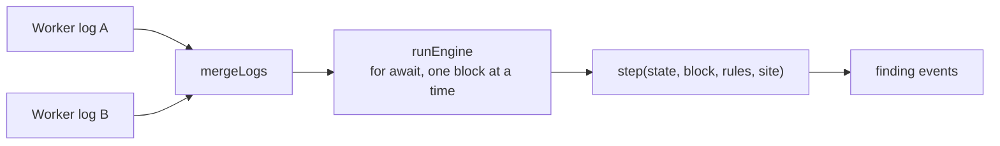
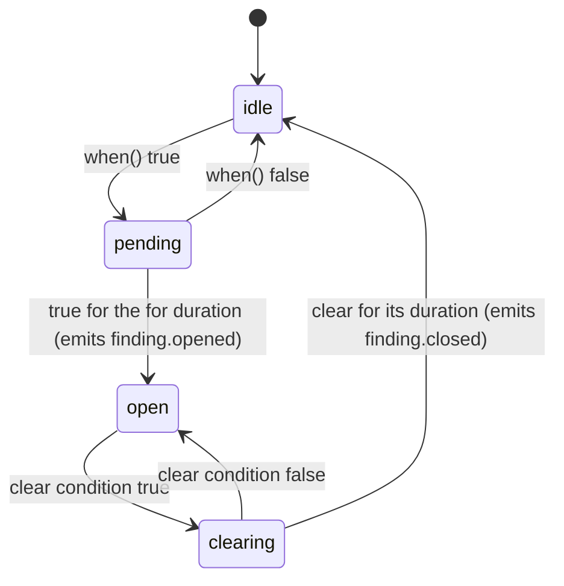

# Sentinel rules engine: proof of concept

## Overview

This is the reference proof of concept for the Sentinel rules engine described in §3 to §5 of the
[rules engine and findings HLD](../hld-rules-engine.md). It reads telemetry from several Worker logs as a live stream, evaluates
rules written as plain JavaScript functions in event time, and emits findings. It has no dependencies.

It runs against a simulated site, not a real MDK stack: two containers, two Workers and four hours of
data with three injected faults. It proves four properties:

- Rules across Workers and devices fire at the right event time
- The findings are the same whatever order the Worker logs arrive in
- A restart from a checkpoint gives the same findings, with no gap and no duplicate
- A rule set can be swapped while the stream runs

## Run it

Needs Node.js 22 or later. There is nothing to install.

```bash
npm start
npm test
```

`npm start` streams the simulated logs through the engine, prints every finding, then checks the
properties above. Expected output (the replay time varies by machine):

```
Streaming 14412 blocks from 2 live Worker logs (4 h of event time)

02:00  OPEN   P2  performance.hashrate.below_floor@1       m-c02-3  since 02:00  ec24b8912ed8
02:12  OPEN   P2  anomaly.container.power_and_heat@1       c01      since 02:07  718c041e5fb0
02:30  CLOSE  P2  anomaly.container.power_and_heat@1       c01      since 02:07  718c041e5fb0
03:45  OPEN   P2  performance.hashrate.below_floor@1       m-c02-1  since 03:45  2789f1228e7a
03:45  OPEN   P2  performance.hashrate.below_floor@1       m-c02-2  since 03:45  7430b5bb6fe5
03:45  OPEN   P2  performance.hashrate.below_floor@1       m-c02-4  since 03:45  5993c9543138
03:45  OPEN   P1  performance.container.hashrate_down@1    c02      since 03:45  89472e46ec33

Checks
  same findings from the merged live logs as from an in-order replay
  same findings when one Worker's whole log arrives before the other's (event time, not arrival time)
  same findings after a restart from a 114 KB JSON checkpoint at block 7206
  replay of 14412 blocks: 63 ms
```

Times are offsets from the start of the simulated data. `since` is when the rule's condition first
held; the finding opens once it has held for the rule's `for` duration.

## Directory layout

```text
poc-vanilla/
├── index.js                  # Demo: streams the simulated logs, prints findings, runs the checks
├── lib/
│   ├── engine.js             # step(), the reducer; runEngine() for streams; replay() for arrays
│   ├── merge.js              # mergeLogs(): one async stream from many logs, one block read ahead per log
│   ├── series.js             # Per-minute buckets and the read-only series view rules see
│   ├── rule.js               # rule() validates a rule definition; tune() changes params within bounds
│   └── duration.js           # '30s', '5m', '1h' to milliseconds
├── rules/
│   ├── container-power-and-heat.js   # Miner power above its 1 h mean AND container hotter than its 30 min mean
│   ├── hashrate-below-floor.js       # A miner below 5 TH/s for over an hour
│   ├── container-hashrate-down.js    # Every miner in a container below 5 TH/s for over an hour
│   └── index.js                      # The rule set the demo and tests load
├── sim/
│   ├── site.js               # The simulated site: containers, devices, Workers and their poll intervals
│   ├── generate.js           # Seeded data generator with the three injected faults
│   └── logs.js               # asLiveLog(): an array as an async iterable, standing in for a Worker's pull loop
└── test/
    ├── rules.test.js         # Each rule's logic against fake series, without the engine
    └── engine.test.js        # The engine end to end: faults, ordering, checkpoints, rule swap, read-ahead
```

## How it works

### Blocks

Each Worker log is an ordered list of blocks. A Worker writes one batch per poll, called a sweep: a
reading per device, then a sweep marker.

```js
{ type: 'reading', worker: 'wm-1', deviceId: 'm-c01-1', ts: 1793923200000, metrics: { power: 3402.5, hashrate_avg: 219.8 } }
{ type: 'sweep', worker: 'wm-1', ts: 1793923200000, devices: 8, answered: 8 }
```

The sweep marker means "this Worker has sent everything up to `ts`". It is what moves event time
forward.

### The flow



1. `mergeLogs` takes one async iterable per Worker log and yields blocks as they arrive, in any
   interleaving. It reads at most one block ahead per log, so a slow engine slows the logs down.
2. `runEngine` loops over the merged blocks with `for await`, calls `step` for each one with the
   current rule set, and yields whatever events `step` returns.
3. `step` is a reducer: it changes one plain `state` object and returns the events the block caused.
   All the event-time logic lives here.

`replay(blocks, { rules, site })` is the same thing without the loop, for an array of blocks. Tests and
backtests use it.

### Inside `step`

| Block        | What `step` does                                                                          |
| ------------ | ----------------------------------------------------------------------------------------- |
| Reading      | Adds each metric to that device's per-minute bucket. Nothing is evaluated                 |
| Sweep marker | Records the Worker's watermark; when every Worker has passed the next minute boundary, evaluates every rule for every key at that boundary, then drops buckets older than the longest declared history |

The **watermark** is the lowest latest sweep time across all Workers. Minute M is evaluated only once
every Worker has swept past it, and an evaluation at M only sees buckets that end at or before M. A
Worker that runs ahead therefore cannot leak future readings into an evaluation, and a Worker that
lags only delays evaluation. This is why the merge does not need to sort blocks: only the order
within each log matters.

### What a rule sees

For each rule and key, `step` builds a frozen `ctx` and calls `when(ctx)`:

- **`keyBy: 'device'`.** One evaluation per matching device; each input is that device's series
- **`keyBy: 'container'`.** One evaluation per container. An input that matches the container's own
  device (its controller) is one series; an input that matches devices inside it is an array of
  series

Each series offers the same helpers, computed from the minute buckets:

| Helper        | Returns                                                                        |
| ------------- | ------------------------------------------------------------------------------ |
| `now`         | Latest value in the last complete minute, or `undefined` if the device was silent |
| `mean(w)`     | Mean over the window, or `NaN` with no data                                    |
| `min(w)`, `max(w)` | Extremes over the window, or `NaN` with no data                           |
| `count(w)`    | Number of readings in the window                                               |
| `covered(w)`  | Whether the series has data reaching back the whole window                     |

`NaN` and `undefined` make every comparison false, so a rule cannot fire on missing data by accident.
Asking for a window longer than the input's declared `history` is reported as a `rule.error` event.

### Findings and episodes

A rule's result becomes a finding through an episode per rule and key:



The clear condition is `clear.when` if the rule defines it, otherwise "`when` is false". A finding's ID
is a hash of the rule version, the key and the episode start, so replays and restarts reproduce it.

| Event            | Fields                                                    |
| ---------------- | --------------------------------------------------------- |
| `finding.opened` | `id`, `rule`, `severity`, `key`, `firstSeen`, `at`        |
| `finding.closed` | `id`, `rule`, `severity`, `key`, `firstSeen`, `at`        |
| `rule.error`     | `rule`, `key`, `at`, `error`                              |

### Checkpoints

`state` is one plain object, so there are two ways to resume after a restart. Both are tested.

| Checkpoint           | Holds                                    | Size here | Resume                                                        |
| -------------------- | ---------------------------------------- | --------- | ------------------------------------------------------------- |
| Full state           | `JSON.stringify(state)`                  | 114 KB    | Continue from the next block                                  |
| Episodes and offsets | `nextEval`, `episodes`, the log offset   | 853 B     | Replay the longest declared history to rebuild the buckets, then continue |

## Write a rule

A rule is one file that calls `rule()`. `when` must be pure and synchronous: no clock, no randomness,
no I/O, and the same answer for the same `ctx`.

```js
const { rule } = require('../lib/rule')

module.exports = rule({
  id: 'performance.hashrate.below_floor',
  version: 1,
  severity: 'P2',
  keyBy: 'device',
  inputs: { hr: { family: 'miner', metric: 'hashrate_avg', history: '1h' } },
  params: { floor: 5 },
  tunable: { floor: [1, 50] },
  clear: { for: '5m' },
  when: ({ hr, params }) => hr.covered('1h') && hr.max('1h') < params.floor
})
```

| Field         | Meaning                                                                         |
| ------------- | ------------------------------------------------------------------------------- |
| `id`, `version` | Stable code and integer version; findings record `id@version`                 |
| `severity`    | `P1` to `P4`                                                                    |
| `keyBy`       | `device` or `container`                                                         |
| `inputs`      | Named series: a selector (`family`, `brand`, `model`), a `metric` and how much `history` to keep |
| `params`      | Values `when` reads                                                             |
| `tunable`     | `[min, max]` per param; `tune(rule, { floor: 3 })` refuses anything else         |
| `for`         | How long `when` must hold before the finding opens; default `0s`                |
| `clear`       | `{ for, when? }`: how long, and optionally what, closes the finding             |
| `when`        | `(ctx) => boolean`                                                              |

Add the file to [`rules/index.js`](./rules/index.js), then test its logic without the engine by
passing fake series, as [`test/rules.test.js`](./test/rules.test.js) does:

```js
const series = ({ now, mean, max, covered = true }) => ({ now, mean: () => mean, max: () => max, covered: () => covered })
assert.equal(rule.when({ hr: series({ max: 3 }), params: rule.params }), true)
```

To swap rules while the stream runs, pass a function as `rules`; it is read on every block:

```js
for await (const event of runEngine(mergeLogs(logs), { rules: () => current, site })) { /* ... */ }
```

## The simulated site

| Device              | Worker | Polled every | Metrics                    |
| ------------------- | ------ | ------------ | -------------------------- |
| `m-c01-1` to `m-c01-4`, `m-c02-1` to `m-c02-4` | `wm-1` | 10 s | `power` (W), `hashrate_avg` (TH/s) |
| `as-c01`, `as-c02` (container controllers) | `as-1` | 30 s | `outlet_temp` (°C) |

| Fault injected                                              | Expected finding                                  |
| ----------------------------------------------------------- | ------------------------------------------------- |
| 02:00 to 02:40: `m-c01-1` draws 15% more power and `c01` heats by 4 °C | `anomaly.container.power_and_heat` on `c01` |
| From 01:00: `m-c02-3` hashes at about 2 TH/s                | `performance.hashrate.below_floor` on `m-c02-3`   |
| From 02:45: every miner in `c02` hashes at about 1 TH/s     | `performance.container.hashrate_down` on `c02`, and the per-miner rule on each |

The power-and-heat finding closes at 02:30, before the fault ends at 02:40. That is the rule working as
written: it compares each device with its own recent mean, so a sustained fault slowly becomes the
new normal. The HLD's §9.3 discusses the fix.

## Limits

This proof of concept leaves out parts of the HLD:

- The cursor read through the Kernel and the pull loops (HLD §3.1); `sim/logs.js` stands in
  for them
- Rules that read other rules' findings, and `upstream(...)` keys from the site model
- The `node:vm` context and per-call timeout that keep `when` pure
- Idle-Worker handling and a watermark per rule
- Cases, the case log, the narrator and actions

## Next steps

- [Rules engine and findings HLD](../hld-rules-engine.md): the full design, with the engine in §3 to §5
- [RxJS proof of concept](../poc/): the earlier version of this engine, and why RxJS was dropped (HLD §13.2)
